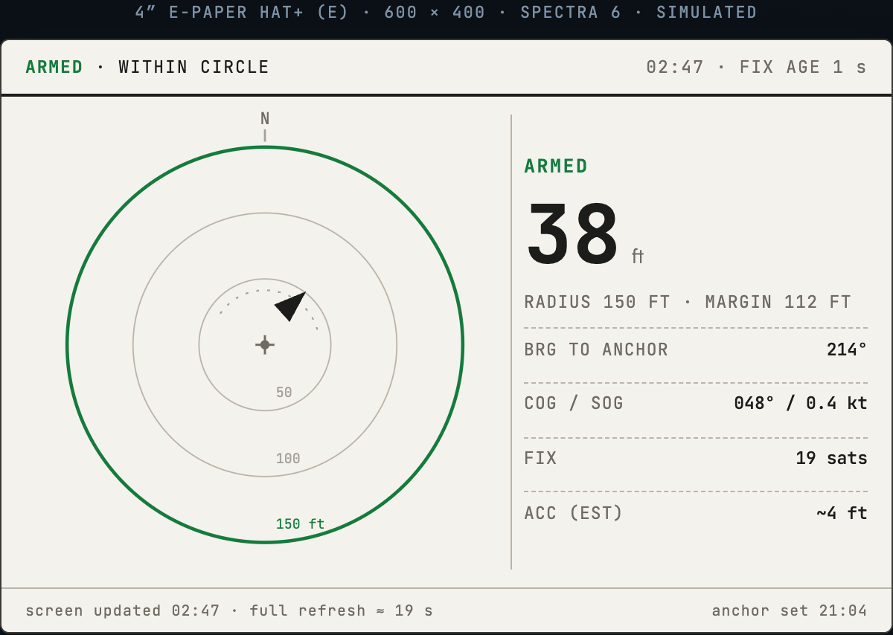
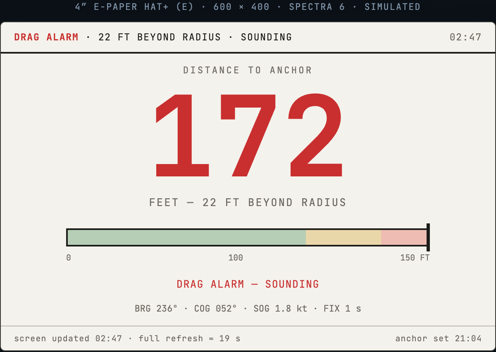
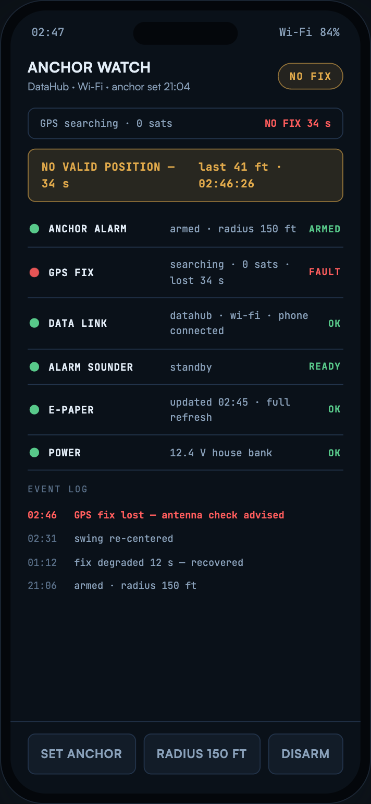
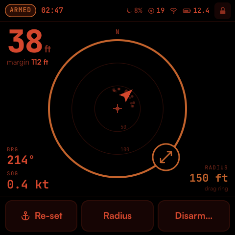
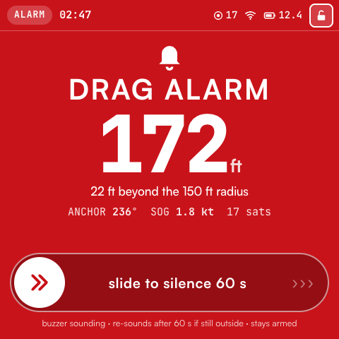

# Moorpheus

An anchor-drag alarm for a boat, built around a Raspberry Pi Pico 2 W, a GNSS receiver and a small colour e-paper screen.

> [!NOTE]
> **Start with the display bring-up, not the full alarm.** There is a display-only C/Pico SDK sample that builds for the Pico 2 W. The anchor alarm is still design and planning work. Nothing has been assembled or tested on hardware.

Step 1 starts with **Hello Moorpheus** to check the wiring. A separate
[layout demo](docs/display-bring-up.md#then-run-the-five-layout-demo) then cycles
the five normal-state screens with fixed simulated data, waiting 180 seconds
after each completed display update. The guide covers building and flashing
each application; neither is an anchor alarm.

## The idea

You drop anchor, press a button, and the device remembers where the boat is. It keeps checking your GPS position, and if the boat drifts outside the radius you set, it sounds an alarm. The e-paper screen shows the distance and the state at a glance and uses almost no power between updates. A phone view over the boat's local Wi-Fi (PredictWind DataHub) is planned too.

The design is a prototype. It isn't a certified marine safety system, so if you try anything from it on a real boat, keep a second anchor watch running alongside.

## What the screens might look like

These come from the layout mockups in [`layouts/`](layouts/). Three samples:

| Watch Circle · e-paper · normal | Big Number · e-paper · alarm |
|---|---|
|  |  |

*Status Ledger on the phone, after the GPS fix has dropped out.*

There are five concepts in total, each drawn for the 600 × 400 e-paper panel and a phone, in normal, alarm and no-fix states. To browse all of them, open [`layouts/index.html`](layouts/index.html) in a browser. No build step is needed, though the fonts load from the web.

## A second option: square touch screen

A parallel edition is being planned around the [Waveshare ESP32-S3-Touch-LCD-4](https://www.waveshare.com/esp32-s3-touch-lcd-4.htm), a 4" 480 × 480 colour touch screen with an ESP32-S3 built in. It runs straight from the boat's 12 V supply through a fuse and protection. The same NEO-F10N GPS connects through a small RS485 converter, because the screen uses up nearly all the board's spare pins. It doesn't replace the Pico design, and so far it's documentation and screen sketches only. There's no firmware for it.

| Watch Circle · touch · night | Alarm Takeover · touch · alarm |
|---|---|
|  |  |

Read the [ESP32-S3 touch edition guide](docs/esp32_s3_touch_lcd_4_anchor_alarm_build_guide.md) for parts, GPS wiring and boat power, and open [`layouts/touch-lcd/index.html`](layouts/touch-lcd/index.html) to browse all five touch concepts.

## What's in the repo

- [`docs/build-steps.md`](docs/build-steps.md) is the step-by-step path through the build. Start with Step 1, which brings up the Pico, toolchain and display before adding other hardware. The page links to the full [build guide](docs/pico_2_w_anchor_alarm_build_guide_v2.md) and the detailed [Step 1 display instructions](docs/display-bring-up.md).
- [`docs/pico_2_w_anchor_alarm_build_guide_v2.md`](docs/pico_2_w_anchor_alarm_build_guide_v2.md) is the full design reference for parts, power, pin assignments, firmware, display policy and optional variants.
- [`examples/display-hello/`](examples/display-hello/) contains the standalone Step 1 sample.
- [`examples/display-layouts/`](examples/display-layouts/) contains the separate five-screen demo and its pre-rendered images.
- [`docs/data/`](docs/data/) has one reference file per component: specs, wiring, power notes and sources. It's mostly there so that AI coding agents can look things up without redoing the research each time, but it's readable enough for people too. Its [README](docs/data/README.md) tracks design checks and measurements that remain open.
- [`docs/esp32_s3_touch_lcd_4_anchor_alarm_build_guide.md`](docs/esp32_s3_touch_lcd_4_anchor_alarm_build_guide.md) is the planning guide for the ESP32-S3 touch-screen edition.
- [`layouts/`](layouts/) is the static HTML mockup gallery for e-paper and phone, and [`layouts/touch-lcd/`](layouts/touch-lcd/) holds the touch-screen concepts. Screenshots are in [`layouts/screenshots/`](layouts/screenshots/).

## Status

- [x] Build guide drafted
- [x] Component reference notes collected
- [x] Display layout concepts mocked up
- [x] Step 1 display-only sample builds for Pico 2 W
- [x] Separate five-layout simulation builds for Pico 2 W
- [x] ESP32-S3 touch edition planned: guide, component notes and five touch screen sketches (no firmware)
- [ ] Complete the open design checks in [`docs/data/README.md`](docs/data/README.md)
- [ ] Breadboard prototype
- [ ] Step 1 on-device acceptance
- [ ] Anchor-alarm firmware

## Licensing

Copyright (c) 2026 Sam Jarvinen.

- **Code**, including the HTML, CSS, and JavaScript in `layouts/`, is licensed
  under the [MIT License](LICENSE).
- **Documentation**, including this README and the material in `docs/`, is
  licensed under [Creative Commons Attribution 4.0 International
  (CC BY 4.0)](docs/LICENSE).

These licenses apply to their respective parts of the project; they are not
alternative licenses for the same material. Both permit commercial use.
Third-party material, including external fonts and dependencies, remains subject
to its own license terms and is not relicensed by this project.

When sharing documentation, credit Sam Jarvinen, link to the
[moorpheus project](https://github.com/frye/moorpheus) and
[CC BY 4.0](https://creativecommons.org/licenses/by/4.0/), and indicate any
changes, as required by the license.
