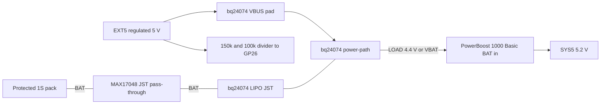
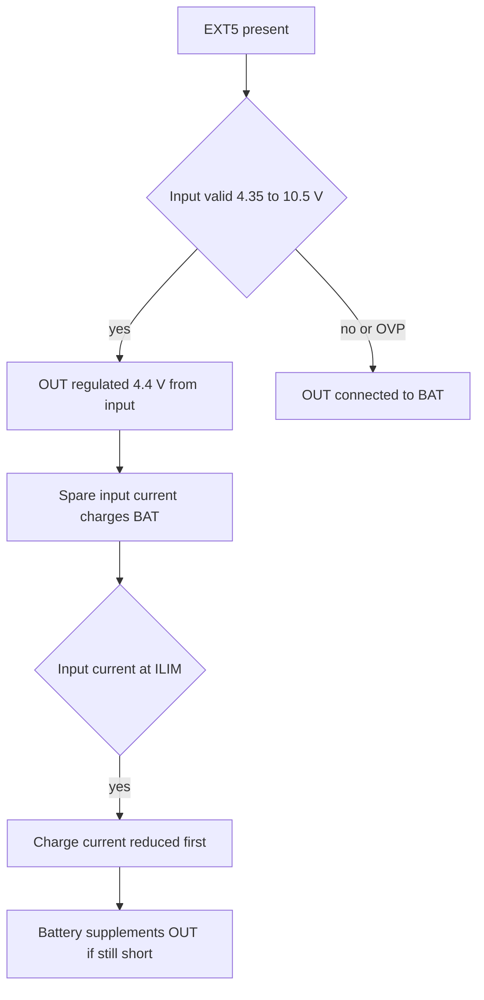

# Adafruit BQ24074 Universal USB/DC/Solar LiPo Charger — datasheet & integration notes

> Part: Adafruit product 4755 (TI bq24074 linear charger with power-path) · Role in project: charges the protected 1S pack from EXT5 and supplies LOAD to the PowerBoost · Configuration: battery-backed only

## 1. Overview

The Adafruit 4755 breakout uses the TI bq24074, a single-cell Li-ion linear charger with dynamic power-path management (DPPM): the system output (OUT/"LOAD") is powered from the input when present, while surplus input current charges the battery; when the input is removed OUT switches to the battery [1][3]. In this design EXT5 feeds the charger input, BAT connects through the MAX17048 pass-through, and charger OUT becomes **LOAD**, which feeds the PowerBoost 1000 Basic [5].

## 2. Key specifications

| Parameter | Value | Source |
|---|---|---|
| Input range (Adafruit) | 5–10 V; "28 V protected" | [1] |
| Input operating range (IC) | 4.35–10.5 V | [3] |
| Input over-voltage protection | VOVP 10.2/10.5/10.8 V (min/typ/max), 175 mV hysteresis; input withstands 28 V with operation suspended | [3] |
| Input UVLO | 3.3 V typ | [3] |
| Charge current, default | 1.0 A jumper (R9 = 1 kΩ → ICHG = 890/1000 ≈ 0.89 A typ) | [1][2][3] |
| Charge current, other jumpers | 0.5 A (R5 2 kΩ → ≈0.45 A); 1.5 A (R3 590 Ω → ≈1.51 A) | [1][2][3] |
| ICHG formula | ICHG = KISET / RISET, KISET 797/890/975 AΩ; RISET range 590 Ω–8.9 kΩ | [3][4] |
| Input current limit (default mode) | ILIM = KILIM / RILIM = 1610 / 1 kΩ ≈ 1.6 A | [2][3] |
| OUT (LOAD) regulation | VO(REG) 4.3/4.4/4.5 V when input present | [3] |
| OUT with no input | battery voltage minus VDO(BAT-OUT) 50/100 mV at 1 A | [3][4] |
| Maximum load | 1.5 A | [1] |
| Battery regulation | VBAT(REG) 4.16/4.20/4.23 V | [3] |
| Pre-charge threshold / current | VLOWV 3.0 V; IPRECHG = 88 AΩ / RISET (≈88 mA at 1 kΩ) | [3] |
| Recharge threshold | VBAT(REG) − 100 mV | [3] |
| Termination current | ITERM = 0.03 × RITERM / RISET (R2 = 10 kΩ on breakout → ≈0.3 A at 1 A setting, see §7) | [2][3] |
| Safety timers | **Disabled on breakout** (TMR tied to GND) | [2][3] |
| TS thermistor | 75 µA bias; VCOLD 2.1 V (≈28 kΩ, ≈0 °C), VHOT 0.3 V (≈4 kΩ, ≈50 °C) for 10 k NTC | [1][3] |
| Thermal regulation / shutdown | TJ(REG) 125 °C / 155 °C | [3] |
| Input dropout VIN−OUT | 300 mV typ, 475 mV max at 1 A | [3] |
| Battery drain, input absent | 4.3 µA typ, 6.5 µA max (IC) | [3] |
| IC supply current | 1.1 mA typ, 1.5 mA max (input present) | [3] |
| Inputs on board | USB-C and DC barrel jack, each via SK34A Schottky; also VBUS pad | [1][2] |

## 3. Pinout / connections

From the learn-guide pinouts page [4] and schematic [2]:

| Pin / pad | Function |
|---|---|
| VBUS | Charger input (after the USB-C/DC-jack Schottky diodes) |
| OUT | System output = LOAD, ≤4.4 V; battery voltage when no input |
| LIPO | Battery + |
| GND | Ground |
| JST "Lipo Batt" | 2-pin JST-PH to battery |
| JST "Load Out" | 2-pin JST-PH, same net as OUT |
| CE | Charge enable, active low, 10 kΩ pull-down; pull high to stop charging (OUT still powered) |
| PGOOD | Open-drain, low when valid input present (also drives green LED) |
| CHG | Open-drain, low while charging; flashes 2 Hz on fault (also drives LED) |
| THERM / TS | Thermistor input; default jumper to 10 kΩ fixed resistor; cut and fit 10 k NTC |
| ISET jumpers | 0.5 A / 1.0 A (default) / 1.5 A, or cut and fit 590 Ω–8.9 kΩ |
| EN1/EN2 jumpers | Low/Low 100 mA; High/Low 500 mA; Low/High (default) = ILIM resistor; High/High standby |

## 4. Wiring in this project

| Charger pin | Net | Connects to |
|---|---|---|
| VBUS pad (recommended) | EXT5 | Regulated boat 5 V supply output [5] |
| LIPO / "Lipo Batt" JST | BAT | MAX17048 JST pass-through → protected 1S pack [5] |
| OUT / "Load Out" JST | LOAD | PowerBoost 1000 Basic BAT input [5] |
| GND | GND | Common ground |
| CE | — | Leave at default (charging enabled) |
| PGOOD / CHG | — | LEDs only; optional to Pico via pull-up to Pico 3V3 (not in build guide) |
| THERM | — | Fit NTC on pack if charging in hot/cold enclosure (see §7) |

## 5. Power requirements & consumption

| Condition | Current | Basis |
|---|---|---|
| Battery drain, EXT5 absent | 4.3 µA typ / 6.5 µA max (IC) | datasheet [3] |
| Same, plus LEDs | LEDs off without input (PGOOD high, CHG off) — CHG LED off when not charging | [3][4] |
| Input quiescent, EXT5 present | 1.1–1.5 mA (IC) + PGOOD LED via 10 kΩ ≈0.3 mA | datasheet [3], schematic [2] estimate |
| EXT5 input, charging + full load | up to ILIM ≈1.6 A | [2][3] |
| Worst-case dissipation | (VIN − VBAT) × ICHG + (VIN − VOUT) × ILOAD; e.g. (5.0 − 3.0) × 0.89 + (5.0 − 4.4) × 0.6 ≈ 2.1 W | formula [3], estimate |

The 2.1 W example will engage thermal regulation (TJ(REG) 125 °C), automatically reducing charge current [3].

## 6. Programming / configuration

No firmware registers. Hardware choices:

- **Charge current:** pick ISET jumper (0.5/1.0/1.5 A) or cut the 1.0 A jumper and fit RISET = 890 AΩ / ICHG (590 Ω–8.9 kΩ) [3][4]. Choose ICHG ≤ 0.5 C of the selected pack (see lipo-1s-protected-battery.md); e.g. 0.5 A jumper for a 1000–2000 mAh pack, 1.0 A for ≥2000 mAh.
- **Input mode:** keep EN1/EN2 default (Low/High = ILIM resistor mode) [4].
- **Charge inhibit:** CE high disables charging while OUT keeps working [4].
- **Status to Pico (optional):** PGOOD and CHG are open-drain; wire to spare GPIO with internal pull-ups enabled (3.3 V) — not part of the current build guide pin plan [5].

## 7. Design notes, limits & gotchas

- **Use the VBUS pad, not the DC jack.** Both USB-C and DC jack feed VBUS through an SK34A Schottky (≈0.5 V drop per Adafruit) [1][2]. With EXT5 = 5.0 V the charger IN would be ≈4.5 V, below VO(REG) + dropout (4.4 + 0.3 V), so OUT would fall out of regulation and the input could hover near the 4.35 V operating minimum. Wiring EXT5 to VBUS avoids this — estimate based on [2][3].
- ⚠️ **Discrepancy with build guide / Adafruit text:** VIN-DPM (input voltage tracking at 4.5 V) only applies in USB modes (EN2 = Low); in the default ILIM mode it is not active [3]. A weak EXT5 supply will therefore sag rather than be protected by VIN-DPM — size EXT5 for ≥ILIM (≥2 A recommended).
- **RILIM modification required by the guide.** The stock breakout uses 1 kΩ for ILIM (≈1.6 A); TI specifies RILIM ≥ 1.1 kΩ (ILIM ≤ 1.5 A) [2][3]. Use at least 1.2 kΩ nominal so the actual resistance remains above the minimum; the guide's EXT5 budget must use the resulting input limit.
- **Termination-current estimate (unverified).** RITERM 10 kΩ gives ITERM ≈ 0.03 × 10 k / 1 k ≈ 0.3 A at the 1 A setting, about 34 % of ICHG; this is a calculation, not a measured charge-completion result. Measure end-of-charge voltage/SOC on the selected pack before relying on it. At the 0.5 A setting (RISET 2 kΩ), the calculated value is ≈0.15 A.
- **Safety timers disabled** (TMR = GND) [2][3]. A degraded cell will not be timed out; rely on pack protection and TS.
- **TS thermistor:** default fixed 10 kΩ disables temperature qualification [2][4]. For a marine enclosure that may exceed 45 °C in sun, fit a 10 kΩ NTC on the pack (B-value must match the TS thresholds in [3]; unverified for a specific part) — Adafruit window is 0–50 °C [1].
- **LOAD voltage:** OUT ≤ 4.4 V with input, ≈VBAT (3.0–4.2 V) without; the PowerBoost accepts 1.8–5 V, so both are fine [3][6].
- **Pack protection trip:** if neither LED lights with a battery connected, the pack PCM may have tripped; re-plug or apply input to reset [4].
- **OVP:** EXT5 > 10.5 V suspends input and OUT runs from BAT [3] — a failed 12→5 V converter passing 12–14 V would be blocked but leaves the system on battery.

## 8. Bring-up / test checklist

1. Verify ISET jumper matches pack capacity; verify EN1/EN2 default; verify THERM configuration.
2. With no battery, apply 5.0 V to VBUS from a 2 A current-limited supply; confirm OUT ≈4.4 V and PGOOD LED on.
3. Connect the pack via MAX17048 pass-through; confirm CHG LED on and charge current (≈0.89 A at 1 A jumper, less if VBAT < 3.0 V pre-charge) with an inline meter.
4. Load OUT with 1 A; confirm charge current falls while input stays ≤ILIM and OUT stays ≥4.2 V.
5. Remove EXT5; confirm OUT switches to VBAT without PowerBoost/Pico reset (scope SYS5).
6. Charge to termination; record final VBAT and MAX17048 SOC to quantify the ITERM effect.
7. With EXT5 removed, measure battery drain with downstream boards disconnected (expect µA range).
8. Check board temperature at worst case (VBAT ≈3.2 V, full load).

## 9. References

1. Adafruit, "Adafruit Universal USB / DC / Solar Lithium Ion/Polymer charger - bq24074", product 4755 — https://www.adafruit.com/product/4755
2. Adafruit, Adafruit-BQ24074-PCB (Eagle schematic) — https://github.com/adafruit/Adafruit-BQ24074-PCB
3. Texas Instruments, "bq2407x 1.5-A USB-Friendly Li-Ion Battery Charger and Power-Path Management IC" (SLUS810N) — https://www.ti.com/lit/ds/symlink/bq24074.pdf
4. Adafruit Learning System, "Adafruit BQ24074 Universal USB/DC/Solar Charger Breakout" — pinouts and FAQ — https://learn.adafruit.com/adafruit-bq24074-universal-usb-dc-solar-charger-breakout/pinouts
5. Project build guide — docs/pico_2_w_anchor_alarm_build_guide_v2.md, sections 4–5
6. Adafruit, "PowerBoost 1000 Basic", product 2030 — https://www.adafruit.com/product/2030
