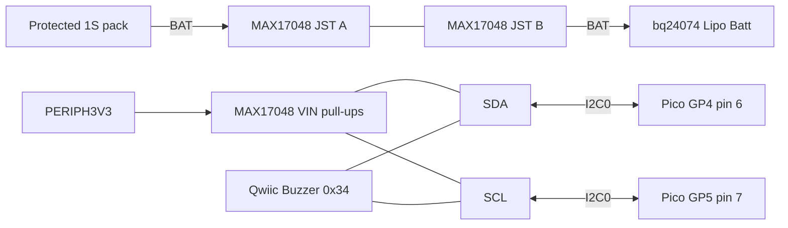
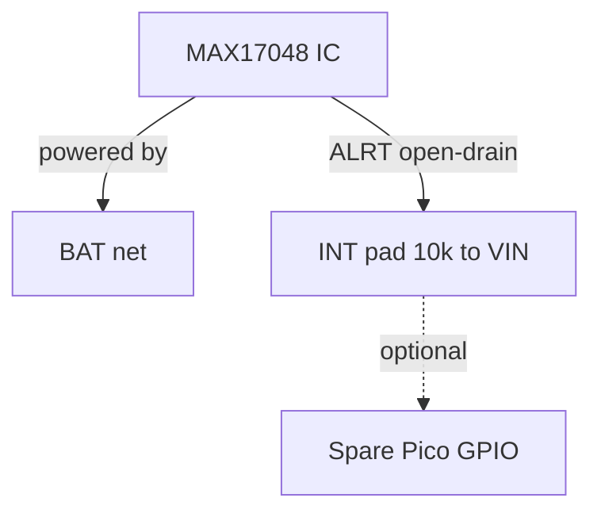

# Adafruit MAX17048 LiPoly/Li-ion Fuel Gauge — datasheet & integration notes

> Part: Adafruit product 5580 (Analog Devices/Maxim MAX17048 ModelGauge fuel gauge) · Role in project: reports pack voltage, state of charge and charge rate on I2C0 at 0x36 · Configuration: battery-backed only

## 1. Overview

The MAX17048 is a 1-cell Li-ion fuel gauge that estimates state of charge (SOC) from cell voltage only, using the ModelGauge algorithm — no sense resistor and no coulomb counting [3]. The Adafruit 5580 breakout adds two JST-PH battery ports wired in parallel (pass-through), STEMMA QT/Qwiic connectors and I2C pull-ups [1][2]. In this project it sits in-line on net **BAT** between the pack and the bq24074, and the firmware reads it over I2C0 (GP4/GP5) to drive SOC refresh thresholds and Emergency60 mode at ≤20 % SOC [4].

## 2. Key specifications

| Parameter | Value | Source |
|---|---|---|
| I2C address | 0x36 (7-bit); 0x6C write / 0x6D read 8-bit | [2][3] |
| I2C speed | up to 400 kHz | [3] |
| IC supply (CELL/VDD) | 2.5–4.5 V, powered from the battery | [2][3] |
| Breakout logic VIN | 3–5 V (pull-up supply only) | [2] |
| Active current | 23 µA typ, 40 µA max | [3] |
| Hibernate current | 3 µA typ, 5 µA max (≈4 µA with reset comparator on) | [3] |
| Sleep current | 0.5 µA typ, 2 µA max | [3] |
| ADC sample period | 250 ms active; 45 s hibernate | [3] |
| Voltage measurement error | ±7.5 mV at 25 °C; ±20 mV over temperature | [3] |
| VCELL resolution | 78.125 µV/LSB | [3] |
| SOC resolution | 1/256 % per LSB | [3] |
| CRATE resolution | 0.208 %/hr per LSB, signed | [3] |
| Pin voltage range | −0.3 to 5.5 V (SDA, SCL, ALRT, QSTRT) | [3] |
| Input thresholds | VIH 1.4 V, VIL 0.5 V | [3] |
| ALRT | Open-drain, active low | [3] |
| Bus-low sleep timeout | 1.75–2.5 s (only if MODE.EnSleep set) | [3] |
| Pull-ups on breakout | 10 kΩ on SDA, SCL and INT/ALRT to VIN | [2] |

## 3. Pinout / connections

From the Adafruit pinouts page [2]:

| Pin / connector | Function |
|---|---|
| VIN | 3–5 V logic/pull-up supply (does **not** power the IC) |
| GND | Ground |
| SCL / SDA | I2C, 10 kΩ pull-ups to VIN |
| INT | MAX17048 ALRT, active low, 10 kΩ pull-up to VIN |
| QStart | Quick-start input (hardware SOC re-estimate); leave unconnected / low |
| Bat | Battery + (sense) |
| JST-PH × 2 | Battery and load/charger, wired in parallel |
| STEMMA QT × 2 | 4-pin JST-SH I2C (VIN, GND, SDA, SCL) |
| "On" LED jumper | Cut to disable the green LED |

⚠️ The IC is powered from the battery. With no battery connected it will not ACK on I2C even when VIN is present [2].

## 4. Wiring in this project

| Breakout pin | Net / Pico pin | Notes |
|---|---|---|
| JST port A | BAT | Protected 1S pack [4] |
| JST port B | BAT | bq24074 "Lipo Batt" JST [4] |
| VIN | PERIPH3V3 | Keeps pull-ups at 3.3 V [4] |
| GND | GND | Common |
| SDA | GP4, pin 6 (I2C0 SDA) | Shared with Qwiic Buzzer 0x34 [4] |
| SCL | GP5, pin 7 (I2C0 SCL) | Shared with Qwiic Buzzer [4] |
| INT | not connected | Build guide polls; optional spare GPIO with pull-up to 3.3 V |





## 5. Power requirements & consumption

| Mode | Current from BAT | Basis |
|---|---|---|
| Active (ADC every 250 ms) | 23 µA typ / 40 µA max | datasheet [3] |
| Hibernate (default HIBRT 0x8030) | 3 µA typ / 5 µA max | datasheet [3] |
| Sleep (CONFIG.SLEEP) | 0.5 µA typ / 2 µA max | datasheet [3] |
| Green "on" LED | from VIN (PERIPH3V3) — current not published; **unverified**, cut jumper to remove | [2] |
| I2C pull-ups | only while lines are low: 3.3 V / 10 kΩ = 0.33 mA per line (in parallel with other pull-ups) | estimate |

## 6. Programming / configuration

### Registers (all 16-bit, MSB first) [3]

| Addr | Name | R/W | Meaning / scaling | Default |
|---|---|---|---|---|
| 0x02 | VCELL | R | 78.125 µV/LSB | — |
| 0x04 | SOC | R | high byte = %, low byte = 1/256 % | — |
| 0x06 | MODE | W | bit 14 Quick-Start, bit 13 EnSleep, bit 12 HibStat (R) | 0x0000 |
| 0x08 | VERSION | R | IC version | 0x001_ |
| 0x0A | HIBRT | R/W | high byte HibThr 0.208 %/hr/LSB; low byte ActThr 1.25 mV/LSB; 0x0000 = never hibernate, 0xFFFF = always | 0x8030 |
| 0x0C | CONFIG | R/W | high byte RCOMP; low byte bit 7 SLEEP, bit 6 ALSC, bit 5 ALRT, bits 4:0 ATHD = 32 − threshold % | 0x971C (4 %) |
| 0x14 | VALRT | R/W | high byte MIN, low byte MAX, 20 mV/LSB | 0x00FF |
| 0x16 | CRATE | R | signed, 0.208 %/hr/LSB | — |
| 0x18 | VRESET/ID | R/W | VRESET[7:1] 40 mV/LSB, bit 0 Dis; low byte ID | 0x96__ |
| 0x1A | STATUS | R/W | high byte: RI 0x01, VH 0x02, VL 0x04, VR 0x08, HD 0x10, SC 0x20, EnVr 0x40 | 0x01__ |
| 0xFE | CMD | W | write 0x5400 = power-on reset (no ACK returned) | 0xFFFF |

**20 % alert:** ATHD = 32 − 20 = 12 = 0x0C, so with default RCOMP 0x97, CONFIG = **0x970C** [3]. ATHD alerts only when SOC falls through the threshold. Clear CONFIG.ALRT (bit 5) and STATUS.HD to release ALRT [3]. CONFIG.ALSC (bit 6) raises an alert on every 1 % SOC change — usable to trigger the build guide's 15/10/5/4/3/2/1 % refresh checks [3][4].

### Pico SDK C example (I2C0, GP4/GP5, 100 kHz)

```c
#include <stdio.h>
#include "pico/stdlib.h"
#include "hardware/i2c.h"

#define GAUGE_I2C     i2c0
#define GAUGE_SDA     4
#define GAUGE_SCL     5
#define MAX17048_ADDR 0x36

#define REG_VCELL   0x02
#define REG_SOC     0x04
#define REG_VERSION 0x08
#define REG_CONFIG  0x0C
#define REG_CRATE   0x16
#define REG_STATUS  0x1A

#define CONFIG_ALRT     (1u << 5)
#define STATUS_RI_HB    0x01u
#define STATUS_HD_HB    0x10u

static bool reg_read(uint8_t reg, uint16_t *val) {
    uint8_t buf[2];
    if (i2c_write_timeout_us(GAUGE_I2C, MAX17048_ADDR, &reg, 1, true, 5000) != 1) return false;
    if (i2c_read_timeout_us(GAUGE_I2C, MAX17048_ADDR, buf, 2, false, 5000) != 2) return false;
    *val = ((uint16_t)buf[0] << 8) | buf[1];
    return true;
}

static bool reg_write(uint8_t reg, uint16_t val) {
    uint8_t buf[3] = { reg, (uint8_t)(val >> 8), (uint8_t)(val & 0xFF) };
    return i2c_write_timeout_us(GAUGE_I2C, MAX17048_ADDR, buf, 3, false, 5000) == 3;
}

bool gauge_init(void) {
    i2c_init(GAUGE_I2C, 100 * 1000);
    gpio_set_function(GAUGE_SDA, GPIO_FUNC_I2C);
    gpio_set_function(GAUGE_SCL, GPIO_FUNC_I2C);
    // Breakout already has 10k pull-ups to PERIPH3V3; internal pulls not needed.

    uint16_t version, config, status;
    if (!reg_read(REG_VERSION, &version)) return false;   // no ACK: battery absent or bus fault

    // 20 % SOC alert: keep RCOMP (high byte), ATHD = 32 - 20 = 12, clear ALRT and SLEEP.
    if (!reg_read(REG_CONFIG, &config)) return false;
    config = (config & 0xFF00) | (32 - 20);
    if (!reg_write(REG_CONFIG, config)) return false;

    // Clear reset indicator and SOC-low flag.
    if (!reg_read(REG_STATUS, &status)) return false;
    status &= ~(uint16_t)((STATUS_RI_HB | STATUS_HD_HB) << 8);
    return reg_write(REG_STATUS, status);
}

bool gauge_read(float *volts, float *soc_pct, float *crate_pct_hr) {
    uint16_t v, s, c;
    if (!reg_read(REG_VCELL, &v) || !reg_read(REG_SOC, &s) || !reg_read(REG_CRATE, &c)) return false;
    *volts = v * 78.125e-6f;
    *soc_pct = s / 256.0f;
    *crate_pct_hr = (int16_t)c * 0.208f;
    return true;
}

bool gauge_alert_ack(void) {
    uint16_t config, status;
    if (!reg_read(REG_CONFIG, &config) || !reg_read(REG_STATUS, &status)) return false;
    if (!reg_write(REG_STATUS, status & ~(uint16_t)(STATUS_HD_HB << 8))) return false;
    return reg_write(REG_CONFIG, config & ~(uint16_t)CONFIG_ALRT);
}

int main(void) {
    stdio_init_all();
    bool ok = gauge_init();
    while (true) {
        float v, soc, crate;
        if (ok && gauge_read(&v, &soc, &crate)) {
            printf("VCELL %.3f V  SOC %.2f %%  CRATE %.1f %%/h\n", v, soc, crate);
        } else {
            printf("MAX17048 not responding\n");
            ok = gauge_init();
        }
        sleep_ms(5000);
    }
}
```

The SOC register can briefly read above 100 % after a full charge; clamp in firmware (behaviour noted in Adafruit library practice — **unverified** in the datasheet extract).

## 7. Design notes, limits & gotchas

- **Battery powers the IC.** No battery → no ACK [2]. Treat a NACK as "gauge/battery missing", not 0 % [4].
- **Shared I2C pull-ups.** The breakout adds 10 kΩ pull-ups to VIN; the Qwiic Buzzer may add more. Keep VIN at PERIPH3V3 so pull-ups never exceed 3.3 V on Pico GPIO [2][4].
- **Back-powering:** if PERIPH3V3 is off while the Pico drives I2C, the bus can back-power VIN through pull-ups — keep the build guide's power-sequencing rule [4].
- **Voltage-based SOC.** ModelGauge needs time after power-up/reset to converge; Quick-Start (MODE bit 14) restarts estimation and should only be used when the cell is relaxed [3]. Charging/discharging current shifts cell voltage, so SOC from a heavily loaded cell is approximate.
- **CRATE sign** is negative while discharging [3].
- **RCOMP** default 0x97 suits typical Li-ion; custom models require Maxim/ADI characterisation [3].
- **VRESET** default 0x96 → 75 × 40 mV = 3.0 V reset threshold; ADI recommends 2.5 V for captive cells [3].
- **ALRT polarity:** active low, open-drain, pulled to VIN (3.3 V) on the breakout — safe for a Pico GPIO if later wired [2][3].
- **Hibernate** is automatic with default HIBRT; ADC sampling drops to 45 s, so SOC updates slowly during steady low current [3].

## 8. Bring-up / test checklist

1. With battery connected, meter BAT at both JST ports (same voltage, correct polarity).
2. Power PERIPH3V3; run an I2C scan on GP4/GP5 — expect 0x34 (buzzer) and 0x36 (gauge).
3. Read VERSION (0x08) and VCELL; compare VCELL with a DMM at the JST (within ≈±20 mV).
4. Write CONFIG 0x970C; read back.
5. Disconnect battery; confirm firmware reports "gauge absent" rather than 0 %.
6. Discharge through 20 %; confirm STATUS.HD sets (and ALRT goes low if wired); acknowledge and confirm release.
7. Log SOC and CRATE across a full charge/discharge cycle to validate threshold timing.

## 9. References

1. Adafruit, "Adafruit MAX17048 LiPoly / LiIon Fuel Gauge and Battery Monitor", product 5580 — https://www.adafruit.com/product/5580
2. Adafruit Learning System, "Adafruit MAX17048 LiPoly/LiIon Fuel Gauge and Battery Monitor — Pinouts" — https://learn.adafruit.com/adafruit-max17048-lipoly-liion-fuel-gauge-and-battery-monitor/pinouts
3. Analog Devices (Maxim Integrated), "MAX17048/MAX17049 3µA 1-Cell/2-Cell Fuel Gauge with ModelGauge" datasheet — https://www.analog.com/media/en/technical-documentation/data-sheets/max17048-max17049.pdf
4. Project build guide — docs/pico_2_w_anchor_alarm_build_guide_v2.md, sections 5, 6 and 11
5. Adafruit, Adafruit_MAX1704X Arduino library (register map cross-check) — https://github.com/adafruit/Adafruit_MAX1704X
6. Adafruit, Adafruit-MAX17048-PCB (Eagle schematic) — https://github.com/adafruit/Adafruit-MAX17048-PCB
