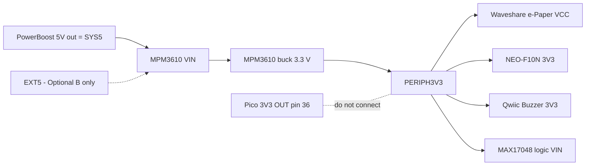
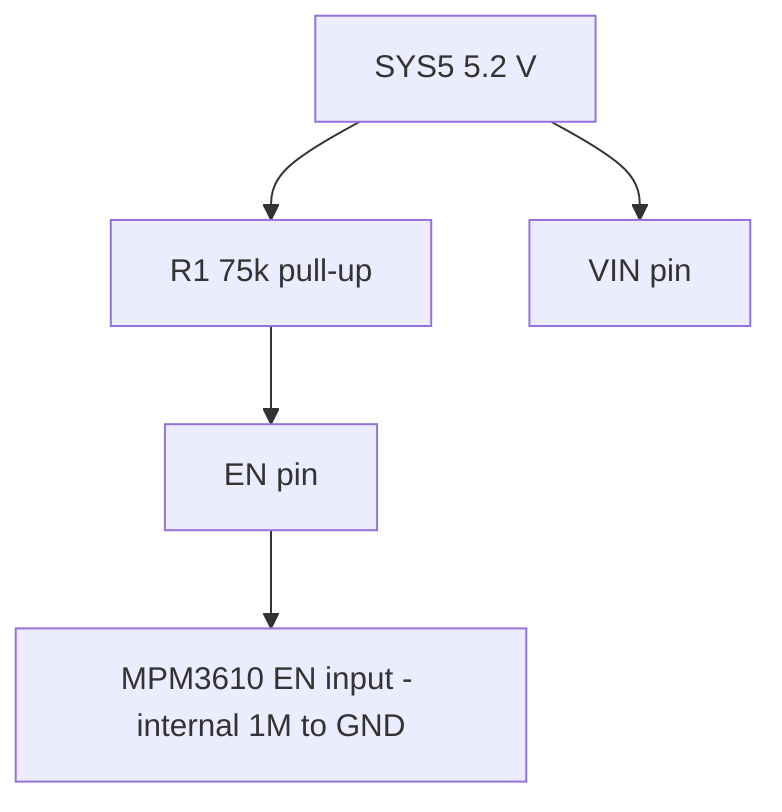

# Adafruit MPM3610 5V→3.3V 1.2A buck converter — datasheet & integration notes

> Part: Adafruit product 4683 (MPS MPM3610 power module) · Role in project: generates PERIPH3V3 for GPS, e-paper, Qwiic Buzzer and gauge logic · Configuration: both (fed from SYS5 in battery-backed build, from EXT5 in Optional B)

## 1. Overview

The Adafruit 4683 breakout carries an MPS MPM3610 synchronous step-down power module (controller, MOSFETs and inductor in one QFN package) set to a fixed 3.3 V output [1][3]. It is a drop-in, pin-compatible replacement for an LM1117 TO-220 linear regulator footprint [1]. In this project it creates the separate peripheral rail **PERIPH3V3** so that GPS, display, buzzer and gauge logic do not load the Pico 2 W's on-board 3V3 OUT (pin 36), which Raspberry Pi recommends keeping under 300 mA [5][4].

## 2. Key specifications

| Parameter | Value | Source |
|---|---|---|
| Input voltage (breakout) | 4.5–21 V | [1] |
| Input voltage (IC operating) | 4.5–21 V; absolute max 28 V | [3] |
| Output voltage | 3.3 V fixed (FB divider 75 kΩ/24 kΩ, VFB 0.798 V → 3.29 V calc.) | [1][2][3] |
| Output current | up to 1.2 A over the full input range | [1][3] |
| Efficiency | 90–95 % (Adafruit, heavy load) | [1] |
| Switching frequency | 2 MHz typ (1.7–2.4 MHz) | [1][3] |
| Quiescent current (IC, not switching) | 0.2 mA typ with AAM = 0.5 V; 0.7 mA typ with AAM floating/5 V (forced PWM) | [3] |
| Shutdown current (IC) | 1 µA typ | [3] |
| Current limit | 2.4 A min / 3 A typ, hiccup over-current protection | [3] |
| UVLO | 3.9 V rising typ, ≈3.25 V falling (650 mV hysteresis) | [3] |
| EN threshold | rising 1.15/1.4/1.65 V, falling 1.05/1.25/1.45 V (min/typ/max) | [3] |
| Soft-start | 1.5 ms typ | [3] |
| Thermal shutdown | 150 °C, 20 °C hysteresis | [3] |
| θJA | 46 °C/W (MPS EVB) | [3] |
| Junction temperature range | −40 to +125 °C | [3] |
| On-board capacitors | 22 µF in, 22 µF out | [2] |
| EN pull-up on breakout | 75 kΩ to VIN | [2] |

## 3. Pinout / connections

Breakout header JP1 (from Adafruit Eagle schematic [2]; confirm against board silkscreen before soldering):

| Pin | Name | Function |
|---|---|---|
| 1 | EN | Enable; pulled up to VIN by 75 kΩ (R1). Tie low to shut down [1][2] |
| 2 | VIN | 4.5–21 V input |
| 3 | 3.3V | Regulated output |
| 4 | GND | Ground |

Adafruit describes the board as pin-compatible with an LM1117 TO-220 regulator [1]; the header order above comes from the schematic net list and is unverified against the physical silkscreen — read the silkscreen before wiring.

Internal IC pins not broken out: AAM (left unconnected on the breakout → forced continuous-conduction PWM, see §7), PG not broken out [2][3].

## 4. Wiring in this project

| MPM3610 pin | Net | Connects to |
|---|---|---|
| VIN | SYS5 (battery-backed) or EXT5 (Optional B) | PowerBoost 1000 Basic 5V out, or regulated boat 5 V [4] |
| 3.3V | PERIPH3V3 | Waveshare e-Paper VCC, NEO-F10N 3V3, Qwiic Buzzer 3V3, MAX17048 logic VIN [4] |
| GND | GND | Common ground |
| EN | — | Leave unconnected (default enabled via 75 kΩ pull-up) [2][4] |

Pico 3V3 OUT (pin 36) stays separate from PERIPH3V3 [4].

## 5. Power requirements & consumption

| Mode | Input current at 5.2 V | Basis |
|---|---|---|
| Disabled (EN held low) | ≈69 µA (5.2 V / 75 kΩ through R1) + 1 µA IC | estimate from [2][3] |
| Enabled, no load | ≥0.7 mA (IC Iq with AAM floating) plus switching losses in forced PWM; likely several mA | datasheet [3] + estimate — **unverified, measure** |
| Enabled, 100 mA at PERIPH3V3 | ≈75 mA (0.33 W / 0.85 / 5.2 V, assumed η = 85 %) | estimate |
| Enabled, 1.2 A at PERIPH3V3 | ≈0.85 A (3.96 W / 0.90 / 5.2 V) | estimate from [1] efficiency |

Actual PERIPH3V3 peak load depends on the e-paper refresh and GNSS/antenna; measure it.

## 6. Programming / configuration

No firmware configuration. Hardware options:

- Shutdown: drive EN below 1.05 V. Because EN has a 75 kΩ pull-up to VIN and the IC clamps EN with a 6.5 V Zener (keep EN current < 100 µA), drive it with an open-drain/open-collector transistor rather than a Pico GPIO directly [2][3]. The build guide leaves EN unused [4].
- No output-voltage adjustment without changing R2/R3 [2].

## 7. Design notes, limits & gotchas

- **Forced PWM at light load.** The AAM pin is unconnected on the breakout, so the IC runs in CCM PWM instead of advanced asynchronous mode; light-load efficiency will be lower than the 90–95 % headline and no-load input current higher than 0.2 mA [2][3]. Measure no-load SYS5 current; it matters for battery runtime.
- **UVLO margin.** UVLO rising ≈3.9 V [3]; SYS5 (5.2 V) and EXT5 (5.0 V) are well above it. Do not feed it from the 1S cell directly (build guide agrees [4]).
- **Thermal.** At 1.2 A × 3.3 V with ≈90 % efficiency, loss ≈0.44 W → ≈20 °C rise using θJA 46 °C/W (EVB figure; breakout copper differs) [3] — estimate.
- **Back-powering.** If the Pico is USB-powered and PERIPH3V3 is off, Pico GPIO can back-power peripherals through I/O protection diodes (build guide caution) [4].
- **Output capacitance** is 22 µF on board [2]; adding bulk capacitance at the e-paper is acceptable but large values lengthen soft-start inrush — unverified limit, not specified for this module.

## 8. Bring-up / test checklist

1. With no load, apply 5.0 V from a current-limited bench supply (limit 200 mA) to VIN; confirm 3.25–3.35 V at 3.3V pin.
2. Measure no-load input current at 5.2 V; record it as the PERIPH3V3 overhead.
3. Ground EN; confirm output collapses and input current drops to ≈70 µA.
4. Load 3.3V with 1 A electronic load at 5.2 V input for 10 minutes; check module temperature by touch/IR, and output ripple.
5. Connect to SYS5, then add PERIPH3V3 loads one at a time; confirm voltage stays ≥3.2 V during e-paper refresh and GNSS start.
6. Confirm PERIPH3V3 is not connected to Pico pin 36 (continuity test, power off).

## 9. References

1. Adafruit, "Adafruit MPM3610 5V Buck Converter Breakout - 21V In 3.3V Out at 1.2A", product 4683 — https://www.adafruit.com/product/4683
2. Adafruit, Adafruit-MPM3610-PCB (Eagle schematic/board files) — https://github.com/adafruit/Adafruit-MPM3610-PCB
3. Monolithic Power Systems, MPM3610 "21V Input, 1.2A Module Synchronous Step-Down Converter with Integrated Inductor" datasheet rev 1.0 — https://www.monolithicpower.com/en/mpm3610.html (copy used: https://www.glynstore.com/content/docs/mps/MPM3610_r1.0.pdf)
4. Project build guide — docs/pico_2_w_anchor_alarm_build_guide_v2.md, sections 4–5 and Optional B
5. Raspberry Pi Ltd, "Raspberry Pi Pico 2 W Datasheet" (RP-008304-DS), section 2.1 pin descriptions — https://pip.raspberrypi.com/documents/RP-008304-DS
