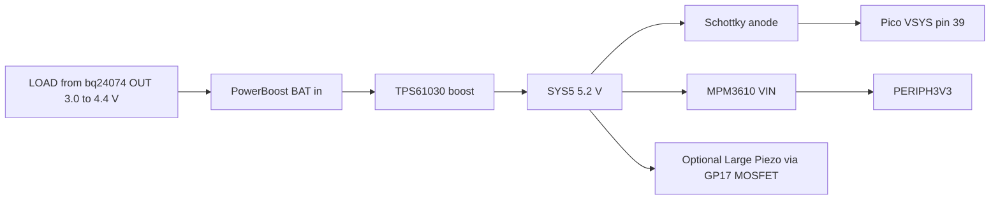
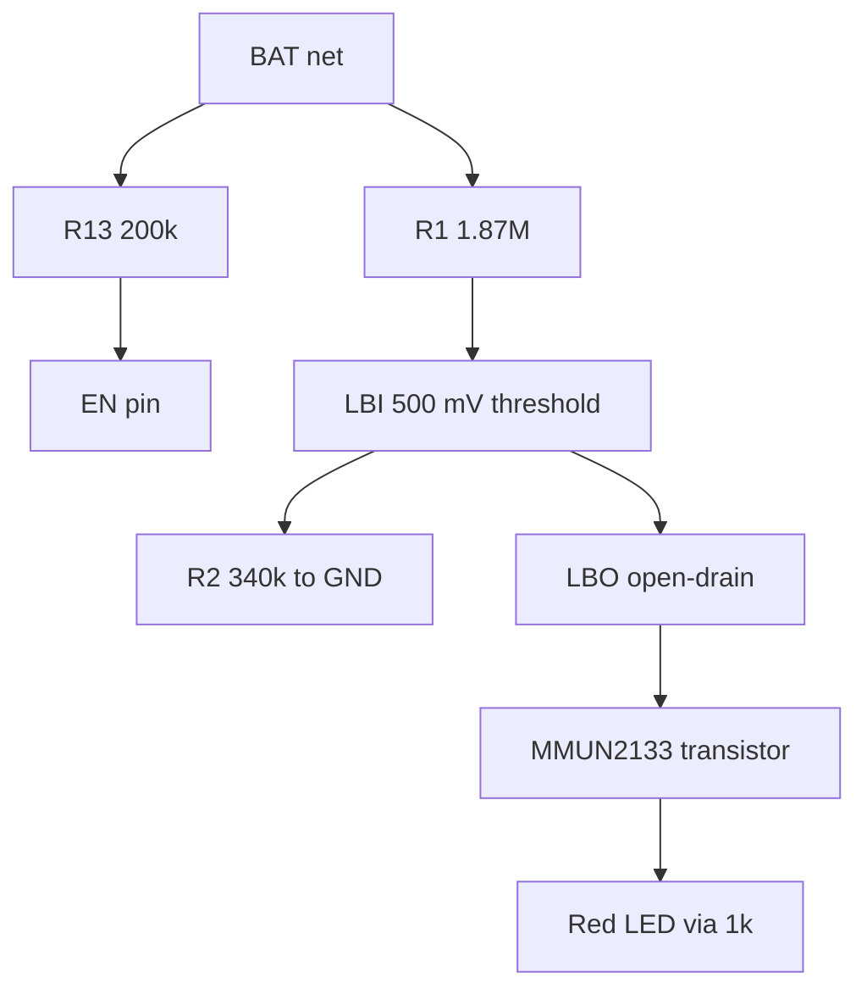

# Adafruit PowerBoost 1000 Basic — datasheet & integration notes

> Part: Adafruit product 2030 (TI TPS61030 synchronous boost) · Role in project: boosts charger LOAD (3.0–4.4 V) to SYS5 ≈5.2 V for the Pico VSYS diode, MPM3610 and optional sounder · Configuration: battery-backed only

## 1. Overview

The PowerBoost 1000 Basic is a 5 V boost converter for 1S Li-ion/LiPo inputs, without a charger (the "Basic" version omits the on-board charger of the PowerBoost 1000C) [1][2]. It is based on the TI TPS61030 synchronous boost converter, with output set to ≈5.2 V so that cable drop still leaves ≈5 V at a load [1][3]. In this design its BAT input is fed from the bq24074 **LOAD** (OUT) rail rather than directly from the cell, so the bq24074 handles charging and power-path switching while the PowerBoost only boosts. Using the 1000C instead would place a second charger in series — hence the Basic [5].

⚠️ **Discrepancy with task brief:** the chip is the **TPS61030**, not the TPS61090 [1][2][3].

## 2. Key specifications

| Parameter | Value | Source |
|---|---|---|
| Input (BAT) range | 1.8–5 V (Adafruit); TPS61030 VIN 1.8–5.5 V | [1][2][3] |
| Output voltage | 5.2 V nominal; may sag toward 5 V above ≈1 A | [1][2] |
| FB divider | R3 1.87 MΩ / R4 200 kΩ → 0.5 V × 10.35 = 5.175 V calc.; VFB 490/500/510 mV | [3][4] |
| Output current | ≥1 A from 2 V in; ≥2 A from 3.7 V LiPo (Adafruit) | [1][2] |
| Switch current limit | 3.6/4.0/4.5 A (min/typ/max); start-up limit ≈0.4 × ISW | [3] |
| Efficiency | up to 96 % (TPS61030 headline); board-level efficiency not specified — measure | [3] |
| Switching frequency | 600 kHz typ (500–700 kHz); Adafruit states 700 kHz | [2][3] |
| Quiescent (board, enabled) | ≈5 mA with power LED on | [2] |
| Quiescent (board, disabled) | ≈20 µA | [2] |
| IC quiescent / shutdown | 20 µA typ / 0.1 µA typ, 1 µA max | [3] |
| EN thresholds | VIL ≤ 0.2 × VBAT, VIH ≥ 0.8 × VBAT | [3] |
| EN pull-up | R13 200 kΩ to VBAT (≈21 µA when grounded at 4.2 V) | [4] |
| Low-battery detect | LBI divider R1 1.87 MΩ / R2 340 kΩ with 500 mV LBI threshold → ≈3.25 V; Adafruit "below 3.2 V" | [2][3][4] |
| LBO | Open-drain on IC (100 µA sink spec); board drives red LED via MMUN2133 transistor | [3][4] |
| Output capacitors / inductor | 2 × 100 µF; 6.8 µH | [4] |
| Over-temperature | 140 °C shutdown (IC) | [3] |
| Load disconnect | Output fully disconnected from input when disabled | [2][3] |
| Connector | JST-PH 2-pin input, rated ≈2 A | [2] |

## 3. Pinout / connections

From the learn guide pinouts page [2] and schematic [4]:

| Pin | Function |
|---|---|
| BAT | Boost input (also on JST) |
| GND | Ground (several pads) |
| 5V | Boosted output (≈5.2 V) |
| EN | Enable, pulled up to BAT by 200 kΩ; tie to GND to disable (output disconnected) |
| LBO | Low-battery output, low when BAT < ≈3.2 V (lights red LED) |
| USB-A footprint | Optional USB-A jack output |

## 4. Wiring in this project

| PowerBoost pin | Net | Connects to |
|---|---|---|
| BAT (or JST) | LOAD | bq24074 OUT / "Load Out" JST [5] |
| 5V | SYS5 | Schottky anode → Pico VSYS pin 39; MPM3610 VIN; optional Large Piezo alarm supply [5] |
| GND | GND | Common |
| EN | — | Leave unconnected (default enabled) [5] |
| LBO | — | Leave unconnected (see §7 before using) |

## 5. Power requirements & consumption

| Condition | Current from LOAD | Basis |
|---|---|---|
| Disabled (EN grounded) | ≈20 µA board (≈21 µA in EN pull-up at 4.2 V) | [2], estimate from [4] |
| Enabled, no load | ≈5 mA (green power LED ≈3 mA via 1 kΩ from 5 V) | [2], estimate from [4] |
| Enabled, 200 mA at SYS5 | ≈0.33 A at 3.7 V (1.04 W / 0.85 / 3.7 V, η assumed 85 %) | estimate |
| Enabled, 1 A at SYS5 | ≈1.6 A at 3.7 V (5.2 W / 0.88 / 3.7 V) — exceeds bq24074 1.5 A max load if on battery | estimate, [6] |

The no-load ≈5 mA is a significant constant battery drain (≈18.5 mW at 3.7 V); removing or cutting the green LED would save ≈3 mA (estimate, modification not documented by Adafruit).

## 6. Programming / configuration

No firmware. Hardware options:

- **Disable:** ground EN. Do not drive EN from a Pico GPIO directly: VIH is 0.8 × VBAT (up to ≈3.5 V at 4.4 V LOAD), above the Pico 3.3 V high level [3]. Use an N-MOSFET/open-drain pull-down if switching is ever needed.
- **Do not apply voltage to the 5V output while disabled** (Adafruit warning) [2]; the Schottky to VSYS prevents USB VBUS back-feed into SYS5 [5][7].

## 7. Design notes, limits & gotchas

- **LBO level:** LBO drives an on-board digital transistor and LED; there is no separate pull-up to 3.3 V. Its high level relates to BAT/LOAD (up to ≈4.4 V) [4] — **do not connect LBO directly to a Pico GPIO**. Use the MAX17048 for battery state instead [5].
- **LBO threshold vs. LOAD rail:** with EXT5 present LOAD is ≈4.4 V, so LBO only reflects the cell when running on battery [3][6].
- **Input current from the bq24074:** the bq24074 OUT is limited to 1.5 A max load [6]; at ≈3.4 V cell and η ≈85 %, this caps SYS5 to ≈0.83 A (estimate). Keep SYS5 peaks (Wi-Fi, e-paper, sounder) below this.
- **Start-up current limit** is ≈0.4 × ISW until the output reaches regulation [3]; large SYS5 capacitance or heavy loads during start-up can extend start-up.
- **VSYS limit:** 5.2 V minus diode drop is well within VSYS 5.5 V max even with ±3 % VFB tolerance (5.35 V max output) [3][7].

## 8. Bring-up / test checklist

1. Apply 3.7 V from a current-limited supply (2 A) to BAT; confirm 5V ≈5.1–5.25 V and green LED.
2. Measure no-load input current (expect ≈5 mA).
3. Ground EN; confirm 5V falls to 0 V and input current ≈20 µA.
4. Sweep BAT down to 3.1 V; confirm red LBO LED turns on near 3.2–3.25 V.
5. Load 5V with 1 A at 3.4 V input; record output voltage and input current; check temperature.
6. Connect to bq24074 LOAD; pull EXT5 while loaded and confirm SYS5 stays above 4.8 V across the input transition (scope).

## 9. References

1. Adafruit, "PowerBoost 1000 Basic - 5V USB Boost @ 1000mA from 1.8V+", product 2030 — https://www.adafruit.com/product/2030
2. Adafruit Learning System, "Adafruit PowerBoost 1000 Basic" (overview, pinouts) — https://learn.adafruit.com/adafruit-powerboost-1000-basic
3. Texas Instruments, "TPS6103x 96% Efficient Synchronous Boost Converter" (TPS61030) — https://www.ti.com/lit/ds/symlink/tps61030.pdf
4. Adafruit, PowerBoost 1000 Basic Eagle schematic — https://github.com/adafruit/Adafruit-PowerBoost-1000-PCB ("Adafruit PowerBoost 1000 Basic.sch")
5. Project build guide — docs/pico_2_w_anchor_alarm_build_guide_v2.md, sections 4–5
6. Texas Instruments, bq24074 datasheet (SLUS810N) — https://www.ti.com/lit/ds/symlink/bq24074.pdf; Adafruit product 4755 — https://www.adafruit.com/product/4755
7. Raspberry Pi Ltd, "Raspberry Pi Pico 2 W Datasheet" (RP-008304-DS) — https://pip.raspberrypi.com/documents/RP-008304-DS
