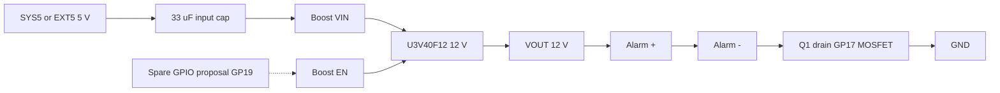

# Optional 12 V boost converter for the piezo alarm — datasheet & integration notes

> Part: Pololu U3V40F12 (#4016, primary), Pololu U3V16F12 (#4945), generic MT3608 module (caution) · Role in project: raise SYS5/EXT5 to 12 V so the piezo alarm reaches ≈ 102 dBA · Configuration: Optional A (item A4)

## 1. Overview

The CED-ME516AQSW alarm gives ≈ 90 dBA at 5 V but 102 dBA at 12 V (61 cm) [4]. Optional item A4 in the build guide adds a regulated 12 V boost fed from SYS5 (battery build) or EXT5 (Optional B); the guide notes no converter has been qualified and that an enable line needs an extra GPIO [5]. This file compares three candidates and sizes the input current. Recommendation: Pololu U3V40F12 (has EN, OVP, fixed 12 V); U3V16F12 if no enable is needed and the supply itself is switched; MT3608 modules only with caution.

## 2. Key specifications

| Parameter | Pololu U3V40F12 [1] | Pololu U3V16F12 [2] | MT3608 IC / generic module [3] |
|---|---|---|---|
| Output | 12 V fixed, ±4 % | 12 V fixed, ±4 % | Adjustable (FB 0.6 V), up to 28 V; set by trimpot on modules |
| Input range | 1.3–12 V (start-up ≥ 2.7 V) | 1.3–16 V (start-up ≥ 2.7 V) | 2–24 V |
| Switching frequency | ≈ 600 kHz | ≈ 1.2 MHz | 1.2 MHz |
| Efficiency | 85–95 % typical | see Pololu efficiency graph; 80–90 % class at 5 V in (estimate) | module-dependent, unverified |
| Quiescent (no load, enabled) | < 2 mA typ | < 1 mA typ | IC: 100–200 µA PFM; 1.6–2.2 mA PWM |
| Switch / input current limit | ≈ 9.5 A input limit | 2 A switch limit; ≈ 1.5 A continuous input | 4 A switch limit |
| Output over-voltage protection | ≈ 16.5 V | unverified | IC has none stated for modules — unverified |
| Enable | EN pin, 30 kΩ pull-up to VIN (on by default); < 0.4 V disables | **No EN pin** (VIN, GND, VOUT only) | IC EN: high ≥ 1.5 V, low ≤ 0.4 V; on modules usually tied to VIN, not broken out |
| Shutdown current | unverified (EN low) | n/a | ≤ 1 µA (IC) |
| Behaviour when disabled | VIN passes to VOUT through inductor and diode | VIN passes to VOUT when VIN > VOUT | Boost topology: VIN − diode drop appears at VOUT |
| Protection | No reverse-polarity, no short-circuit protection | No reverse-polarity, no short-circuit protection | Module-dependent |
| Size | 15.2 × 15.2 mm | 13.1 × 8.1 × 3 mm | ≈ 37 × 17 mm typical module (unverified) |

> ⚠️ Discrepancy with build guide: the guide implies an enable-capable converter; U3V16F12 has **no** EN pin [2]. Also, on all boost converters "disabled" does **not** mean 0 V out — VIN (≈ 5 V minus a diode drop) still reaches the alarm, which will sound at ≈ 90 dBA. The alarm must still be switched by the GP17 MOSFET; EN only saves quiescent current.

## 3. Pinout / connections

| Board | Pins |
|---|---|
| U3V40F12 | VIN, GND, VOUT, EN (plus GND duplicates; see Pololu pinout) [1] |
| U3V16F12 | VIN, GND, VOUT [2] |
| MT3608 module | VIN+, VIN−, VOUT+, VOUT− (EN typically not exposed) [3] |

## 4. Wiring in this project

| Signal | From | To | Notes |
|---|---|---|---|
| VIN | SYS5 (battery) or EXT5 (Optional B) | Boost VIN | Add 33 µF electrolytic at VIN if leads are long [6] |
| GND | Common GND | Boost GND | — |
| VOUT 12 V | Boost VOUT | Alarm + | — |
| Alarm − | — | Q1 drain (GP17 MOSFET) | See MOSFET file |
| EN (U3V40F12 only) | Spare GPIO via 1 kΩ, e.g. GP19 (proposal; not assigned in guide) | Boost EN | Default on via 30 kΩ pull-up; GPIO low disables. Do not use GP18 (reserved) or GP23–25/29 [5] |



## 5. Power requirements & consumption

Load: 12 V × 40 mA (alarm max) = 0.48 W; typical 12 V × 30 mA = 0.36 W [4][5].

| Case | Efficiency | Input power | Input current at 5.0 V | Input current at 5.2 V | Basis |
|---|---|---|---|---|---|
| Max alarm load, 40 mA | 85 % | 0.565 W | 113 mA | 109 mA | estimate from [1][4] |
| Max alarm load, 40 mA | 80 % | 0.600 W | 120 mA | 115 mA | estimate |
| Typical alarm load, 30 mA | 85 % | 0.424 W | 85 mA | 82 mA | estimate |
| Quiescent, U3V40F12 enabled, alarm off | — | — | < 2 mA | < 2 mA | datasheet [1] |
| Quiescent, U3V16F12, alarm off | — | — | < 1 mA | < 1 mA | datasheet [2] |
| Alarm off, U3V40F12 EN low | — | — | unverified (EN 30 kΩ pull-up draws ≈ 0.17 mA from 5 V when held low) | — | estimate |

Formula: I_in = (V_out × I_out) / (η × V_in) + I_q. Budget ≈ 125 mA on SYS5/EXT5 while the 12 V alarm sounds. Start-up inrush charges output capacitance; if SYS5 is near its limit, test for brown-out.

## 6. Programming / configuration

Only the U3V40F12 has an enable; use it to cut quiescent current when the alarm is idle. The alarm itself is still switched by GP17.

```c
#include "pico/stdlib.h"

#define ALARM_GATE_PIN  17
#define BOOST_EN_PIN    19   // proposal: spare GPIO, not assigned in build guide
#define BOOST_SETTLE_MS 5    // estimate; verify output rise on a scope

void boost_alarm_init(void) {
    gpio_init(ALARM_GATE_PIN);
    gpio_disable_pulls(ALARM_GATE_PIN);
    gpio_put(ALARM_GATE_PIN, 0);
    gpio_set_dir(ALARM_GATE_PIN, GPIO_OUT);

    gpio_init(BOOST_EN_PIN);
    gpio_disable_pulls(BOOST_EN_PIN);
    gpio_put(BOOST_EN_PIN, 0);              // boost off (VIN passthrough) at idle
    gpio_set_dir(BOOST_EN_PIN, GPIO_OUT);
}

void boost_alarm_set(bool on) {
    if (on) {
        gpio_put(BOOST_EN_PIN, 1);           // releases EN; 30k pull-up also holds it high
        sleep_ms(BOOST_SETTLE_MS);
        gpio_put(ALARM_GATE_PIN, 1);
    } else {
        gpio_put(ALARM_GATE_PIN, 0);
        gpio_put(BOOST_EN_PIN, 0);
    }
}
```

Note: the EN pin is pulled up to VIN (5 V) by 30 kΩ on the U3V40F12 [1]. Driving it from a 3.3 V GPIO high means the 5 V pull-up back-feeds the pad through 30 kΩ (≈ 57 µA into the 3.3 V pad, estimate). Alternatives: drive EN open-drain (output low to disable, input/high-Z to enable — the pad then sees ≈ 5 V through 30 kΩ; RP2350 GPIOs are specified 5 V-tolerant only while IOVDD is powered, so verify against the RP2350 datasheet before relying on this [7]), or — most robust — add a small N-MOSFET/NPN that pulls EN low, keeping 5 V off the Pico pad entirely.

```c
// Open-drain style EN control (only if 5 V tolerance is confirmed; see note above)
void boost_enable(bool on) {
    if (on) gpio_set_dir(BOOST_EN_PIN, GPIO_IN);   // 30k pull-up enables
    else { gpio_put(BOOST_EN_PIN, 0); gpio_set_dir(BOOST_EN_PIN, GPIO_OUT); }
}
```

## 7. Design notes, limits & gotchas

- **Passthrough when disabled**: all three candidates pass ≈ VIN to VOUT when not boosting [1][2][3]; never rely on EN to silence the alarm.
- **U3V40F12 VIN max 12 V** [1]: fine for SYS5/EXT5 (≈ 5 V). Do not feed it from a 12 V boat bus directly.
- **OVP**: U3V40F12 output OVP ≈ 16.5 V [1] keeps the alarm (16 V max, 19.2 V surge [4]) safe if feedback fails; MT3608 modules have a trimpot that can set > 16 V by accident — measure and lock with glue before connecting the alarm.
- **MT3608 modules**: unknown inductor/diode quality, trimpot drift with vibration, EN normally tied high; acceptable only for experiments [3].
- **No reverse/short protection** on Pololu boards [1][2]: add a polyfuse (e.g., 200 mA hold, proposal) on VIN.
- **LC spikes**: hot-plugging with long leads can overshoot; Pololu recommends a ≥ 33 µF electrolytic across VIN [6].
- **EMI**: 600 kHz / 1.2 MHz switching near the GPS antenna can raise noise floor; keep the boost and its leads away from the GPS module and antenna (general practice).
- **GPIO budget**: EN needs a GPIO not listed in the guide's map; GP19 is proposed here only as an example [5].

## 8. Bring-up / test checklist

1. Bench-power the boost alone from a current-limited 5 V supply; measure VOUT = 12 V ± 4 % [1].
2. Measure no-load input current (expect < 2 mA for U3V40F12) [1].
3. Pull EN low; confirm VOUT drops to ≈ VIN minus diode drop (not 0 V).
4. Connect the alarm via Q1; command on; measure input current (expect ≤ 125 mA at 5 V) and VOUT under load.
5. Check SYS5/EXT5 does not dip enough to brown out the Pico during alarm start (scope VSYS).
6. Check GPS fix quality / C/N0 with boost running versus off.
7. Thermal check after 10 minutes continuous alarm: board should be barely warm.

## 9. References

1. Pololu, "12V Step-Up Voltage Regulator U3V40F12" #4016 — https://www.pololu.com/product/4016
2. Pololu, "12V Step-Up Voltage Regulator U3V16F12" #4945 — https://www.pololu.com/product/4945
3. Aerosemi, MT3608 datasheet — https://www.olimex.com/Products/Breadboarding/BB-PWR-3608/resources/MT3608.pdf
4. Challenge Electronics, CED-ME516AQSW datasheet — http://cdn.sparkfun.com/datasheets/Components/General/CED-ME516AQSW.pdf
5. Project build guide, `docs/pico_2_w_anchor_alarm_build_guide_v2.md` (Optional A, A4, GPIO map)
6. Pololu, "Understanding Destructive LC Voltage Spikes" — https://www.pololu.com/docs/0J16
7. Raspberry Pi, RP2350 datasheet (GPIO electrical characteristics) — https://datasheets.raspberrypi.com/rp2350/rp2350-datasheet.pdf
