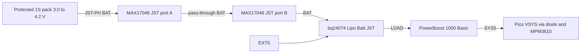
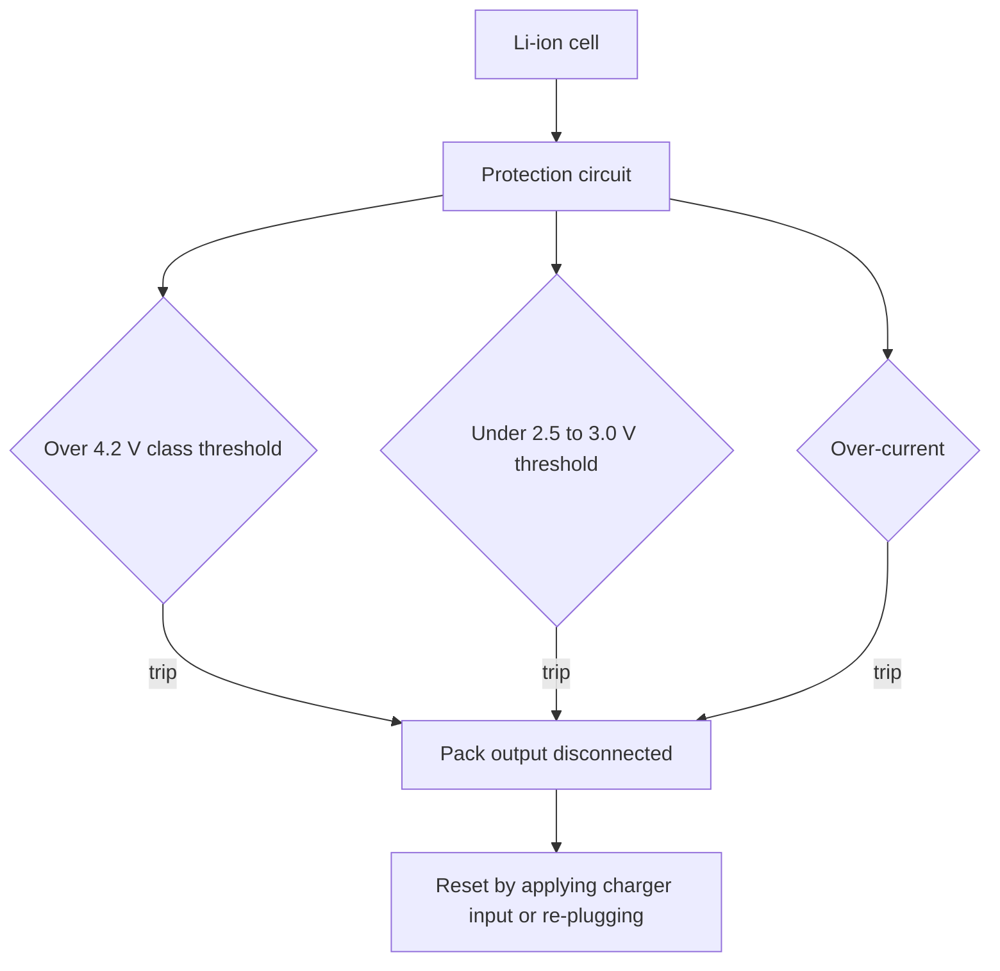

# Protected 1S Li-ion / LiPo battery pack — datasheet & integration notes

> Part: generic protected single-cell (1S) Li-ion/LiPo pack from Adafruit category 574 (e.g. products 2011, 354, 353, 5035) · Role in project: backup energy store on net BAT · Configuration: battery-backed only

## 1. Overview

A 1S lithium-ion or lithium-polymer cell (3.7 V nominal, 4.2 V full) with an attached protection circuit module (PCM) that disconnects the cell on over-charge, over-discharge and over-current [1][2]. In this project the pack connects via its JST-PH lead to the MAX17048 pass-through and on to the bq24074 battery input (net **BAT**). Capacity is chosen after measuring real system power, using the build-guide sizing formulas [3].

## 2. Key specifications

| Parameter | Value | Source |
|---|---|---|
| Nominal voltage | 3.7 V | [1] |
| Maximum (charge) voltage | 4.2 V | [1] |
| "Dead" voltage | ≈3.4 V (most energy delivered above this) | [1] |
| Cutoff (protection) | ≈3.0 V (Adafruit guide); 2.5 V stated on the 4400 mAh product page | [1][4] |
| Protection functions | Over-voltage, under-voltage, over-current | [2][4] |
| Max discharge (guide rule of thumb) | ≈1–2 C | [2] |
| Max charge current (guide rule of thumb) | ≈1 C | [2] |
| Recommended charge current | ≤0.5 C; 0.25 C or less when no thermistor is fitted (4400 mAh pack: 1 A max) | [4] |
| Charge temperature | "usually about 0–50 °C"; check cell datasheet | [2] |
| Charger type | Li-ion CC/CV 4.2 V only; never NiMH/NiCd/lead-acid chargers | [4][5] |
| Connector | JST-PH 2-pin, cable rated 2 A (Adafruit packs) | [4] |
| Thermistor | Not built into Adafruit packs | [4] |
| Protection thresholds (exact) | Pack/PCM-specific; not published on Adafruit product pages — **unverified**, consult each pack datasheet | [2] |

## 3. Pinout / connections

| Lead | Function |
|---|---|
| Red | Pack + (after PCM) |
| Black | Pack − (PCM switches the negative path in typical designs — unverified for a given pack) |
| JST-PH 2-pin | Adafruit polarity: matches all Adafruit LiPo chargers and boards |

⚠️ **Polarity warning:** Adafruit states that "other brands may have reverse polarity and can destroy your battery" [4]. Verify with a meter before plugging any non-Adafruit pack into the MAX17048 or bq24074 JST.

## 4. Wiring in this project

| Pack | Net | Connects to |
|---|---|---|
| JST-PH lead | BAT | MAX17048 JST port A; MAX17048 JST port B → bq24074 "Lipo Batt" JST [3][6] |
| − | GND | Common ground via the boards |

## 5. Power requirements & consumption

Self-discharge and PCM drain are pack-specific (unverified). System drain on BAT when EXT5 is absent equals the measured battery-input power of all downstream stages [3].

### Capacity selection

From the build guide [3]:

    usable_energy_Wh ≈ 3.7 × capacity_Ah × usable_fraction
    runtime_hours ≈ usable_energy_Wh / measured_battery_input_power_W

**Example sizing table — power values are PLACEHOLDERS, not measurements.** usable_fraction = 0.8 assumed (example). Replace the power columns with the measured battery-input power for each firmware mode before choosing a pack.

| Pack (Adafruit example) | Capacity | Usable Wh (×0.8) | Runtime at 0.25 W (example) | Runtime at 0.5 W (example) | Runtime at 1.0 W (example) |
|---|---|---|---|---|---|
| Product 2011 | 2000 mAh | 5.9 Wh | 23.7 h | 11.8 h | 5.9 h |
| Product 354 | 4400 mAh | 13.0 Wh | 52.1 h | 26.0 h | 13.0 h |
| Product 353 | 6600 mAh | 19.5 Wh | 78.1 h | 39.1 h | 19.5 h |
| Product 5035 | 10050 mAh | 29.7 Wh | 119.0 h | 59.5 h | 29.7 h |

Derate further for cold, ageing and an alarm-energy reserve [3]. Note the system enters Emergency60 at ≤20 % SOC [3], so "runtime to emergency mode" is ≈0.8 × the figure above only if usable_fraction is defined from 100 % to 0 % SOC.

### Charge-rate selection with the bq24074

| Capacity | 0.5 C | 0.25 C | Suggested bq24074 ISET jumper |
|---|---|---|---|
| 2000 mAh | 1.0 A | 0.5 A | 0.5 A (≈0.45 A) |
| 4400 mAh | 2.2 A | 1.1 A | 1.0 A (≈0.89 A) |
| 6600 mAh | 3.3 A | 1.65 A | 1.0 A or 1.5 A |
| 10050 mAh | 5.0 A | 2.5 A | 1.5 A (≈1.5 A) |

C-rate guidance from [4]; jumper currents from bq24074 KISET calculation (see adafruit-bq24074-charger.md). With no thermistor fitted, prefer ≤0.25 C [4].

## 6. Programming / configuration

No direct configuration. Related firmware/hardware settings:

- Set bq24074 ISET for the pack (table above).
- MAX17048 needs no capacity setting (ModelGauge uses voltage only); set the ATHD alert to 20 % to match Emergency60 [3][7].

## 7. Design notes, limits & gotchas

- **Protection is a last resort, not a system cutoff.** The PCM trips at ≈2.5–3.0 V [1][4]; the build guide warns that gauge SOC is not a guaranteed cutoff point [3]. Firmware should shed load well above PCM trip.
- **Discrepancy within sources:** the guide states ≈3.0 V cutoff [1], while the 4400 mAh product page states 2.5 V [4]. Treat the threshold as pack-specific.
- **Temperature:** charge only within about 0–50 °C [2]; the bq24074 TS input is disabled by default on the Adafruit board (fixed 10 kΩ) — fit an NTC if the enclosure can heat in sun or drop near 0 °C [8].
- **Marine safety:** do not immerse or expose to water; store cool and dry; do not use or leave in high temperature (direct sun, hot vehicle); do not short; do not install reversed; stop using if the cell swells, smells, heats or discolours [5]. Use a vented, non-metallic, strain-relieved mount; avoid metal objects near terminals [5]. Adafruit also advises never charging unattended [4] — note this conflicts with an unattended overnight anchor alarm; mitigate with conservative charge rate, NTC and enclosure fire containment (design decision for the owner).
- **Never charge a 4.1 V/3.6 V-chemistry cell** with the 4.2 V bq24074 [1].
- **JST cable rating** 2 A [4]; keep within it.
- **Pack PCM reset:** after an under-voltage trip the pack may appear dead until charger input is applied [8].

## 8. Bring-up / test checklist

1. Inspect pack for damage/swelling; confirm PCM is present under the tape [2].
2. Meter the JST: confirm polarity matches the MAX17048/bq24074 silkscreen and voltage is 3.0–4.2 V.
3. Set bq24074 ISET for ≤0.5 C (≤0.25 C without thermistor).
4. First charge supervised; check pack temperature periodically by touch/IR.
5. Measure battery-input power for each firmware mode with EXT5 removed; fill the sizing table with measured values.
6. Run a discharge test to the firmware shutdown point; record Wh delivered and compare to the estimate.

## 9. References

1. Adafruit Learning System, "Li-Ion & LiPoly Batteries — Voltages" — https://learn.adafruit.com/li-ion-and-lipoly-batteries/voltages
2. Adafruit Learning System, "Li-Ion & LiPoly Batteries — Protection Circuitry" — https://learn.adafruit.com/li-ion-and-lipoly-batteries/protection-circuitry
3. Project build guide — docs/pico_2_w_anchor_alarm_build_guide_v2.md, sections 4, 5 and 11
4. Adafruit, "Lithium Ion Battery Pack - 3.7V 4400mAh", product 354 — https://www.adafruit.com/product/354 ; battery category — https://www.adafruit.com/category/574
5. Adafruit Learning System, "Li-Ion & LiPoly Batteries — Conclusion" (manufacturer warnings) — https://learn.adafruit.com/li-ion-and-lipoly-batteries/conclusion
6. Adafruit Learning System, MAX17048 guide pinouts — https://learn.adafruit.com/adafruit-max17048-lipoly-liion-fuel-gauge-and-battery-monitor/pinouts
7. Analog Devices, MAX17048/MAX17049 datasheet — https://www.analog.com/media/en/technical-documentation/data-sheets/max17048-max17049.pdf
8. Adafruit Learning System, BQ24074 guide pinouts/FAQ — https://learn.adafruit.com/adafruit-bq24074-universal-usb-dc-solar-charger-breakout/pinouts
