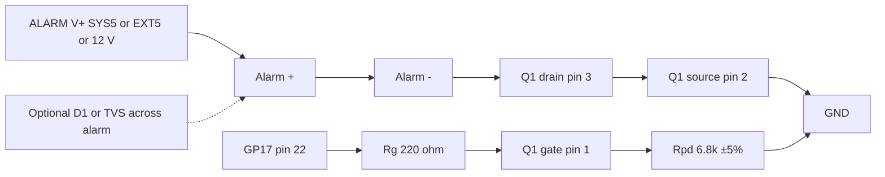

# Logic-level N-MOSFET low-side driver — datasheet & integration notes

> Part: AO3400A (primary), IRLML6344TRPbF, DMG2302U (alternatives) · Role in project: low-side switch for the piezo alarm, gate driven from GP17 at 3.3 V · Configuration: Optional A

## 1. Overview

The optional piezo alarm (25–60 mA at 5–16 V [6]) is switched on its negative lead by an N-channel MOSFET whose gate is driven directly by RP2350 GPIO17 at 3.3 V [7]. Because 3.3 V gate drive is low, the MOSFET must have R_DS(on) **specified at V_GS ≤ 2.5 V**; parts rated only at 10 V / 5 V (e.g., FQP30N06L) are not guaranteed to be fully enhanced [1]–[5]. Recommended: AO3400A, IRLML6344, or DMG2302U (all SOT-23). A 100–330 Ω series gate resistor and a gate-to-source pull-down keep the alarm off during reset and boot [7].

## 2. Key specifications

| Parameter | AO3400A [1] | IRLML6344TRPbF [2] | DMG2302U [3] | IRLML2502 [4] | FQP30N06L [5] |
|---|---|---|---|---|---|
| Package | SOT-23 | SOT-23 (Micro3) | SOT-23 | SOT-23 (Micro3) | TO-220 |
| V_DS max | 30 V | 30 V | 20 V | 20 V | 60 V |
| V_GS max | ±12 V | ±12 V | ±8 V | ±12 V | ±20 V |
| V_GS(th) | 0.65 / 1.05 / 1.45 V (min/typ/max) | 0.5 / 0.8 / 1.1 V | 0.4–1.0 V | 0.6–1.2 V | 1.0–2.5 V |
| R_DS(on) max @ 4.5 V | 32 mΩ | 29 mΩ | 90 mΩ | 45 mΩ | — (5 V: 45 mΩ class) |
| R_DS(on) max @ 2.5 V | 48 mΩ (I_D = 3 A) | 37 mΩ (I_D = 4 A) | 120 mΩ | 80 mΩ | **not specified** |
| I_D continuous (25 °C) | 5.7 A | 5.0 A | 4.2 A | 4.2 A | 32 A |
| C_iss | 630 pF | 650 pF | 594 pF | unverified | unverified |
| Q_g total | 6–7 nC | 6.8 nC | 7 nC | unverified | unverified |
| Pinout | 1 G, 2 S, 3 D | 1 G, 2 S, 3 D | 1 G, 2 S, 3 D | 1 G, 2 S, 3 D | G-D-S (TO-220) |
| Recommendation | Primary | Alternative | Alternative (20 V margin note) | Acceptable | Not recommended for 3.3 V drive |

- Si2302 (Vishay): commonly cited as 2.5 V-rated; the datasheet could not be retrieved during this research — unverified.
- SparkFun "N-Channel MOSFET 60V 30A" is FQP30N06L; R_DS(on) is specified only at V_GS = 10 V and 5 V, and V_GS(th) can be as high as 2.5 V, leaving almost no overdrive at 3.3 V [5].

The RP2350-E9 pull-down selection is documented in §7; the guide specifies a 6.8 kΩ ±5% pull-down and no more than 330 Ω series resistance for A2 silicon.

## 3. Pinout / connections

SOT-23 (top view, AO3400A / IRLML6344 / DMG2302U / IRLML2502): pin 1 = Gate, pin 2 = Source, pin 3 = Drain (tab side, single pin) [1]–[4].

Pinout caution:
- SOT-23 parts need a breakout board (e.g., SOT-23 to DIP adapter) for hand wiring; verify pin 1 orientation against the breakout silkscreen, not the MOSFET marking.
- TO-220 parts (FQP30N06L) are G-D-S left to right facing the label; other TO-220 MOSFETs vary — always check the datasheet [5].
- Some generic "MOSFET modules" invert logic or include their own pull-ups; do not substitute without checking.

## 4. Wiring in this project

| Component | From | To | Value / note |
|---|---|---|---|
| Rg (series gate) | GP17 (pin 22) | Q1 gate | 100–330 Ω (220 Ω suggested) [7] |
| Rpd (gate pull-down) | Q1 gate | Q1 source / GND | 6.8 kΩ ±5%; keep GP17-to-ground resistance below 8.2 kΩ including Rg for RP2350 A2/E9 [7][8] |
| Q1 source | — | GND (Pico GND, short return) | — |
| Q1 drain | Alarm − terminal | — | — |
| Alarm + | SYS5 / EXT5 / 12 V boost | — | [6][7] |
| D1 (optional) | Across alarm, cathode to + | — | Only if a magnetic/inductive sounder or long leads are used |



## 5. Power requirements & consumption

| Item | Value | Basis |
|---|---|---|
| Drain current, alarm at 12 V | 40 mA max | datasheet [6] |
| Conduction loss, AO3400A at 2.5 V drive, 60 mA worst case | I²R = 0.06² × 0.048 ≈ 0.17 mW | estimate from [1][6] |
| V_DS drop at 40 mA, AO3400A | ≈ 2 mV | estimate |
| Gate pull-down current while on, 100 kΩ | 33 µA | estimate (3.3 V / 100 kΩ) |
| Gate pull-down current while on, 6.8 kΩ + 220 Ω | ≈470 µA | calculation |
| Off-state drain leakage | ≤ 1 µA at rated V_DS (AO3400A I_DSS) | datasheet [1] |

Thermal: negligible; no heatsink needed.

## 6. Programming / configuration

```c
#include "pico/stdlib.h"
#include "hardware/gpio.h"

#define ALARM_GATE_PIN 17

// Safe default: output driven low, no internal pulls.
void alarm_driver_init(void) {
    gpio_init(ALARM_GATE_PIN);             // input, function SIO, output latch 0
    gpio_disable_pulls(ALARM_GATE_PIN);    // avoid RP2350-E9 pull-down latch-up
    gpio_put(ALARM_GATE_PIN, 0);
    gpio_set_dir(ALARM_GATE_PIN, GPIO_OUT);
    gpio_set_drive_strength(ALARM_GATE_PIN, GPIO_DRIVE_STRENGTH_4MA);
}

void alarm_driver_set(bool on) {
    gpio_put(ALARM_GATE_PIN, on ? 1 : 0);
}

// Call from fault / watchdog paths before anything else.
void alarm_driver_safe_off(void) {
    gpio_put(ALARM_GATE_PIN, 0);
}

int main(void) {
    stdio_init_all();
    alarm_driver_init();
    // Self-test: short chirp
    alarm_driver_set(true);
    sleep_ms(200);
    alarm_driver_set(false);
    while (true) tight_loop_contents();
}
```

Gate charge timing: Q_g ≈ 7 nC through 220 Ω from a 3.3 V pin switches in well under 1 µs (τ ≈ 220 Ω × 630 pF ≈ 0.14 µs, estimate from [1]); switching loss is irrelevant at alarm cadences.

## 7. Design notes, limits & gotchas

- **Why ≤ 2.5 V rating**: at V_GS = 3.3 V only parts with R_DS(on) guaranteed at 2.5 V give a margin over the 3.3 V GPIO minus any droop; AO3400A guarantees 48 mΩ at 2.5 V [1].
- **Gate resistor 100–330 Ω** [7]: limits GPIO peak current into C_iss, damps ringing from the gate-lead inductance, and gives some protection if the MOSFET fails gate-drain short.
- **Pull-down rationale**: during reset, BOOTSEL, flashing and before firmware runs, GP17 is an input; the pull-down holds V_GS ≈ 0 so the alarm stays silent [7].
- **RP2350-E9 erratum**: on RP2350 A2 silicon, a GPIO with its input buffer enabled can sit at ≈ 2.1–2.2 V when only a weak external pull-down (> ≈ 8.2 kΩ) is present, because of leakage from the pad [8][9]. 2.1 V exceeds V_GS(th) of all recommended MOSFETs, so the alarm could partially turn on before firmware drives GP17 low. Keep the complete resistance from GP17 through Rg and Rpd to ground below 8.2 kΩ. A 6.8 kΩ ±5% Rpd and Rg ≤330 Ω meet that limit even at tolerance extremes [8]. Verify the stepping (A4 fixes E9; requires pico-sdk ≥ 2.1.0) [10], and drive GP17 low as an output immediately at boot without enabling the internal pull-down. With 6.8 kΩ and 220 Ω Rg, the pull-down current is about 0.47 mA while the alarm is on.
- **Flyback / snubber**: the CED-ME516AQSW contains its own driver and presents a DC-powered electronic load, not a bare coil, so a flyback diode is generally not required [6]. If a magnetic sounder, relay or long (> 1–2 m) leads are substituted, add a 1N4148/1N5819 across the load (cathode to +) or a TVS (e.g., SMBJ18A for a 12 V rail — proposal) from drain to source.
- **V_DS rating**: DMG2302U/IRLML2502 (20 V) are adequate for 5 V or 12 V supplies, but with the boost's ≈ 16.5 V OVP and the alarm's 19.2 V surge limit, 30 V parts (AO3400A, IRLML6344) give more margin [1][3][6][11].
- **ESD**: SOT-23 MOSFETs are ESD-sensitive; handle with grounding.
- **Ground return**: route source to the same ground point as the Pico; alarm current is small, so ground shift is negligible.

## 8. Bring-up / test checklist

1. Before fitting the alarm, measure gate-to-source resistance: ≈ Rpd value.
2. With alarm connected and Pico in BOOTSEL (no firmware), confirm alarm silent and V_gate < 0.3 V.
3. Repeat during power-up of the Pico several times; watch for chirps (E9 symptom).
4. Load firmware; confirm `alarm_driver_init()` holds V_gate ≈ 0 V.
5. Command on; measure V_gate ≈ 3.3 V and V_DS < 20 mV.
6. Command off; confirm silence and V_DS ≈ supply voltage.
7. Trigger a watchdog reset while alarm is on; confirm alarm stops during reset (pull-down holds gate low).
8. Inspect solder joints on the SOT-23 breakout for bridging.

## 9. References

1. Alpha & Omega Semiconductor, AO3400A datasheet (rev 3.1, Jul 2023) — https://www.aosmd.com/res/datasheets/AO3400A.pdf
2. Infineon, IRLML6344TRPbF datasheet — https://www.infineon.com/dgdl/irlml6344pbf.pdf?fileId=5546d462533600a4015356686fed261f
3. Diodes Inc., DMG2302U datasheet — https://www.diodes.com/assets/Datasheets/DMG2302U.pdf
4. Infineon, IRLML2502PbF datasheet — https://www.infineon.com/dgdl/irlml2502pbf.pdf?fileId=5546d462533600a401535668048e2606
5. onsemi/Fairchild, FQP30N06L datasheet (SparkFun "N-Channel MOSFET 60V 30A") — https://cdn.sparkfun.com/datasheets/Components/General/FQP30N06L.pdf
6. Challenge Electronics, CED-ME516AQSW datasheet — http://cdn.sparkfun.com/datasheets/Components/General/CED-ME516AQSW.pdf
7. Project build guide, `docs/pico_2_w_anchor_alarm_build_guide_v2.md` (GP17, Optional A)
8. Adafruit, "Raspberry Pi RP2350 erratum workarounds" — https://learn.adafruit.com/key-pad-matrix-scanning-in-circuitpython/raspberry-pi-rp2350-erratum-workarounds
9. Raspberry Pi pico-feedback issue #401 (RP2350-E9) — https://github.com/raspberrypi/pico-feedback/issues/401
10. CNX Software, "RP2350 A4 stepping fixes E9 GPIO erratum" — https://www.cnx-software.com/2025/07/29/raspberry-pi-rp2350-a4-stepping-fixes-e9-gpio-erratum-9-glitching-bugs-introduces-2mb-flash-variants/
11. Pololu, U3V40F12 — https://www.pololu.com/product/4016
