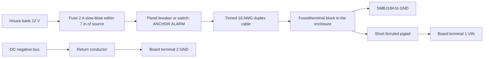

# Boat 12 V direct input to the ESP32-S3-Touch-LCD-4 — protection & wiring notes

> Part: fuse, switch, TVS, wiring and enclosure between the boat 12 V house bank and the board's VIN terminal (no separate converter) · Role in project: primary power for the ESP32 touch edition · Configuration: ESP32 touch edition only

## 1. Overview

The Pico edition feeds its electronics from a separate regulated 12 V → 5 V converter ([marine-12v-to-5v-supply.md](marine-12v-to-5v-supply.md)). The Waveshare ESP32-S3-Touch-LCD-4 has its own wide-input buck (XL1509) on the screw terminal, rated "DC 7-36V" on the silkscreen [1]. Boat 12 V can therefore go straight to the board's VIN terminal, as long as the wiring has the protection the board itself lacks. This file defines that protection. It reuses the boat-side environment data and the load-dump caveats from the Pico edition supply note [3].

This is a planned design, not a tested one. The anchor alarm is a prototype, not a certified marine safety system.

## 2. Key specifications

### 2.1 Boat side (same environment as the Pico edition)

| Parameter | Value | Source |
|---|---|---|
| 12 V bus, normal operation | ≈ 10.5–14.8 V | [3][4] |
| Flooded-battery equalisation | 15.8–16 V | [3][4] |
| Load dump, ISO 16750-2, 12 V, unsuppressed | Us 79–101 V, td 40–400 ms | [3][5][6] |

### 2.2 Board input (V4.0)

| Parameter | Value | Source |
|---|---|---|
| Rated VIN | Silkscreen 7–36 V. V4 schematic and Waveshare reference say 5–36 V. Plan for **7–36 V** | [1][2] |
| Series reverse-polarity diode | 1N5822 Schottky (D11) | [1] |
| Onboard TVS | SMAJ40CA bidirectional (D9). Does not clamp until above 40 V | [1] |
| Buck converter | XL1509-ADJ, 2 A, 150 kHz, datasheet input 4.5–40 V | [1][7] |
| Buck output | ≈ 5.2 V (**calculated** from the feedback divider) | [1] |
| Maximum buck output power | ≈ 10.4 W (2 A × 5.2 V, **calculated**) | [1][7] |
| Ground | VIN negative = board GND. The RS485 surge net "EARTH" is tied to GND through R71 0 Ω | [1] |
| Isolation | None | [1] |
| Board input current at 12 V | Not published — **measure** | [2] |

## 3. Pinout / connections

| Board terminal pin | Connection |
|---|---|
| 1 VIN | Boat + after fuse, switch and TVS |
| 2 GND | Boat DC negative bus |

The board takes a 3.5 mm pitch 10-pin pluggable terminal block. Back-entry and bottom-entry versions are supplied [2]. The wire range and current rating of the terminal are not published — **unverified**.

## 4. Wiring in this project

| Item | Planned choice | Why | Source |
|---|---|---|---|
| Fuse | 2 A slow-blow (ATO/ATC blade or in-line), within 7 in (≈ 18 cm) of the source connection | Protects the wire. Board input ≈ 1 A at 12 V at the buck's full output (**estimate**: 10.4 W ÷ 12 V ÷ ≈ 0.85 efficiency). If start-up inrush trips it, measure the inrush and consider 3 A | [3][7][8] |
| Switch | Dedicated, labelled breaker or switch on the DC panel | Lets the alarm be isolated for service. Do not share a circuit that is routinely switched off at anchor (instrument or nav-light circuits) | Design choice |
| Reverse polarity | Onboard 1N5822 series diode blocks it. An external unidirectional TVS also conducts when reversed and blows the fuse | Two independent fail-safes | [1][3] |
| TVS | **SMBJ18A** across VIN–GND at the board end: VWM 18 V, VBR 20.0 V min, VC 29.2 V at 20.5 A | VWM stays above 16 V equalisation. VC stays under the 36 V rating, which the onboard SMAJ40CA cannot do | [3][9] |
| Load dump | A 600 W SMB TVS handles short transients, not a full 400 ms load dump (**estimate**). Confirm the boat's alternator and battery-switch protection | Same caveat as the Pico edition | [3][5][6] |
| Cable | Tinned, marine-grade, 16 AWG duplex, red/black or red/yellow | ≤ 3 % drop on a critical circuit: 1 A over 10 m round trip in 16 AWG (≈ 13 mΩ/m) drops ≈ 0.13 V (**estimate**) | [3][8] |
| Board connection | Run 16 AWG to a terminal block inside the enclosure, then a short, ferruled pigtail into the 3.5 mm terminal | 16 AWG may not fit the 3.5 mm terminal (**unverified**). Ferrules stop strands breaking under vibration | Design choice |
| Strain relief | Clamp the cable at the enclosure gland and again before the terminal | The screw terminal is not a strain relief | Design choice |

ABYC E-11 practice is summarised from secondary sources, because the standard is paywalled. Check the current edition, including its minimum conductor-size rules and exceptions for wiring inside equipment [8].

## 5. Power requirements & consumption

Nothing below is measured. The table shows what has to be measured and how it combines.

| Load | Value | Source / status |
|---|---|---|
| ESP32-S3 Wi-Fi TX peak | 340 mA at 3.3 V (chip) | [10] |
| ESP32-S3 modem-sleep, 240 MHz | up to 107.9 mA at 3.3 V (chip) | [10] |
| Backlight (AP3032 boost) | **measure** at full, night and off | [1] |
| NEO-F10N + ANN-MB5 | ≈ 38–45 mA at 3.3 V | [11] estimate |
| TTL-to-RS485 converter | ≈ 54 mA at 5 V (Waveshare FAQ); at 3.3 V **measure** | [12] |
| Battery charging (V4) | up to 2 A into the cell at ≈ 4 V | [1][13] |
| **Board input at 12 V, each mode** | **measure** | — |

Converting a measured board input power to boat-bank consumption:

    I_12V ≈ P_board_in / V_bus
    Ah_per_night ≈ I_12V × hours_at_anchor

Measure P_board_in at the VIN terminal at 12.8 V in each mode (screen on day, screen on night, screen off, Wi-Fi on and off, charging and not charging). Do not use the chip figures above as a substitute.

The charger shares the buck's ≈ 10.4 W output with the system [1]. During a low-battery recharge with the backlight at full, the buck may reach its 2 A limit. Measure the VIN current in that case before the fuse is finalised.

## 6. Programming / configuration

No configuration on the power side. Firmware duties that depend on this wiring:

- Assert SYS_EN early, so a VIN loss hands over to the battery instead of switching the board off ([waveshare-esp32-s3-touch-lcd-4.md](waveshare-esp32-s3-touch-lcd-4.md) §4.1).
- Detect loss of boat power and warn on screen. No dedicated VIN-sense signal was found on the V4 schematic. The charger STAT line (possibly on CH32 EXIO0) and the battery voltage trend are the candidates — **inferred, unverified** [1].
- Log the reset reason on every boot, so brown-outs at hand-off show up in testing.

## 7. Design notes, limits & gotchas

- **Do not rely on the onboard protection.** The SMAJ40CA starts conducting above 40 V [1], which is above the 36 V rating. The external SMBJ18A is what keeps VIN below 36 V on short transients [9].
- **Fast-charge USB.** Waveshare reports that some fast-charge USB sources have burnt the input TVS and ideal-diode MOSFET [2]. On board, use a plain 5 V USB port for service only.
- **Grounding.** Connect board GND only to the DC negative bus. Do not bond it to the boat's bonding or lightning system. A laptop on shore-power USB while the board runs from the boat bank creates a second ground path. Disconnect VIN or use a USB isolator during service (design choice).
- **Noise.** The XL1509 switches at 150 kHz [7], and Wi-Fi bursts draw up to 340 mA [10]. Route the VIN cable away from the GNSS antenna cable. Repeat the GNSS fix-quality log with the board running from VIN (see [sparkfun-neo-f10n-gnss.md](sparkfun-neo-f10n-gnss.md) §10).
- **Enclosure and condensation.** The board is a bare PCB with bonded glass and no IP rating [2]. A clear cover over a capacitive touch screen will probably stop touch working (**inferred**). The likely choices are:
  - a gasketed bezel that seals around the glass edge with the touch surface exposed, or
  - a dry, below-deck mounting.
  
  Add a breathable vent to reduce condensation. Do not conformally coat the screen, the connectors or the buttons.
- **Temperature.** The ESP32-S3-WROOM-1-N16R8 module is rated to 65 °C ambient [10][14]. Sun on a closed cockpit box can exceed that. Below-deck or shaded mounting is the default.
- **Sunlight readability.** The display is a transmissive IPS LCD with no published brightness [2]. Unlike the Pico edition's reflective e-paper, it may be hard to read in direct sun (**inferred**). Measure it outdoors before choosing a cockpit location.
- **Night vision.** A backlit screen at full brightness destroys night vision. Firmware needs a night mode: dark, red-on-black UI and the lowest stable backlight level. Dimming is through the CH32 PWM into the AP3032 feedback node (**inferred**) [1]. Minimum level, flicker and any backlight bleed must be **measured** ([waveshare-esp32-s3-touch-lcd-4.md](waveshare-esp32-s3-touch-lcd-4.md) §4.2).
- **Always-on load.** Unlike e-paper, the LCD draws power all the time it shows anything. The boat-bank budget is likely dominated by the backlight. Turning the screen off while the watch continues, and waking on touch or alarm, is the main lever (build guide §9 and §11).

## 8. Bring-up / test checklist

1. On a current-limited bench supply, test the fused, switched, TVS-protected assembly at VIN of 7, 10.5, 12.8, 14.8 and 16 V. Record the input current in each display and Wi-Fi mode. Do not apply steady 36 V with the SMBJ18A fitted: its breakdown starts at 20 V [9]. Any separate bare-board qualification at 36 V [1][2] must have the external TVS disconnected; refit it before testing the boat-power assembly.
2. Reverse VIN at 12 V with a 0.5 A current limit and no external TVS. Confirm no current flows (1N5822). Then fit the external TVS and confirm the reversed supply trips the limit.
3. Measure the inrush current at power-up at 12.8 V. Check it against the fuse's time-current curve.
4. Measure the voltage drop over the installed cable at 1 A.
5. With a battery fitted and SYS_EN asserted, switch VIN off and on 20 times. Log reset reasons and the 3V3 rail.
6. Run a low-battery recharge with the backlight at full. Measure the VIN current and the board temperature after 30 minutes.
7. Heat-soak the closed enclosure in its planned location. Log the internal temperature against 65 °C.
8. Check readability in direct sun and at night at the lowest backlight level.

## 9. References

1. Waveshare, "ESP32-S3-Touch-LCD-4 V4.0" schematic — https://files.waveshare.com/wiki/ESP32-S3-Touch-LCD-4/ESP32-S3-Touch-LCD-4%20V4.0.pdf ; project note [waveshare-esp32-s3-touch-lcd-4.md](waveshare-esp32-s3-touch-lcd-4.md)
2. Waveshare Wiki, "ESP32-S3-Touch-LCD-4" — https://www.waveshare.com/wiki/ESP32-S3-Touch-LCD-4 ; product page https://www.waveshare.com/esp32-s3-touch-lcd-4.htm
3. Moorpheus component note, [marine-12v-to-5v-supply.md](marine-12v-to-5v-supply.md) (boat bus range, load dump, TVS selection, fuse and ABYC practice)
4. Victron Energy material on 12 V lead-acid/AGM absorption, float and equalisation voltages — https://www.victronenergy.com/media/pg/Manual_BlueSolar_100-30__100-50/en/operation.html
5. Texas Instruments, application brief SNOAAA1 (ISO 7637-2 / ISO 16750-2 transients) — https://www.ti.com/document-viewer/lit/html/snoaaa1
6. Vishay, "Load dump protection: Old vs. new ISO standards" — https://www.vishay.com/docs/49748/49748.pdf
7. XLSEMI, XL1509 "150KHz 40V 2A Switching Current Mode Step-Down Converter" datasheet — https://www.alldatasheet.com/datasheet-pdf/pdf/1134347/XLSEMI/XL1509.html
8. ABYC E-11 "AC and DC Electrical Systems on Boats" summaries: Marine Power Lab — https://marinepowerlab.com/marine-wire-sizing-abyc-awg-guide/ ; BoatHowTo ampacity tables — https://boathowto.com/electrics/abyc-ampacity-tables/ (primary standard: https://abycinc.org)
9. Vishay, "SMBJ5.0A thru SMBJ188A Surface-Mount TRANSZORB Transient Voltage Suppressors" (doc 88392) — https://www.vishay.com/docs/88392/smbj.pdf
10. Moorpheus component note, [espressif-esp32-s3.md](espressif-esp32-s3.md) (ESP32-S3 datasheet v1.6 and WROOM-1 datasheet v1.2 figures)
11. Moorpheus component note, [sparkfun-neo-f10n-gnss.md](sparkfun-neo-f10n-gnss.md) §5
12. Moorpheus component note, [waveshare-ttl-to-rs485-b.md](waveshare-ttl-to-rs485-b.md)
13. ETA Solutions, ETA6098 datasheet V1.1 — https://www.eta-semi.com/wp-content/uploads/2022/03/ETA6098_V1.1.pdf
14. Espressif, ESP32-S3-WROOM-1 / WROOM-1U Datasheet v1.2 — https://files.waveshare.com/wiki/common/Esp32-s3-wroom-1_wroom-1u_datasheet_en.pdf
