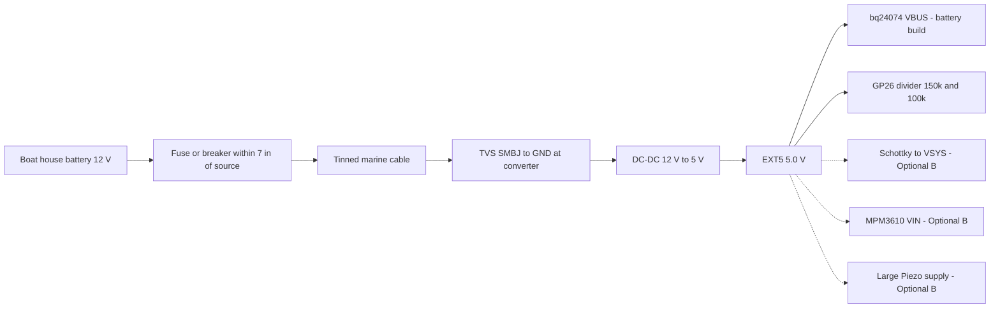
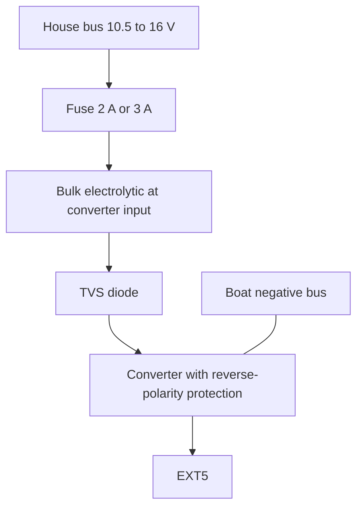

# Marine 12 V → 5 V supply and input protection — datasheet & integration notes

> Part: regulated boat-to-5 V DC-DC converter (candidates Pololu D36V28F5, Pololu D24V22F5, Mean Well DDR-15G-5) plus fuse, TVS and wiring · Role in project: creates EXT5 from the boat house battery · Configuration: both (feeds bq24074 in battery build; feeds diode, MPM3610 and sounder directly in Optional B)

## 1. Overview

The build guide requires a "regulated boat-to-5 V supply" with "appropriate input/transient/thermal rating and fuse", and warns never to feed boat voltage directly to Pico VSYS or 5 V peripherals [1]. A nominal 12 V boat system actually spans roughly 10.5–14.8 V in normal operation, up to ≈16 V during flooded-battery equalisation, with fast transients when loads or alternators are switched [2][3]. This file defines the input range the converter must handle, compares three candidate converters, and specifies fuse, TVS, reverse-polarity and wiring practice.

## 2. Key specifications

### Boat-side environment

| Parameter | Value | Source |
|---|---|---|
| Lead-acid/AGM absorption voltage | 14.4 V typical; up to 14.8 V for some deep-cycle batteries | [2] |
| Float voltage | 13.5–13.8 V | [2] |
| Equalisation (flooded only) | 15.8–16 V | [2] |
| Automotive normal operating range (reference) | 9–16 V | [3] |
| Jump-start (automotive reference) | up to 24 V for ≈1 min | [3] |
| Load dump ISO 16750-2, 12 V system, unsuppressed | Us 79–101 V, td 40–400 ms, Ri 0.5–4 Ω | [3][4] |
| ISO 7637-2 pulse 1 / pulse 2a (12 V) | ≈−100 V / ≈+50 V (class-dependent) | [3] |

ISO 16750/7637 are automotive standards; they are used here as a conservative reference because no marine equivalent was found for small electronics (see §7).

### Candidate converters

| Parameter | Pololu D36V28F5 | Pololu D24V22F5 | Mean Well DDR-15G-5 |
|---|---|---|---|
| Input range | 5.3–50 V | VOUT + dropout to 36 V | 9–36 V (on ≥9 V, off ≤8.5 V) |
| Output | 5 V ±4 % | 5 V ±4 % | 5 V, adjustable 4.5–5.5 V, ±2 % |
| Continuous output current | 2.5–4 A typ (input-dependent) | 1.4–2.6 A typ | 3 A (15 W) |
| Efficiency | 80–90 % typ | 85–95 % typ | 84 % typ |
| No-load quiescent | 2–3 mA typ | ≈1 mA typ | not specified — **unverified, measure** |
| Disabled (EN low) | 10–20 µA per volt of VIN | 5–10 µA per volt of VIN | no EN input |
| Reverse-polarity protection | integrated, up to 40 V | integrated | internal MOSFET, auto-recovering |
| Other protection | OCP, short-circuit, output UV/OV, thermal shutdown, soft-start | OCP, short-circuit, thermal, soft-start | OVP 5.75–7 V (latch, re-power), overload 110–150 % (hiccup), UVLO |
| Power-good output | yes, open-drain | yes, open-drain | no |
| Isolation | none (common ground) | none | 4 kVdc input–output |
| Operating temperature | not stated on page | not stated on page | −40 to +85 °C (with derating) |
| Mounting | 17.8 × 20.3 mm PCB, M2 holes | 17.8 × 17.8 mm PCB | DIN rail, 17.5 × 90 × 54.5 mm |
| Source | [5] | [6] | [7] |

## 3. Pinout / connections

| Candidate | Pins |
|---|---|
| D36V28F5 | VIN, GND, GND, VOUT, EN (100 kΩ pull-up to VIN), PG [5] |
| D24V22F5 | VIN, GND, VOUT, EN (270 kΩ pull-up to protected VIN), PG, extra GND [6] |
| DDR-15G-5 | +Vin, −Vin, +Vout, −Vout screw terminals, output trim pot [7] |

## 4. Wiring in this project

| Point | Net | Connects to |
|---|---|---|
| Boat + via fuse at source | BOAT12 | Distribution panel breaker or fuse block |
| TVS cathode / converter VIN | BOAT12F | After fuse; TVS to GND at converter input |
| Converter VOUT | EXT5 | bq24074 VBUS pad and GP26 divider top (battery build); diode anode, MPM3610 VIN, sounder (Optional B) [1] |
| Converter GND | GND | Common ground with all boards [1] |

### EXT5 current budget

| Configuration | Load on EXT5 | Value | Basis |
|---|---|---|---|
| Battery build | bq24074 input, limited by ILIM | ≤1.5 A design limit (RILIM ≥1.1 kΩ) | per guide; calculated from TI KILIM [8] |
| Battery build | GP26 divider | 5.0 V / 250 kΩ = 20 µA | calculated [1] |
| Optional B | Pico 2 W via diode | **unverified — measure peak during Wi-Fi TX** | — |
| Optional B | MPM3610 input (GPS, e-paper, buzzer) | **unverified — measure peak during e-paper refresh** | — |
| Optional B | Large Piezo at 5 V | **unverified — measure**; 12 V option ≈40 mA at 12 V (≈0.1 A from 5 V via boost, estimate) | [1] |

**Recommendation:** size EXT5 for ≥2 A continuous to cover the configured charger input limit (≤1.5 A after the required RILIM change) plus system load [8]. All three candidates meet this at 12–14.8 V input [5][6][7].

## 5. Power requirements & consumption

| Condition | Boat-side current at 12.8 V | Basis |
|---|---|---|
| D24V22F5 no load | ≈1 mA | [6] |
| D36V28F5 no load | 2–3 mA | [5] |
| DDR-15G-5 no load | unverified | [7] |
| 5 V × 1.6 A (charging + load) at 85 % | ≈0.74 A | estimate |
| 5 V × 2 A at 85 % | ≈0.92 A | estimate |
| 5 V × 3 A at 84 % | ≈1.4 A | estimate from [7] |

Boat-side draw is small compared with typical house-bank capacity, but the alarm is continuously on; include it in the boat's overnight energy budget.

## 6. Programming / configuration

- **D36V28F5 / D24V22F5:** leave EN unconnected (enabled by default) [5][6]. EN can implement a low-VIN cutoff with a divider from VIN (D36V28: thresholds 1.2 V falling / 1.35 V rising) to avoid flattening the house bank — optional [5].
- **DDR-15G-5:** set trim pot to 5.0 V at the bq24074 input (do not set above 5.25 V without reviewing downstream ratings; Pico VSYS max 5.5 V in Optional B) [7][9].
- **PG pins** (Pololu) are open-drain; could feed a Pico GPIO with pull-up to 3.3 V as an "EXT5 good" signal, but the build guide already uses the GP26 divider [1][5].

## 7. Design notes, limits & gotchas

- **Load dump exceeds every candidate's rating.** 79–101 V unsuppressed load dump [3][4] is above 50 V (D36V28) and 36 V (D24V22, DDR). Boats usually keep the battery connected to the alternator, but switching the battery selector while charging can cause a load-dump-like event — unverified for a given installation. Confirm the vessel's alternator/battery protection or qualify additional series/pre-regulator protection for the installation; do not assume a TVS alone handles a sustained load dump.
- **TVS selection** (Vishay SMBJ, 600 W 10/1000 µs) [10]:
  - For D24V22F5 / DDR-15G-5 (36 V max): **SMBJ18A** — VWM 18 V, VBR 20.0 V min, VC 29.2 V at 20.5 A.
  - For D36V28F5 (50 V max): **SMBJ24A** — VWM 24 V, VBR 26.7 V min, VC 38.9 V at 15.4 A; also does not conduct during 24 V jump-start.
  - VWM must stay above the highest normal bus voltage (≈16 V equalisation) [2]. A 600 W SMB TVS is for short transients (ISO 7637 type), not a full 400 ms load dump — estimate.
- **Reverse polarity:** all three candidates include it [5][6][7]; the TVS is unidirectional, so a reversed supply forward-biases it and blows the fuse — acceptable fail-safe behaviour.
- **Fuse sizing:** fuse protects the wire. Converter input ≈0.9 A at 2 A output (estimate, §5) → **2 A** fuse for D24V22F5; **3 A** for D36V28F5 / DDR-15G-5 to cover start-up inrush (DDR inrush listed as 15 A typ at 24 V input — figure parsed from spec table, verify) [7]. Use slow-blow/ATO type; wire ampacity must exceed fuse rating [11].
- **ABYC E-11 practice** (summarised from secondary sources; the standard is paywalled — verify against the current edition) [11]:
  - Overcurrent protection within 7 in (≈18 cm) of the power source connection.
  - Voltage drop ≤3 % for critical circuits (treat the anchor alarm as critical): ≤0.38 V at 12.8 V.
  - Use marine-grade, finely stranded tinned copper (UL 1426 type) wire.
  - Example: 1 A over 10 m round trip in 16 AWG (≈13 mΩ/m) drops ≈0.13 V — well inside 3 % (estimate).
- **Long input leads** can cause LC voltage spikes on hot-plug that exceed a converter's rating; Pololu recommends adding an electrolytic capacitor near the input (≥33 µF class, unverified value for these boards) [12].
- **Isolation:** DDR-15G-5 is isolated, so EXT5 ground is not tied to boat negative unless you connect it; tie −Vout to the common GND per the build guide and decide whether to bond to boat negative [1][7].
- **Enclosure heat:** Pololu boards can get hot enough to burn at full load [5]; derate for sun-heated enclosures.
- **Optional B** has no backup: a breaker trip removes all monitoring [1].

## 8. Bring-up / test checklist

1. Bench-test the converter from a current-limited lab supply at 10.5, 12.8, 14.8 and 16 V; confirm 4.9–5.1 V out at no load and at 2 A.
2. Measure no-load input current at 12.8 V.
3. Reverse-polarity test at 12 V with a 0.5 A current limit (converter must survive; fuse/TVS path checked separately).
4. Fit fuse within 7 in of the source; measure loop resistance and voltage drop at 1 A.
5. Connect EXT5 to the bq24074 VBUS pad; confirm EXT5 ≥4.9 V while charging at the configured input limit (≤1.5 A) plus full system load.
6. Engine start/stop and alternator on/off: scope EXT5 and the converter input for dips/spikes.
7. Check converter temperature after 1 h at the maximum observed load inside the closed enclosure.

## 9. References

1. Project build guide — docs/pico_2_w_anchor_alarm_build_guide_v2.md, sections 4–5, Optional A and Optional B
2. Victron Energy community/manual material on 12 V lead-acid/AGM absorption, float and equalisation voltages — https://www.victronenergy.com/media/pg/Manual_BlueSolar_100-30__100-50/en/operation.html ; https://communityarchive.victronenergy.com/questions/311178/agm-charging-regime.html
3. Texas Instruments, application brief SNOAAA1 (automotive transient overview, ISO 7637-2 / ISO 16750-2) — https://www.ti.com/document-viewer/lit/html/snoaaa1
4. Vishay, "Load dump protection: Old vs. new ISO standards" — https://www.vishay.com/docs/49748/49748.pdf
5. Pololu, "5V, 3.2A Step-Down Voltage Regulator D36V28F5", item 3782 — https://www.pololu.com/product/3782
6. Pololu, "5V, 2.5A Step-Down Voltage Regulator D24V22F5", item 2858 — https://www.pololu.com/product/2858
7. Mean Well, DDR-15 series specification (DDR-15G-5) — https://www.meanwell.com/Upload/PDF/DDR-15/DDR-15-SPEC.PDF
8. Texas Instruments, bq24074 datasheet (SLUS810N), KILIM — https://www.ti.com/lit/ds/symlink/bq24074.pdf ; Adafruit-BQ24074-PCB schematic — https://github.com/adafruit/Adafruit-BQ24074-PCB
9. Raspberry Pi Ltd, "Raspberry Pi Pico 2 W Datasheet" (RP-008304-DS) — https://pip.raspberrypi.com/documents/RP-008304-DS
10. Vishay, "SMBJ5.0A thru SMBJ188A Surface-Mount TRANSZORB Transient Voltage Suppressors" (doc 88392) — https://www.vishay.com/docs/88392/smbj.pdf
11. ABYC E-11 "AC and DC Electrical Systems on Boats" summaries: Marine Power Lab — https://marinepowerlab.com/marine-wire-sizing-abyc-awg-guide/ ; BoatHowTo ampacity tables — https://boathowto.com/electrics/abyc-ampacity-tables/ (primary standard: https://abycinc.org)
12. Pololu, "Understanding Destructive LC Voltage Spikes" — https://www.pololu.com/docs/0J16
