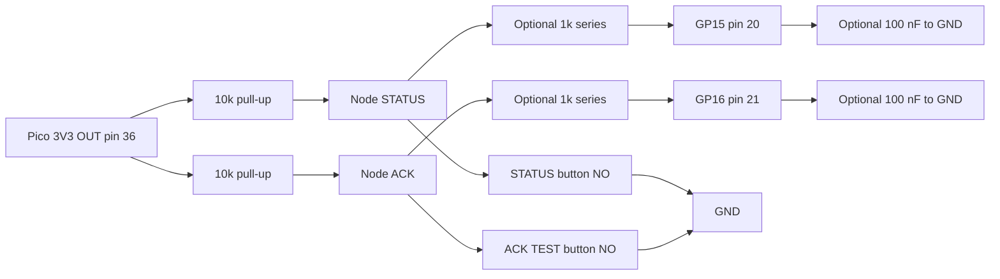

# Momentary pushbuttons (STATUS and ACK/TEST) — datasheet & integration notes

> Part: 2 × normally-open momentary panel pushbuttons (recommended: IP67 stainless anti-vandal, e.g. Schurter MSM 16; alternatives E-Switch PV6 IP65, Adafruit 559 / 1445) · Role in project: STATUS (GP15) and ACK/TEST (GP16) user inputs · Configuration: Both

## 1. Overview

Two normally-open (NO) momentary buttons switch GP15 (STATUS, pin 20) and GP16 (ACK/TEST, pin 21) to GND, each with an external 10 kΩ pull-up to the Pico 3V3 OUT (pin 36) [8]. Firmware debounces for 30–50 ms and distinguishes short taps from long holds: ACK tap = bounded silence (e.g. 60 s), STATUS hold ≈ 3 s = Wi-Fi setup, ACK hold while quiet = sounder test; a release is required after a long press [8]. For a cockpit/companionway location the switch should be sealed (IP67 front) and corrosion resistant.

## 2. Key specifications

| Parameter | Schurter MSM 16 (IP67 version) [1] | E-Switch PV6 [2] | Adafruit 559 (16 mm metal, LED ring) [3] | Adafruit 1445 / 1505 (16 mm plastic) [4] |
|---|---|---|---|---|
| Mounting hole | 16 mm | 16 mm (M16 × 1.0 thread) | 16 mm | 16 mm |
| Function | Momentary, SPDT microswitch (use NO) | SPST Off-(On) | Momentary, 1 NO + 1 NC | Momentary NO |
| Front sealing | IP67 front to contact area; microswitch IP40 or IP67 optional | IP65 | Rubber gasket "to keep water out"; no IP rating stated | No IP rating stated |
| Contact rating (low-level option) | Au micro switch 0.1 A / 30 VDC | 2 A / 48 VDC | 3 A / 250 VDC (per listing) | unverified |
| Contact resistance | < 50 mΩ (Au) | 50 mΩ | < 50 mΩ | unverified |
| Bounce | < 5 ms | unverified | unverified | unverified |
| Actuating force / travel | 4.5 N / 1.0 mm | unverified | unverified | unverified |
| Mechanical life | 1.5 M operations | 1 M | > 500 k | unverified |
| Electrical life | 0.2 M at rated load | 50 k | > 50 k | unverified |
| Operating temperature | −25 to +85 °C | −20 to +55 °C | −20 to +55 °C | unverified |
| Material | Stainless steel housing and actuator, NBR70 seal | Brass nickel or stainless option | Chrome-plated brass | Plastic |
| Vandal resistance | IK10 (non-illuminated), IK07 (ring-illuminated) | unverified | — | — |
| Salt spray | 24 / 48 / 96 h (DIN 50021-SS) | unverified | unverified | unverified |
| Panel thickness | unverified | 1–10 mm | 1–13 mm | unverified |
| Termination | Flat-pin (quick-connect) | Solder lug or optional 300 mm wire leads | Solder lugs | Solder lugs |

Recommendation: **Schurter MSM 16 with the IP67 microswitch and gold (Au) contacts** for marine exposure (choose the exact order code with IP67 switching unit; the base product lists IP40 switching unit as standard) [1]. E-Switch PV6 is a lower-cost IP65 option for sheltered locations [2]. Adafruit 559/1445 are suitable for bench prototypes or fully enclosed mounting only [3][4].

> ⚠️ Discrepancy with build guide: the guide's shopping list links Adafruit's general buttons category (155) without an IP rating [8]. For exterior or cockpit mounting, specify IP67 front sealing explicitly. APEM AV-series and other IP67 anti-vandal switches exist but were not verified against a primary datasheet here — unverified; check the exact part-number datasheet.

> Note on contacts: with a 10 kΩ pull-up the contact carries only 0.33 mA; silver contacts rated for amps can oxidise at such dry-circuit currents. Prefer gold-plated (Au) contacts for low-level signals [1].

## 3. Pinout / connections

| Terminal | Use |
|---|---|
| C / COM | to GND |
| NO | to GPIO (GP15 or GP16) and pull-up |
| NC | not used |
| LED +/− (if illuminated) | not used, or driven separately via resistor (not in guide) |

## 4. Wiring in this project

| Button | Pico GPIO | Physical pin | Pull-up | Other side |
|---|---|---|---|---|
| STATUS | GP15 | 20 | 10 kΩ to 3V3 OUT pin 36 | GND (e.g. pin 18 or 23) |
| ACK/TEST | GP16 | 21 | 10 kΩ to 3V3 OUT pin 36 | GND |

Optional RC filter (per button, proposal): 1 kΩ series resistor between the switch node and the GPIO, plus 100 nF from GPIO to GND. With the switch open the capacitor charges through 10 kΩ + 1 kΩ (τ ≈ 1.1 ms); on press it discharges through 1 kΩ (τ = 0.1 ms). This filters ESD and long-lead noise; firmware debounce is still used. The 1 kΩ also limits ESD/fault current into the pad.



## 5. Power requirements & consumption

| State | Current per button | Basis |
|---|---|---|
| Released | ≈ 0 (pad leakage only) | estimate |
| Pressed | 3.3 V / 10 kΩ = 0.33 mA | estimate (Ohm's law) |
| Stuck pressed (fault) | 0.33 mA continuous | estimate; firmware should flag a stuck button |
| Illuminated variants | LED current extra; not used in guide | — |

## 6. Programming / configuration

GPIO IRQ on both edges, timestamped; a periodic poll (10 ms) applies a 40 ms debounce and long-press detection. The IRQ wakes the logic quickly; the poll makes debounce deterministic.

```c
#include "pico/stdlib.h"
#include "hardware/gpio.h"

#define BTN_STATUS_PIN 15
#define BTN_ACK_PIN    16
#define DEBOUNCE_MS    40
#define LONG_PRESS_MS  3000

typedef enum { BTN_EVT_NONE, BTN_EVT_SHORT, BTN_EVT_LONG } btn_evt_t;

typedef struct {
    uint     pin;
    volatile uint32_t last_edge_ms;
    bool     stable_pressed;
    uint32_t press_start_ms;
    bool     long_reported;
    volatile btn_evt_t evt;
} button_t;

static button_t buttons[2] = {
    { .pin = BTN_STATUS_PIN },
    { .pin = BTN_ACK_PIN },
};

static void gpio_cb(uint gpio, uint32_t events) {
    (void)events;
    uint32_t now = to_ms_since_boot(get_absolute_time());
    for (int i = 0; i < 2; i++) {
        if (buttons[i].pin == gpio) buttons[i].last_edge_ms = now;
    }
}

static bool poll_cb(repeating_timer_t *t) {
    (void)t;
    uint32_t now = to_ms_since_boot(get_absolute_time());
    for (int i = 0; i < 2; i++) {
        button_t *b = &buttons[i];
        bool raw_pressed = !gpio_get(b->pin);           // active low
        if ((now - b->last_edge_ms) < DEBOUNCE_MS) continue;

        if (raw_pressed && !b->stable_pressed) {
            b->stable_pressed = true;
            b->press_start_ms = now;
            b->long_reported = false;
        } else if (!raw_pressed && b->stable_pressed) {
            b->stable_pressed = false;
            if (!b->long_reported) b->evt = BTN_EVT_SHORT;
            // after a long press, release only re-arms the button
        } else if (raw_pressed && !b->long_reported &&
                   (now - b->press_start_ms) >= LONG_PRESS_MS) {
            b->long_reported = true;
            b->evt = BTN_EVT_LONG;
        }
    }
    return true;
}

static repeating_timer_t poll_timer;

void buttons_init(void) {
    for (int i = 0; i < 2; i++) {
        uint p = buttons[i].pin;
        gpio_init(p);
        gpio_set_dir(p, GPIO_IN);
        gpio_disable_pulls(p);                         // external 10k pull-ups
        gpio_set_input_hysteresis_enabled(p, true);
    }
    gpio_set_irq_enabled_with_callback(BTN_STATUS_PIN,
        GPIO_IRQ_EDGE_FALL | GPIO_IRQ_EDGE_RISE, true, &gpio_cb);
    gpio_set_irq_enabled(BTN_ACK_PIN,
        GPIO_IRQ_EDGE_FALL | GPIO_IRQ_EDGE_RISE, true);
    add_repeating_timer_ms(10, poll_cb, NULL, &poll_timer);
}

btn_evt_t button_take_event(int idx) {
    btn_evt_t e = buttons[idx].evt;
    buttons[idx].evt = BTN_EVT_NONE;
    return e;
}

int main(void) {
    stdio_init_all();
    buttons_init();
    while (true) {
        btn_evt_t s = button_take_event(0);
        btn_evt_t a = button_take_event(1);
        if (s == BTN_EVT_LONG)  { /* enter Wi-Fi setup */ }
        if (s == BTN_EVT_SHORT) { /* show status */ }
        if (a == BTN_EVT_SHORT) { /* bounded silence, e.g. 60 s */ }
        if (a == BTN_EVT_LONG)  { /* sounder test if no alarm active */ }
        sleep_ms(5);
    }
}
```

`button_take_event` has a benign race with the timer callback; for production, disable the timer IRQ or use `save_and_disable_interrupts()` around the read-and-clear.

## 7. Design notes, limits & gotchas

- Pull-ups go to **3V3 OUT pin 36**, not PERIPH3V3, so buttons work even if the peripheral rail is off [8].
- Internal pull-ups are not relied on; disable them so the external 10 kΩ sets the level [8].
- RP2350-E9 affects pull-**downs**; pull-up wiring here is not affected [5][6].
- Debounce 30–50 ms per guide [8]; Schurter specifies bounce < 5 ms [1], so 40 ms gives large margin against aged contacts.
- Require release after long press so a held ACK cannot repeatedly re-silence an alarm [8].
- Stuck-button detection: if a button reads pressed for > 30 s, ignore it and flag a fault (proposal).
- Long leads (> 1 m) to a cockpit panel: use twisted pair with GND, add the RC filter, and consider a TVS (e.g., 3.3 V ESD diode) at the Pico end (proposal).
- Seal the panel: use the switch's O-ring on the outside face, tighten nut to the manufacturer torque (MSM: ≤ 2 Nm plastic nut, ≤ 10 Nm stainless nut) [1].
- Gold contacts for dry-circuit currents; silver-contact power switches may become intermittent [1].
- UV: stainless/brass bodies are UV-stable; plastic actuators (Adafruit 1445) may chalk in sunlight (general practice).

## 8. Bring-up / test checklist

1. With power off, check continuity: NO–COM open when released, closed when pressed.
2. Power on; measure GP15 and GP16 ≈ 3.3 V released, < 0.2 V pressed.
3. Run the snippet; tap each button 20 times quickly; confirm exactly one SHORT event per tap.
4. Hold STATUS 3 s; confirm a single LONG event and no SHORT on release.
5. Hold ACK while an alarm sounds; confirm silence logic follows the guide (bounded silence).
6. Spray / splash test of the mounted panel; confirm no false presses.
7. If the RC filter is fitted, confirm presses still register (edge times < 1 ms on a scope).

## 9. References

1. Schurter, MSM 16 metal line switch datasheet (distributor mirror of Schurter typ_msm_16.pdf) — https://res.cloudinary.com/fastron-electronics/image/upload/v1660887023/Schurter%20Datasheets/typ_msm_16.pdf ; product family page https://www.schurter.com
2. E-Switch, PV6 series anti-vandal switch datasheet — https://dev.e-switch.com/wp-content/uploads/2022/06/PV6.pdf
3. Adafruit, "Rugged Metal Pushbutton with Red LED Ring - 16mm Red Momentary", product 559 — https://www.adafruit.com/product/559
4. Adafruit, "16mm Panel Mount Momentary Pushbutton" product 1445 (red) / 1505 (black) — https://www.adafruit.com/product/1445
5. Adafruit, "Raspberry Pi RP2350 erratum workarounds" — https://learn.adafruit.com/key-pad-matrix-scanning-in-circuitpython/raspberry-pi-rp2350-erratum-workarounds
6. Raspberry Pi pico-feedback issue #401 — https://github.com/raspberrypi/pico-feedback/issues/401
7. Raspberry Pi, Pico C/C++ SDK `hardware_gpio` documentation — https://www.raspberrypi.com/documentation/pico-sdk/hardware.html#group_hardware_gpio
8. Project build guide, `docs/pico_2_w_anchor_alarm_build_guide_v2.md` (GPIO map, buttons, firmware behaviour)
