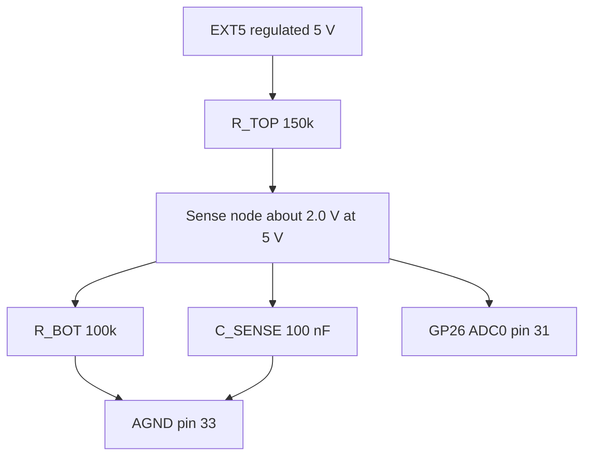

# Passive components and general hardware — datasheet & integration notes

> Part: resistors, capacitors, enclosure, cable glands, vents, coating, marine wire · Role in project: pull-ups, EXT5 sense divider, decoupling, MOSFET gate network, mechanical/environmental protection · Configuration: Both (EXT5 sense divider: wherever EXT5 exists; gate network: Optional A)

## 1. Overview

This file collects the passive parts called out in the build guide and the general hardware needed to make the unit survive a boat environment [1]. The key analog item is the EXT5 sense divider (150 kΩ / 100 kΩ into GP26/ADC0) that lets firmware detect loss of the external 5 V supply [1]. Mechanical items cover the enclosure, sound opening, vent, antenna placement, conformal coating and wire.

## 2. Key specifications

### Bill of passives (from build guide [1])

| Ref (suggested) | Value | Qty | Where | Suggested type |
|---|---|---|---|---|
| R_BTN1, R_BTN2 | 10 kΩ | 2 | Pull-ups GP15, GP16 → 3V3 OUT pin 36 | 1 %, 0.125 W+, metal film or 0603/0805 thick film |
| R_CS | 100 kΩ | 1 | Display CS (GP9, pin 12) → PERIPH3V3 pull-up; TXB0108 requires >50 kΩ | as above |
| R_TOP | 150 kΩ | 1 | EXT5 → sense node | 1 % (0.1 % optional) |
| R_BOT | 100 kΩ | 1 | sense node → GND | 1 % |
| C_SENSE | 100 nF | 1 | sense node → GND (optional per guide) | X7R ceramic, ≥ 10 V |
| C_DEC | 100 nF | per IC/breakout as needed | Supply pins to GND, close to load | X7R ceramic, ≥ 10 V (≥ 25 V on 12 V rail) |
| R_G | 100–330 Ω (220 Ω) | 1 | GP17 → MOSFET gate | 1 %/5 % |
| R_PD | 6.8 kΩ ±5% | 1 | Gate → source; with R_G ≤330 Ω, GP17-to-ground remains <8.2 kΩ for RP2350 A2/E9 | 5 % |
| Optional R_F, C_F | 1 kΩ, 100 nF | 2 each | Button RC filter | see momentary-pushbuttons.md |

On RP2350 A2 silicon, erratum E9 can hold a weakly pulled-down GPIO near 2.1–2.2 V. The 6.8 kΩ ±5% gate pull-down and maximum 330 Ω series resistor keep the effective external pull-down at GP17 below the documented 8.2 kΩ limit, including tolerance. A verified unaffected stepping is an alternative [5][6]. See logic-level-n-mosfet-driver.md.

### EXT5 sense divider calculations

| Parameter | Value | Basis |
|---|---|---|
| Divider ratio | 100 / (150 + 100) = 0.400 | calculation |
| Node voltage at EXT5 = 5.00 V | 2.000 V | calculation (guide states "≈ 2 V") [1] |
| Node voltage at EXT5 = 5.20 V | 2.080 V | calculation |
| ADC counts at 5.00 V (12-bit, 3.30 V ref) | 2.000 / 3.30 × 4096 ≈ 2482 | calculation [2] |
| ADC counts at 5.20 V | ≈ 2582 | calculation |
| ADC full scale (4095) corresponds to EXT5 | 3.30 / 0.400 ≈ 8.25 V | calculation |
| Divider current at 5 V | 5.0 / 250 kΩ = 20 µA | calculation |
| Thevenin source impedance seen by ADC | 150 kΩ ∥ 100 kΩ = 60 kΩ | calculation |
| RC time constant with 100 nF | 60 kΩ × 100 nF = 6 ms | calculation |
| Error from 1 % resistors (worst case) | ≈ ±1.2 % of reading | estimate |
| RP2350 ADC resolution / inputs | 12-bit SAR, 500 kS/s, 4 inputs on GPIO26–29 (QFN-60) | [2] |
| Pico 2 W ADC reference | ADC_VREF from 3.3 V rail via on-board RC filter | [3] |

Role of the 100 nF: the ADC's sample-and-hold capacitor must charge through the source impedance during the short sample window; a 60 kΩ source alone may not settle fully and gives readings that depend on sample rate. The 100 nF acts as a local charge reservoir (charge sharing with a pF-class sample capacitor changes the node by far less than 1 LSB — estimate) and also low-pass filters noise. The penalty is a 6 ms response to real EXT5 changes, which is negligible for supply-loss detection.

Over-voltage: if EXT5 rose to 8.25 V the node would reach 3.3 V; above that the pad's protection diodes conduct, with current limited by 150 kΩ (e.g., 12 V on EXT5 → ≈ 1.6 V excess / 150 kΩ ≈ 10 µA into the clamp — estimate), which is benign.

## 3. Pinout / connections

| Net | Pico pin | Component |
|---|---|---|
| EXT5 | — | R_TOP top |
| EXT5_SENSE | GP26 / ADC0, pin 31 | R_TOP bottom, R_BOT top, C_SENSE |
| GND / AGND | pin 33 (AGND) or any GND | R_BOT bottom, C_SENSE |
| 3V3 OUT | pin 36 | R_BTN1, R_BTN2 tops |
| PERIPH3V3 / GP9 | pin 12 (GP9) | R_CS between GP9 display CS and PERIPH3V3 |
| GP17 | pin 22 | R_G |

## 4. Wiring in this project



Place R_BOT and C_SENSE next to the Pico pin; R_TOP can be at the EXT5 end so the long trace carries only the high-impedance 20 µA signal on the protected side (or vice versa — keep the node trace short).

## 5. Power requirements & consumption

| Item | Current | Basis |
|---|---|---|
| EXT5 divider | 20 µA at 5.0 V | calculation |
| Button pull-ups, pressed | 0.33 mA each | calculation |
| CS pull-up, CS asserted low | 33 µA (100 kΩ) | calculation |
| Gate pull-down while alarm on | ≈0.46 mA (6.8 kΩ + 220 Ω) | calculation |
| Decoupling capacitors | leakage only | estimate |

## 6. Programming / configuration

Read GP26/ADC0, convert to EXT5 volts, apply hysteresis:

```c
#include <stdio.h>
#include "pico/stdlib.h"
#include "hardware/adc.h"

#define EXT5_ADC_GPIO     26
#define EXT5_ADC_INPUT    0
#define ADC_VREF_V        3.30f
#define ADC_MAX_COUNTS    4096.0f
#define DIV_RATIO         (100.0f / (150.0f + 100.0f))   // 0.400
#define EXT5_PRESENT_V    4.50f   // rising threshold
#define EXT5_LOST_V       4.20f   // falling threshold
#define AVG_SAMPLES       16

static bool ext5_present = false;

void ext5_sense_init(void) {
    adc_init();
    adc_gpio_init(EXT5_ADC_GPIO);   // disables digital input buffer and pulls
    adc_select_input(EXT5_ADC_INPUT);
}

float ext5_read_volts(void) {
    uint32_t sum = 0;
    adc_select_input(EXT5_ADC_INPUT);
    (void)adc_read();               // discard first sample after mux change
    for (int i = 0; i < AVG_SAMPLES; i++) sum += adc_read();
    float counts = (float)sum / AVG_SAMPLES;
    float node_v = counts * ADC_VREF_V / ADC_MAX_COUNTS;
    return node_v / DIV_RATIO;
}

// Returns true when state changes.
bool ext5_update(float *volts_out) {
    float v = ext5_read_volts();
    bool prev = ext5_present;
    if (!ext5_present && v >= EXT5_PRESENT_V) ext5_present = true;
    else if (ext5_present && v <= EXT5_LOST_V) ext5_present = false;
    if (volts_out) *volts_out = v;
    return prev != ext5_present;
}

int main(void) {
    stdio_init_all();
    ext5_sense_init();
    while (true) {
        float v;
        if (ext5_update(&v)) {
            printf("EXT5 %s (%.2f V)\n", ext5_present ? "present" : "LOST", v);
        }
        sleep_ms(100);
    }
}
```

Thresholds as ADC counts (for integer-only code): 4.50 V → 1.800 V → ≈ 2234 counts; 4.20 V → 1.680 V → ≈ 2085 counts (calculation). Calibrate once against a meter to remove ADC_VREF and resistor tolerance.

## 7. Design notes, limits & gotchas

**Passives**
- Use 1 % resistors in the divider; hysteresis (300 mV here) absorbs remaining error and noise.
- ADC_VREF on Pico boards derives from the 3.3 V rail, so a sagging 3V3 shifts readings; for supply-loss detection this is acceptable [3].
- `adc_gpio_init()` disables the digital input buffer, which also avoids RP2350-E9 leakage effects on the ADC pin [5][7].
- Ceramic decoupling: X7R/X5R, voltage rating ≥ 2× working voltage to limit DC-bias capacitance loss (general practice).
- Avoid carbon-composition resistors in damp environments; thin/thick-film SMD or metal-film THT, then conformal coat.

**Enclosure and environment** (general marine practice; standards cited for definitions)
- IP rating: IP66 or IP67 enclosure for cockpit/deck; IP54 acceptable only for a dry cabin location. IP codes defined in IEC 60529 [8].
- UV: use UV-stabilised polycarbonate or ASA; standard ABS yellows and embrittles in sunlight.
- Condensation: a sealed box breathes with temperature cycles and accumulates water. Fit a hydrophobic ePTFE pressure-equalisation vent (e.g., Gore protective vent class, IP68-rated types exist [9]) on the lowest-risk face, and add a small desiccant pack.
- Mount glands and vents facing down or sideways; add drip loops on all cables.
- Sound opening: the Qwiic Buzzer is not sealed. Either mount it behind an acoustic membrane vent over a small port, or place it inside and rely on the IP68 external piezo (Optional A) for loudness [9][10]. A 3–5 mm port aligned with the buzzer sound hole gives the most SPL (estimate).
- Antenna mounting: the Pico 2 W Wi-Fi antenna is on the board edge; keep it away from metal, batteries and ground-plane copper and inside a non-metallic enclosure [4]. Mount an active GPS antenna on a metal ground plate (≥ 50–70 mm, per antenna vendor guidance — unverified for the specific antenna) with clear sky view.
- Conformal coating: acrylic (e.g., MG Chemicals 419 class) or silicone, masking connectors, buttons, the buzzer opening, the Pico's BOOTSEL button and the antenna area if the coating's RF effect is unknown [11].
- Wire: tinned stranded copper marine wire (UL 1426 / ABYC E-11 style) for all external runs; heat-shrink with adhesive lining on splices (general marine practice; not verified against the standards text).
- Fasteners: stainless (A4/316) screws; isolate dissimilar metals.

## 8. Bring-up / test checklist

1. Measure R_TOP and R_BOT before fitting; record values.
2. With EXT5 = 5.00 V (meter), measure node voltage: expect 2.00 V ± 1.5 %.
3. Run the ADC snippet; compare reported EXT5 with the meter; record the calibration factor.
4. Sweep EXT5 down from 5.0 V on a bench supply; confirm "LOST" near 4.2 V and "present" again near 4.5 V.
5. Remove EXT5 entirely; confirm node decays to 0 V and status shows LOST within < 0.2 s.
6. Verify each pull-up: GP15/GP16 read 1 when released.
7. Enclosure: hose/splash test with the unit powered; open and inspect for moisture after 24 h.
8. Check Wi-Fi RSSI and GPS C/N0 with the lid closed versus open.

## 9. References

1. Project build guide, `docs/pico_2_w_anchor_alarm_build_guide_v2.md` (EXT5 sense, buttons, GP17 network)
2. Raspberry Pi, RP2350 datasheet (ADC chapter) — https://datasheets.raspberrypi.com/rp2350/rp2350-datasheet.pdf
3. Raspberry Pi, Pico 2 datasheet (ADC_VREF filtering, pin 35) — https://datasheets.raspberrypi.com/pico/pico-2-datasheet.pdf
4. Raspberry Pi, Pico 2 W datasheet (antenna keep-out) — https://pip.raspberrypi.com/documents/RP-008304-DS
5. Adafruit, "Raspberry Pi RP2350 erratum workarounds" — https://learn.adafruit.com/key-pad-matrix-scanning-in-circuitpython/raspberry-pi-rp2350-erratum-workarounds
6. CNX Software, RP2350 A4 stepping fixes E9 — https://www.cnx-software.com/2025/07/29/raspberry-pi-rp2350-a4-stepping-fixes-e9-gpio-erratum-9-glitching-bugs-introduces-2mb-flash-variants/
7. Raspberry Pi, Pico SDK `hardware_adc` documentation — https://www.raspberrypi.com/documentation/pico-sdk/hardware.html#group_hardware_adc
8. IEC 60529 overview of IP codes — https://www.iec.ch/ip-ratings
9. W. L. Gore & Associates, protective vents — https://www.gore.com/products/categories/venting
10. Challenge Electronics, CED-ME516AQSW datasheet (IP68 alarm) — http://cdn.sparkfun.com/datasheets/Components/General/CED-ME516AQSW.pdf
11. MG Chemicals, 419D acrylic conformal coating — https://mgchemicals.com/products/conformal-coatings/acrylic-conformal-coatings/
