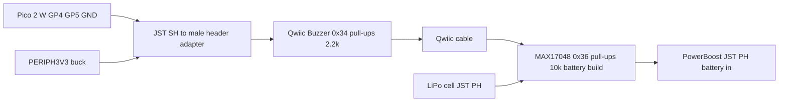

# Qwiic / STEMMA QT cables, connectors and wiring hardware — datasheet & integration notes

> Part: JST SH 1.0 mm 4-pin (Qwiic / STEMMA QT) cables and flying-lead adapters; JST PH 2.0 mm 2-pin battery connector; terminal blocks; hook-up wire · Role in project: I2C0 interconnect (Qwiic Buzzer, MAX17048), battery lead, 5 V distribution · Configuration: Both (battery connector and MAX17048 branch: Battery-backed only)

## 1. Overview

The Pico 2 W has no Qwiic connector, so a JST SH 4-pin to male-header (flying-lead) cable connects GP4/GP5, PERIPH3V3 and GND to the Qwiic chain [1][2][8]. Qwiic and STEMMA QT use the same JST SH 1.0 mm 4-pin connector and pin order [1][2]. This file also covers I2C bus-capacitance limits, the combined pull-up value, the JST PH battery connector polarity, terminal blocks, wire gauge for the 5 V rail and strain relief.

## 2. Key specifications

| Parameter | Value | Source |
|---|---|---|
| Qwiic / STEMMA QT connector | JST SH, 1.0 mm pitch, 4-pin | [1][2] |
| Pin 1 / colour | GND, black | [2] |
| Pin 2 / colour | V+ (3.3 V for Qwiic), red | [1][2] |
| Pin 3 / colour | SDA, blue | [2] |
| Pin 4 / colour | SCL, yellow | [2] |
| Qwiic logic/supply level | 3.3 V | [1] |
| STEMMA QT supply | 3–5 V allowed on V+ (Adafruit) | [2] |
| JST SH current rating | 1 A (AWG 28) | [3] (via search summary of the JST datasheet; PDF not text-extractable) |
| JST SH voltage rating | 50 V AC/DC | [3] (as above) |
| JST SH wire range | AWG 32–28 | [3] (as above) |
| JST SH temperature | −25 to +85 °C | [3] (as above) |
| JST PH (battery) pitch | 2.0 mm | [4] |
| JST PH current / voltage rating | 2 A (AWG 24) / 100 V | [4] (via search summary; not retrieved directly) |
| JST PH wire range | AWG 30–24 | [4] (as above) |
| I2C max bus capacitance (Sm / Fm) | 400 pF | [5] |
| I2C rise time max, Standard-mode 100 kHz | 1000 ns | [5] |
| I2C rise time max, Fast-mode 400 kHz | 300 ns | [5] |
| I2C V_OL / sink, Sm/Fm | 0.4 V at 3 mA | [5] |
| Qwiic Buzzer pull-ups | 2.2 kΩ (SDA, SCL) | [6] |
| Adafruit MAX17048 pull-ups | 10 kΩ (SDA, SCL) | [7] |

## 3. Pinout / connections

Qwiic / STEMMA QT cable (looking at the cable, colours per convention [2]):

| Pin | Signal | Wire colour | Pico 2 W connection |
|---|---|---|---|
| 1 | GND | Black | GND, e.g. pin 8 |
| 2 | 3V3 | Red | PERIPH3V3 (not Pico 3V3 OUT pin 36) [8] |
| 3 | SDA | Blue | GP4, pin 6 [8] |
| 4 | SCL | Yellow | GP5, pin 7 [8] |

Flying-lead adapter: Adafruit 4209 "STEMMA QT / Qwiic JST SH 4-pin to Premium Male Headers Cable", ≈ 150 mm [2]. SparkFun sells equivalent Qwiic breadboard-jumper cables [1].

JST PH 2-pin battery lead (Adafruit convention): red = +, black = −; there is no industry-wide polarity standard and many third-party cells are reversed [7][9]. Always verify with a meter before connecting.

## 4. Wiring in this project

| Net | From | To | Wire |
|---|---|---|---|
| I2C0 SDA | Pico GP4 (pin 6) | Qwiic Buzzer SDA → MAX17048 SDA (daisy-chain) | Qwiic cable, blue |
| I2C0 SCL | Pico GP5 (pin 7) | Qwiic Buzzer SCL → MAX17048 SCL | Qwiic cable, yellow |
| PERIPH3V3 | MPM3610 output | Qwiic red | Qwiic cable, red |
| GND | Common GND | Qwiic black | Qwiic cable, black |
| VBAT | LiPo JST PH | MAX17048 JST PH (pass-through) → PowerBoost | JST PH lead [7][8] |
| EXT5 / SYS5 | Source | Loads via terminal block | 22–20 AWG tinned (see §5) |



### Pull-up combination

Pico 2 W has no on-board I2C pull-ups on GP4/GP5 [8]; the bus pull-up is the parallel combination of the breakout pull-ups:

- Buzzer only (Both configurations): R = 2.2 kΩ.
- Buzzer + MAX17048 (battery build): R = (2.2 × 10) / (2.2 + 10) = **1.80 kΩ** per line [6][7].
- Sink current at V_OL: (3.3 − 0.4) / 1.80 kΩ = **1.61 mA** < 3 mA limit [5].
- Minimum allowed pull-up at 3.3 V: (3.3 − 0.4) / 3 mA = 0.97 kΩ [5]. If more 2.2 kΩ boards are added (e.g., two → 1.1 kΩ, three → 0.73 kΩ), cut the "I2C" jumpers on all but one board [6].

### Cable length vs capacitance

Rise time (30 %→70 %) t_r ≈ 0.8473 × R_p × C_b [5]. With R_p = 1.80 kΩ:

| Bus speed | t_r max [5] | Max C_b at 1.8 kΩ | Notes |
|---|---|---|---|
| 100 kHz | 1000 ns | 656 pF → capped at 400 pF | spec limit governs |
| 400 kHz | 300 ns | 197 pF | — |

Typical ribbon/Qwiic cable capacitance is ≈ 50–100 pF/m line-to-ground (estimate; not measured), plus ≈ 10 pF per device pin (estimate). At 100 kHz, keep the total Qwiic run ≤ 1 m for comfortable margin; the guide's 100 kHz start speed is appropriate [8]. For runs of several metres use a differential I2C extender (e.g., SparkFun QwiicBus / PCA9615 class, unverified for this project).

## 5. Power requirements & consumption

Wire and connector current for the 5 V rail (estimate from component files): Pico + GPS + display + Qwiic Buzzer at volume 4 ≈ 0.4–0.6 A (unverified total; see power-budget file), plus ≈ 125 mA if the 12 V boost alarm is fitted.

| Copper | Resistance (20 °C) | Drop at 1 A over 1 m run (2 m loop) | Basis |
|---|---|---|---|
| 24 AWG | 84.2 mΩ/m | 0.17 V (3.4 % of 5 V) | estimate from standard AWG table [10] |
| 22 AWG | 52.9 mΩ/m | 0.11 V (2.1 %) | estimate [10] |
| 20 AWG | 33.3 mΩ/m | 0.07 V (1.3 %) | estimate [10] |
| 18 AWG | 20.9 mΩ/m | 0.04 V (0.8 %) | estimate [10] |

Recommendation: 20 AWG (0.5 mm²) tinned stranded for EXT5/SYS5 runs inside the enclosure; 18 AWG for the external 12 V feed to the 5 V regulator if > 1 m. Aim for ≤ 3 % drop on the alarm supply (common marine practice for critical circuits, ABYC E-11 — not verified against the standard text). Qwiic cables are 28 AWG class [3]; they carry only the ≈ 100 mA buzzer peak, well within 1 A.

## 6. Programming / configuration

I2C setup and a bus scan to verify cabling (Pico SDK):

```c
#include <stdio.h>
#include "pico/stdlib.h"
#include "hardware/i2c.h"

#define I2C_PORT i2c0
#define SDA_PIN  4
#define SCL_PIN  5

static bool reserved_addr(uint8_t a) { return (a & 0x78) == 0 || (a & 0x78) == 0x78; }

int main(void) {
    stdio_init_all();
    i2c_init(I2C_PORT, 100 * 1000);
    gpio_set_function(SDA_PIN, GPIO_FUNC_I2C);
    gpio_set_function(SCL_PIN, GPIO_FUNC_I2C);
    // External pull-ups on breakouts; do not enable internal pulls.
    gpio_disable_pulls(SDA_PIN);
    gpio_disable_pulls(SCL_PIN);

    sleep_ms(2000);
    // Idle bus check: both lines should read high with pull-ups present.
    gpio_set_function(SDA_PIN, GPIO_FUNC_SIO);
    gpio_set_function(SCL_PIN, GPIO_FUNC_SIO);
    gpio_set_dir(SDA_PIN, GPIO_IN);
    gpio_set_dir(SCL_PIN, GPIO_IN);
    printf("SDA=%d SCL=%d (expect 1 1)\n", gpio_get(SDA_PIN), gpio_get(SCL_PIN));
    gpio_set_function(SDA_PIN, GPIO_FUNC_I2C);
    gpio_set_function(SCL_PIN, GPIO_FUNC_I2C);

    for (uint8_t addr = 0x08; addr < 0x78; addr++) {
        if (reserved_addr(addr)) continue;
        uint8_t rx;
        int r = i2c_read_timeout_us(I2C_PORT, addr, &rx, 1, false, 2000);
        if (r >= 0) printf("found 0x%02X\n", addr);   // expect 0x34, and 0x36 in battery build
    }
    while (true) tight_loop_contents();
}
```

## 7. Design notes, limits & gotchas

- Qwiic V+ is **3.3 V**; feed it from PERIPH3V3, never from 5 V, because the Qwiic Buzzer's pull-ups go to its 3V3 pin and would put the bus above the RP2350's 3.3 V I/O level [1][6][8].
- JST SH connectors are friction-latched and rated for low mating cycles; avoid repeated plugging and secure the cable [3].
- Vibration: add a dab of neutral-cure silicone or hot-melt at the SH housing, and tie the cable to the board/standoff within 20–30 mm of each connector (strain relief, general practice).
- Do not run I2C lines alongside the boost converter inductor or the alarm leads.
- **JST PH polarity**: Adafruit/SparkFun use red + on the right when looking at the plug latch-up; many third-party cells are reversed — check with a meter; reversed connection can destroy charger boards [7][9].
- Terminal blocks: use pluggable or lever-type terminals rated for ≥ 2 A with ferrules on stranded wire; avoid tinning stranded wire ends that go into screw clamps (solder creeps and loosens — general practice). Specific part ratings: unverified.
- Marine wire: tinned stranded copper (e.g., UL 1426 / ABYC-compliant boat cable) resists wicking corrosion (general marine practice; not verified against the standards text).
- Strain relief at the enclosure: cable glands (IP68 rated) for external leads; drip loop below the gland.

## 8. Bring-up / test checklist

1. Before connecting: continuity-check the adapter colours against §3 (black GND, red 3V3, blue SDA, yellow SCL).
2. Measure resistance SDA→3V3 and SCL→3V3 with boards connected and unpowered: expect ≈ 2.2 kΩ (buzzer only) or ≈ 1.8 kΩ (with MAX17048).
3. Power PERIPH3V3; confirm red wire = 3.3 V, not 5 V.
4. Run the scan; confirm 0x34 (and 0x36 in battery build) and idle lines high.
5. Optional: scope SCL rise time at 100 kHz; confirm < 1000 ns (expect a few hundred ns).
6. Battery: meter the JST PH lead; confirm + matches the board's "+" marking before plugging.
7. Tug-test all terminal blocks and crimps; fit strain relief.

## 9. References

1. SparkFun, "Qwiic Connect System" — https://www.sparkfun.com/qwiic
2. Adafruit, "Adafruit STEMMA & STEMMA QT — Technical Specs" — https://learn.adafruit.com/introducing-adafruit-stemma-qt/technical-specs
3. JST, SH connector datasheet (eSH) — https://www.jst.com/wp-content/uploads/2021/01/eSH.pdf
4. JST, PH connector datasheet (ePH) — https://www.jst-mfg.com/product/pdf/eng/ePH.pdf
5. NXP, UM10204 "I2C-bus specification and user manual" — https://www.nxp.com/docs/en/user-guide/UM10204.pdf
6. SparkFun Qwiic Buzzer schematic v10 — https://docs.sparkfun.com/SparkFun_Qwiic_Buzzer/assets/board_files/SparkFun_Qwiic_Buzzer_Schematic_V10.pdf
7. Adafruit, MAX17048 pinouts — https://learn.adafruit.com/adafruit-max17048-lipoly-liion-fuel-gauge-and-battery-monitor/pinouts
8. Project build guide, `docs/pico_2_w_anchor_alarm_build_guide_v2.md`; Raspberry Pi Pico 2 W datasheet — https://pip.raspberrypi.com/documents/RP-008304-DS
9. Adafruit forums, "Is LIPO battery polarity correct?" — https://forums.adafruit.com/viewtopic.php?t=157621
10. Engineering ToolBox, "AWG — American Wire Gauge" (resistance per length) — https://www.engineeringtoolbox.com/awg-wire-gauge-d_731.html
