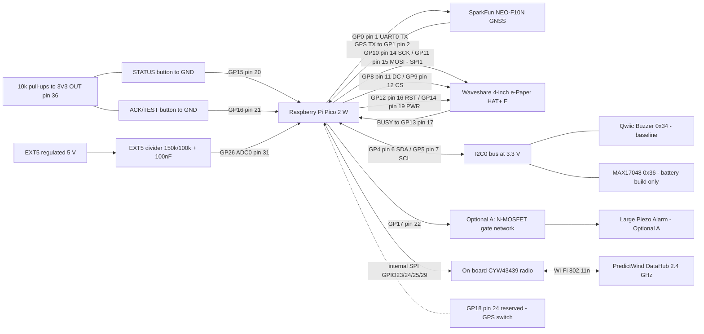
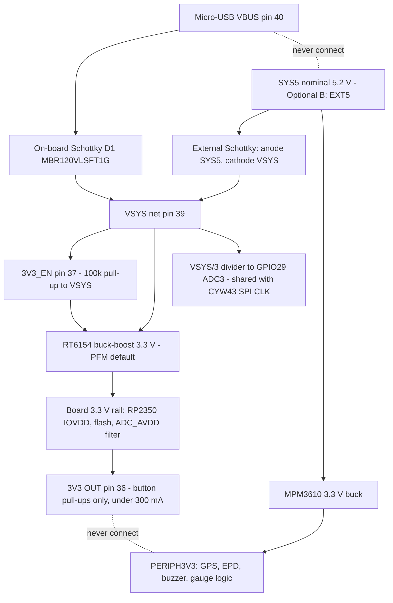

# Raspberry Pi Pico 2 W — datasheet & integration notes

> Part: Raspberry Pi Ltd — Raspberry Pi Pico 2 W (RP2350A + Infineon CYW43439) · Role in project: main controller — GNSS, display, I2C, buttons, EXT5 sensing, alarm logic and DataHub Wi-Fi · Configuration: Both (battery-backed baseline and Optional B; Optional A uses GP17)

## 1. Overview

Pico 2 W is a 51 mm × 21 mm × 1 mm board built around the RP2350 microcontroller with 4 MB QSPI flash, a micro-USB port, an RT6154 buck-boost regulator and an on-board 2.4 GHz Infineon CYW43439 Wi-Fi 4 / Bluetooth 5.2 radio with a licensed Abracon chip antenna [1][4]. It exposes 26 GPIO at a fixed 3.3 V. Three of them, GP26–GP28, can also be used as ADC inputs [1].

In Moorpheus it replaces the XIAO ESP32C3. The board is powered through **VSYS (pin 39)** from SYS5 (battery build) or EXT5 (Optional B) via an external Schottky diode. All peripherals connect directly to GPIO; there is no MCP23017. Firmware targets the Pico SDK with `PICO_BOARD=pico2_w` and CYW43/lwIP networking [15].

The RP2350 has two Arm Cortex-M33 or two Hazard3 RISC-V cores at up to 150 MHz, 520 kB SRAM, 2 × UART, 2 × I2C, 2 × SPI, 16 PWM channels, 3 PIO blocks, a 12-bit 500 ksps ADC and an always-on (AON) timer [1].

> Raspberry Pi states its products are not designed or intended for safety-critical applications [1]. This matches the build guide's position that Moorpheus is a prototype aid, not a certified anchor-watch system [15].

## 2. Key specifications

| Parameter | Value | Source |
|---|---|---|
| MCU | RP2350 (dual Cortex-M33 or Hazard3 RISC-V), up to 150 MHz | [1] |
| SRAM / flash | 520 kB SRAM / 4 MB QSPI flash | [1][4][8] |
| Wireless | CYW43439, 802.11n single-band 2.4 GHz, WPA3, SoftAP up to 4 clients, Bluetooth 5.2 (LE central/peripheral and Classic) | [1] |
| RP2350 ↔ CYW43439 link | SPI, typically 33 MHz; shares pins with the VSYS monitor | [1][4] |
| User GPIO | 26 on header; GP0–GP22 digital only; GP26–GP28 digital or ADC | [1] |
| GPIO voltage | Fixed 3.3 V (IOVDD from on-board SMPS) | [1] |
| VSYS input | 1.8 V min, 5.5 V max | [1] |
| VBUS input | 5 V ± 10 % | [1] |
| 3V3 OUT external load | Recommended < 300 mA. The actual limit depends on RP2350 load and VSYS | [1] |
| 3V3_EN | 100 kΩ pull-up to VSYS; pull low to disable SMPS and RP2350 | [1] |
| RUN | Internal pull-up to 3.3 V of about 50 kΩ; pull low to reset | [1] |
| Regulator | Richtek RT6154 buck-boost; PFM by default (PS=0), PWM when WL_GPIO1 is high | [1] |
| VBUS→VSYS diode | On-board Schottky D1 (MBR120VLSFT1G) | [1] |
| ADC | 12-bit, 500 ksps; ENOB 9–9.5 bits; input impedance 100 kΩ min; range 0–ADC_AVDD | [1][2] |
| ADC reference | ADC_AVDD = 3.3 V SMPS through an RC filter (201 Ω into 2.2 µF). Typical offset is about 30 mV from roughly 150 µA ADC current | [1] |
| GPIO drive strength | 2 / 4 / 8 / 12 mA settings (default 4 mA). These are not hard current limits | [2] |
| Total GPIO current | Sum sourced ≤ 100 mA (IIOVDD_MAX); sum sunk ≤ 100 mA (IIOVSS_MAX) | [2] |
| VIH / VIL at 3.3 V | VIH ≥ 2.0 V; VIL ≤ 0.8 V | [2] |
| VOH / VOL at 3.3 V | VOH ≥ 2.62 V; VOL ≤ 0.5 V at the selected drive current | [2] |
| Internal pulls at 3.3 V | Pull-up 32–86 kΩ; pull-down 36–113 kΩ | [2] |
| IOVDD absolute max | 3.63 V | [2] |
| FT digital pin max | 5.5 V when IOVDD is powered at 3.3 V; 3.63 V when IOVDD = 0 V | [2] |
| GP26–GP29 (ADC pins) | Must not exceed IOVDD + ~300 mV. Leak into IOVDD when unpowered | [1] |
| GP0–GP25 unpowered | Safe to apply up to 3.3 V while RP2350 is unpowered | [1] |
| Operating temperature | −20 °C to +70 °C, including self-heating | [1] |
| MTBF | 182 000 h ground benign; 11 000 h ground mobile | [1] |
| Antenna keep-out | 14 mm × 9 mm antenna cutout; keep material away and do not enclose in metal | [1] |
| Watchdog maximum timeout | 16 777 ms on RP2350 | [9] |
| Flash erase / program granularity | 4096-byte sector erase; 256-byte page program | [10] |

⚠️ **Source inconsistency:** the Pico 2 W datasheet lists "4 MB of flash memory" in its features. Section 3.1 of the same datasheet says "2 MB QSPI flash" and names a W25Q16JV. The Raspberry Pi documentation page [4] and the SDK board header (`PICO_FLASH_SIZE_BYTES = 4 MiB`) [8] both say 4 MB. Treat 4 MB as correct and confirm on the board with `picotool info`.
⚠️ **Source inconsistency:** the documentation page [4] describes VSYS as a "2 V to 5 V system input". The datasheet [1] gives 1.8–5.5 V. In this project VSYS is about 4.7–4.9 V (SYS5 or EXT5 minus the diode drop), which is inside both ranges.

## 3. Pinout / connections

Physical pins are numbered on the Pico 2 W 40-pin edge, not on a Raspberry Pi HAT header. Pin 1 is GP0, at top-left with the USB connector at the top [1][4]. The pinout is identical to Pico W [4]. Alternate functions come from the RP2350 Bank 0 function table [2]. **Bold** rows are used by Moorpheus.

| Pin | Signal | Main alternate functions (SPI / UART / I2C / PWM / other) | Moorpheus use |
|---:|---|---|---|
| **1** | **GP0** | SPI0 RX / **UART0 TX** / I2C0 SDA / PWM0 A | **GPS UART0 TX → GPS RX** |
| **2** | **GP1** | SPI0 CSn / **UART0 RX** / I2C0 SCL / PWM0 B | **GPS UART0 RX ← GPS TX** |
| 3 | GND | — | Common ground |
| 4 | GP2 | SPI0 SCK / UART0 CTS / I2C1 SDA / PWM1 A | Spare |
| 5 | GP3 | SPI0 TX / UART0 RTS / I2C1 SCL / PWM1 B | Spare |
| **6** | **GP4** | SPI0 RX / UART1 TX / **I2C0 SDA** / PWM2 A | **I2C0 SDA (buzzer, gauge)** |
| **7** | **GP5** | SPI0 CSn / UART1 RX / **I2C0 SCL** / PWM2 B | **I2C0 SCL (buzzer, gauge)** |
| 8 | GND | — | Common ground |
| 9 | GP6 | SPI0 SCK / UART1 CTS / I2C1 SDA / PWM3 A | Spare |
| 10 | GP7 | SPI0 TX / UART1 RTS / I2C1 SCL / PWM3 B | Spare |
| **11** | **GP8** | SPI1 RX / UART1 TX / I2C0 SDA / PWM4 A | **EPD DC (SIO output)** |
| **12** | **GP9** | SPI1 CSn / UART1 RX / I2C0 SCL / PWM4 B | **EPD CS (SIO output, 100 kΩ pull-up to PERIPH3V3)** |
| 13 | GND | — | Common ground |
| **14** | **GP10** | **SPI1 SCK** / UART1 CTS / I2C1 SDA / PWM5 A | **EPD CLK** |
| **15** | **GP11** | **SPI1 TX (MOSI)** / UART1 RTS / I2C1 SCL / PWM5 B | **EPD DIN** |
| **16** | **GP12** | HSTX / SPI1 RX / UART0 TX / I2C0 SDA / PWM6 A | **EPD RST (SIO output)** |
| **17** | **GP13** | HSTX / SPI1 CSn / UART0 RX / I2C0 SCL / PWM6 B | **EPD BUSY (input)** |
| 18 | GND | — | Common ground |
| **19** | **GP14** | HSTX / SPI1 SCK / UART0 CTS / I2C1 SDA / PWM7 A | **EPD PWR (SIO output)** |
| **20** | **GP15** | HSTX / SPI1 TX / UART0 RTS / I2C1 SCL / PWM7 B | **STATUS button (to GND, 10 kΩ pull-up to 3V3 OUT)** |
| **21** | **GP16** | HSTX / SPI0 RX / UART0 TX / I2C0 SDA / PWM0 A | **ACK/TEST button (to GND, 10 kΩ pull-up to 3V3 OUT)** |
| **22** | **GP17** | HSTX / SPI0 CSn / UART0 RX / I2C0 SCL / PWM0 B | **Optional A alarm MOSFET gate** |
| 23 | GND | — | Common ground |
| **24** | **GP18** | HSTX / SPI0 SCK / UART0 CTS / I2C1 SDA / PWM1 A | **Reserved: future GPS power switch** |
| 25 | GP19 | HSTX / SPI0 TX / UART0 RTS / I2C1 SCL / PWM1 B | Spare |
| 26 | GP20 | SPI0 RX / UART1 TX / I2C0 SDA / PWM2 A | Spare |
| 27 | GP21 | SPI0 CSn / UART1 RX / I2C0 SCL / PWM2 B | Spare |
| 28 | GND | — | Common ground |
| 29 | GP22 | SPI0 SCK / UART1 CTS / I2C1 SDA / PWM3 A | Spare |
| 30 | RUN | RP2350 reset, active low, ~50 kΩ internal pull-up | Unused (optional reset button to GND) |
| **31** | **GP26 / ADC0** | SPI1 SCK / UART1 CTS / I2C1 SDA / PWM5 A / **ADC0** | **EXT5 sense: 150 kΩ / 100 kΩ divider midpoint** |
| 32 | GP27 / ADC1 | SPI1 TX / UART1 RTS / I2C1 SCL / PWM5 B / ADC1 | Spare |
| 33 | AGND | Analogue ground for GP26–GP29 | Divider bottom and 100 nF filter return (or GND) |
| 34 | GP28 / ADC2 | SPI1 RX / UART0 TX / I2C0 SDA / PWM6 A / ADC2 | Spare |
| 35 | ADC_VREF | ADC supply/reference (filtered 3.3 V) | Leave unconnected |
| **36** | **3V3 (OUT)** | SMPS 3.3 V output, recommended < 300 mA | **Button pull-ups only. Never tie to PERIPH3V3** |
| **37** | **3V3_EN** | SMPS enable, 100 kΩ pull-up to VSYS | **Leave at default (unconnected)** |
| 38 | GND | — | Common ground |
| **39** | **VSYS** | Main input 1.8–5.5 V | **From SYS5 (or EXT5 in Optional B) via Schottky, cathode at pin 39** |
| **40** | **VBUS** | Micro-USB 5 V (0 V with no USB) | **Not connected to SYS5 or EXT5** |

**Internal (not on the header) — do not use as user I/O [1][8]:**

| Signal | Function on Pico 2 W |
|---|---|
| GPIO23 | Output: CYW43439 power-on (WL_ON) |
| GPIO24 | CYW43439 SPI data in/out and IRQ (shared) |
| GPIO25 | CYW43439 SPI CS. When high, it also enables the GPIO29 VSYS ADC path |
| GPIO29 / ADC3 | CYW43439 SPI CLK, and ADC3 reads VSYS/3 when no SPI transfer is in progress |
| WL_GPIO0 | User LED (`CYW43_WL_GPIO_LED_PIN` = 0) |
| WL_GPIO1 | RT6154 PS pin: low = PFM (default), high = PWM |
| WL_GPIO2 | VBUS sense input: high when USB VBUS is present |

**Test points / other:** TP1 GND, TP2 USB D−, TP3 USB D+, TP4 WL_GPIO1 (do not use), TP5 WL_GPIO0/LED (not recommended), TP6 BOOTSEL [1]. The three-pin SWD header (SWCLK, GND, SWDIO) sits just below the RP2350. It has no power pin, so the board must be powered separately while debugging [4]. SWDIO and SWCLK have internal pull-ups of about 60 kΩ [1].

## 4. Wiring in this project

| Pico pin | GPIO / signal | Net / destination | Notes |
|---:|---|---|---|
| 1 | GP0 UART0 TX | GPS RX | 3.3 V logic; GPS default 38400 baud per guide [15] |
| 2 | GP1 UART0 RX | GPS TX | FT pin: tolerates 3.3 V from a powered GPS while the Pico is unpowered [1] |
| 6 / 7 | GP4 / GP5 I2C0 | Qwiic Buzzer 0x34 (baseline), MAX17048 0x36 (battery build) | 100 kHz start; pull-ups to 3.3 V only [15] |
| 11 | GP8 | EPD DC | — |
| 12 | GP9 | EPD CS | 100 kΩ pull-up to PERIPH3V3 [15] |
| 14 / 15 | GP10 / GP11 SPI1 | EPD CLK / DIN | No MISO [15] |
| 16 | GP12 | EPD RST | Polarity and timing per the Waveshare E-model manual |
| 17 | GP13 | EPD BUSY | Input; see the E9 note in §7 |
| 19 | GP14 | EPD PWR | Polarity per the Waveshare E-model manual |
| 20 / 21 | GP15 / GP16 | STATUS / ACK buttons to GND | 10 kΩ pull-ups to Pico 3V3 OUT [15] |
| 22 | GP17 | Optional A MOSFET gate | 100–330 Ω series, 6.8 kΩ ±5% gate-source pull-down keeps GP17-to-ground below 8.2 kΩ for RP2350 A2/E9 [15] |
| 24 | GP18 | Reserved | Leave unconfigured in baseline |
| 31 | GP26 / ADC0 | EXT5 → 150 kΩ → node → 100 kΩ → GND, optional 100 nF | 5.0 V EXT5 gives 2.0 V at the node |
| 36 | 3V3 OUT | Button pull-ups | Separate from PERIPH3V3 |
| 39 | VSYS | Schottky cathode; anode on SYS5 (battery) or EXT5 (Optional B) | — |
| 40 | VBUS | — | Leave unconnected |
| 3, 8, 13, 18, 23, 28, 38 | GND | Common ground | — |



Power path (battery build shown; in Optional B, EXT5 replaces SYS5 at the diode anode and the buck input) [1][15]:



With both sources present, the higher of (VBUS − D1 drop) and (SYS5 − external diode drop) supplies VSYS. Each diode blocks back-powering of the other source [1].

## 5. Power requirements & consumption

| Item | Value | Basis |
|---|---|---|
| VSYS allowed range | 1.8–5.5 V | Datasheet [1] |
| VBUS allowed range | 5 V ± 10 % | Datasheet [1] |
| VSYS in this project | ≈ 4.7–4.9 V (5.2 V SYS5 minus a 0.3–0.5 V Schottky drop) | Estimate; measure at pin 39 under Wi-Fi load |
| 3V3 OUT load budget | < 300 mA recommended | Datasheet [1]. Project load is two 10 kΩ pull-ups, ≈ 0.33 mA each when pressed (Ohm's law) |
| Pico 2, P1.7 lowest low-power state (USB connected, PHY off) | 148 µA at VBUS (0.74 mW) | **Pico 2 (non-W)** datasheet [3] |
| Pico 2, P1.0 low-power state | 233 µA at VBUS | Pico 2 datasheet [3] |
| Pico 2, RUN held low | 388 µA at VBUS | Pico 2 datasheet [3] |
| Pico 2, USB boot idle / boot peak / UF2 write | 5.47 mA / 14.26 mA / 6.61 mA at VBUS | Pico 2 datasheet [3] |
| Pico 2, `hello_serial` (CPU active, UART TX) | 12.4 mA at VBUS (62.1 mW) | Pico 2 datasheet [3] |
| Pico 2, CoreMark single core at 150 MHz | 9.38 mA at VBUS | Pico 2 datasheet [3] |
| RP2350 chip only, P1.7 | 188 µW total | RP2350 datasheet [2] |
| ADC block | ≈ 150 µA ADC current (+≈ 20 µA while sampling) | Datasheet [1] |
| Peripheral clocks (DVDD) | e.g. UART0 2.6 µA/MHz, I2C0 3 µA/MHz, SPI1 1.4 µA/MHz, ADC 0.14 mA | RP2350 datasheet [2] |
| **Pico 2 W with Wi-Fi associated / transmitting** | **Unverified.** The Pico 2 W datasheet [1] says use-case examples are "given in the next section", but it has no power-consumption section. Raspberry Pi publishes no CYW43439 figures for this board | Must be measured |
| **Pico 2 W sleep/dormant with CYW43 off (GPIO23 low)** | **Unverified.** Expect the Pico 2 baseline plus CYW43 leakage and the VSYS/3 divider; no official figure exists | Must be measured |
| Project EXT5 divider current | 5 V / 250 kΩ = 20 µA | Calculated from guide resistor values [15] |

Notes:
- The Pico 2 tables [3] are measured at VBUS with all GPIO unconnected and USB connected. Through VSYS from SYS5, battery current also includes the external diode, PowerBoost and charger losses. Use a battery-side measurement, as section 11 of the guide requires [15].
- RT6154 PFM mode (the default) is more efficient at light load. Forcing PWM through WL_GPIO1 lowers ripple but "much worse efficiency" [1]. Use PWM only briefly around ADC conversions if EXT5 noise matters.
- Measure peak current during Wi-Fi association and transmit, with the e-paper refreshing and the sounder on together. The guide calls for simultaneous-load testing [15].

## 6. Programming / configuration

### 6.1 Loading firmware

- **BOOTSEL/UF2:** hold BOOTSEL while connecting USB. The board mounts as the `RP2350` mass-storage volume; copy a `.uf2` file and it reboots. The boot ROM cannot be overwritten, so the board cannot be bricked this way [1][4]. To wipe flash, copy `nuke_universal.uf2` [4].
- **picotool:** `picotool info -a` shows the program metadata and flash contents. `picotool load -x app.uf2` loads and runs; add `-f` to force a running SDK app with USB stdio into BOOTSEL [4][5].
- **SWD:** connect SWCLK, GND and SWDIO from the debug pads to a Raspberry Pi Debug Probe, or to a second Pico running `debugprobe_on_pico2.uf2`, then use OpenOCD/GDB. Power the target separately [4][5].
- **MicroPython (prototyping):** official `RPI_PICO2_W` firmware exists (v1.29.0 at time of writing) [13]. Low-power behaviour must be measured; the guide recommends C SDK for production [15].

### 6.2 SDK setup

Use Pico SDK 2.3.x; `pico_low_power` appeared in 2.3.0 [6][16]. Select the board before `pico_sdk_init()`, or pass `-DPICO_BOARD=pico2_w` [5][8].

```cmake
cmake_minimum_required(VERSION 3.13)
set(PICO_BOARD pico2_w CACHE STRING "Board type")
include(pico_sdk_import.cmake)
project(moorpheus C CXX ASM)
set(CMAKE_C_STANDARD 11)
pico_sdk_init()

add_executable(moorpheus main.c)
target_include_directories(moorpheus PRIVATE ${CMAKE_CURRENT_LIST_DIR})  # lwipopts.h
target_link_libraries(moorpheus
    pico_stdlib
    pico_cyw43_arch_lwip_threadsafe_background
    hardware_uart hardware_i2c hardware_spi hardware_adc
    hardware_watchdog hardware_flash pico_flash)
pico_enable_stdio_usb(moorpheus 1)
pico_enable_stdio_uart(moorpheus 0)   # UART0 GP0/GP1 belongs to the GPS
pico_add_extra_outputs(moorpheus)
```

**Choosing a CYW43 architecture library** [7]:

| Library | Behaviour | Use here |
|---|---|---|
| `pico_cyw43_arch_lwip_threadsafe_background` | Driver and lwIP serviced automatically from a low-priority IRQ; multicore/IRQ safe. lwIP calls outside callbacks must sit between `cyw43_arch_lwip_begin()` and `cyw43_arch_lwip_end()` | **Recommended** with the bare-metal service loop |
| `pico_cyw43_arch_lwip_poll` | Not multicore/IRQ safe. Application must call `cyw43_arch_poll()` regularly (or `cyw43_arch_wait_for_work_until()`) | Only if every loop path is strictly bounded |
| `pico_cyw43_arch_lwip_sys_freertos` | Full lwIP with sockets under FreeRTOS (`NO_SYS=0`) | If the firmware moves to FreeRTOS |
| `pico_cyw43_arch_none` | No IP stack; LED and WL_GPIO only | Bring-up tests |

Radio power-save modes come from `cyw43_wifi_pm()`. `CYW43_DEFAULT_PM` = `CYW43_PERFORMANCE_PM`; `CYW43_AGGRESSIVE_PM` and `CYW43_NONE_PM` are also defined [12].

### 6.3 Board init for the project allocation

```c
#include "pico/stdlib.h"
#include "pico/cyw43_arch.h"
#include "hardware/uart.h"
#include "hardware/i2c.h"
#include "hardware/spi.h"
#include "hardware/adc.h"
#include "hardware/watchdog.h"

#define GPS_UART     uart0
#define GPS_TX       0
#define GPS_RX       1
#define I2C_PORT     i2c0
#define I2C_SDA      4
#define I2C_SCL      5
#define EPD_SPI      spi1
#define EPD_DC       8
#define EPD_CS       9
#define EPD_SCK      10
#define EPD_MOSI     11
#define EPD_RST      12
#define EPD_BUSY     13
#define EPD_PWR      14
#define BTN_STATUS   15
#define BTN_ACK      16
#define ALARM_GATE   17   /* Optional A */
#define EXT5_GPIO    26
#define EXT5_ADC_CH  0

static void out_init(uint pin, bool level) {
    gpio_init(pin);
    gpio_put(pin, level);          /* set level before enabling the driver */
    gpio_set_dir(pin, GPIO_OUT);
}

static void in_init(uint pin) {
    gpio_init(pin);
    gpio_set_dir(pin, GPIO_IN);
    gpio_disable_pulls(pin);       /* external pull-ups fitted */
}

int board_init(void) {
    stdio_init_all();

    uart_init(GPS_UART, 38400);
    gpio_set_function(GPS_TX, GPIO_FUNC_UART);
    gpio_set_function(GPS_RX, GPIO_FUNC_UART);

    i2c_init(I2C_PORT, 100 * 1000);
    gpio_set_function(I2C_SDA, GPIO_FUNC_I2C);
    gpio_set_function(I2C_SCL, GPIO_FUNC_I2C);

    spi_init(EPD_SPI, 4 * 1000 * 1000);
    spi_set_format(EPD_SPI, 8, SPI_CPOL_0, SPI_CPHA_0, SPI_MSB_FIRST);
    gpio_set_function(EPD_SCK, GPIO_FUNC_SPI);
    gpio_set_function(EPD_MOSI, GPIO_FUNC_SPI);
    out_init(EPD_CS, 1);
    out_init(EPD_DC, 0);
    out_init(EPD_RST, 1);
    out_init(EPD_PWR, 0);          /* verify ON polarity in the Waveshare E-model manual */
    in_init(EPD_BUSY);

    in_init(BTN_STATUS);
    in_init(BTN_ACK);
    out_init(ALARM_GATE, 0);       /* GP18 left unconfigured (reserved) */

    adc_init();
    adc_gpio_init(EXT5_GPIO);      /* disables digital input and pulls */

    if (cyw43_arch_init_with_country(CYW43_COUNTRY_USA))  /* set the vessel's region */
        return -1;
    cyw43_arch_enable_sta_mode();
    cyw43_wifi_pm(&cyw43_state, CYW43_PERFORMANCE_PM);
    cyw43_arch_gpio_put(CYW43_WL_GPIO_LED_PIN, 1);

    watchdog_enable(8000, true);   /* RP2350 max 16777 ms; call watchdog_update() in the loop */
    return 0;
}

float ext5_volts(void) {
    adc_select_input(EXT5_ADC_CH);
    uint32_t sum = 0;
    for (int i = 0; i < 16; i++) sum += adc_read();
    float v_node = (sum / 16.0f) * 3.3f / 4096.0f;
    return v_node * (150.0f + 100.0f) / 100.0f;   /* undo 150k/100k divider */
}
```

The 4 MHz SPI clock and 8000 ms watchdog timeout are project starting values, not datasheet limits. Calibrate `ext5_volts()` against a meter, because the datasheet notes an ADC offset of about 30 mV [1].

**Optional VSYS read (GPIO29/ADC3):** the CYW43 driver uses this pin. Do the read between `cyw43_thread_enter()` and `cyw43_thread_exit()`, then call `adc_gpio_init(29)`, `adc_select_input(3)` and multiply by 3 [1][8]. In this design VSYS is just SYS5 minus a diode drop, so EXT5 (GP26) and the MAX17048 are the main power indicators.

### 6.4 Persistence in flash

- Erase 4096-byte sectors and program 256-byte pages using offsets from the start of flash [10]. Reserve the last sectors, e.g. `PICO_FLASH_SIZE_BYTES - 2 * FLASH_SECTOR_SIZE`, for two alternating records (A/B with version and CRC), matching the guide's dual-record requirement [15].
- Code runs XIP from the same flash, so wrap erase/program in `flash_safe_execute(fn, param, timeout_ms)` [10]. It disables interrupts and locks out the other core. If core 1 runs, it must call `flash_safe_execute_core_init()` or use `pico_multicore` lockout; otherwise the write cannot be made safe [10].
- During an erase, the CYW43 background IRQ and all flash-resident code stall. Write only when settings change, and never while sounding the alarm.

### 6.5 Sleep / dormant status

- RP2350 supports SLEEP, DORMANT (all clocks stopped; wake on GPIO or AON timer) and POWMAN power states P1.0–P1.7 (switched core off) [2].
- **Pico SDK 2.3.0** added `pico_low_power`. It provides helpers for Sleep, Dormant and, on RP2350, Pstate, for example `low_power_dormant_until_gpio_pin_state()`, `low_power_sleep_until_aon_timer()`, `low_power_pstate_until_gpio_pin_state()` and `low_power_set_pins_low_leakage_exclude_mask()` [6][11]. Examples are in `pico-examples/low_power` [6]. SDK 2.3.1 fixed RP2350 busy-wait-instead-of-sleep bugs in `pico_sync` and timers [16]. The older `pico-extras` `pico_sleep` library is still maintained (updated for SDK 2.3.0) [14].
- No official document gives Pico **2 W** current with CYW43 off or in power-save during these states. Before relying on them, verify wake-up by button (GP15/GP16), AON timer, peripheral and clock restoration, and Wi-Fi re-initialisation. **Measure the current.** The guide's baseline is to stay awake with radio power-save first [15].

## 7. Design notes, limits & gotchas

1. **Do not use UART0 for stdio.** The `pico2_w` board defaults to `PICO_DEFAULT_UART 0` on GP0/GP1 [8]. Disable UART stdio and use USB stdio so debug output does not reach the GPS RX pin.
2. **Watchdog vs e-paper refresh.** RP2350 watchdog max is 16.7 s [9]; the guide notes a 19 s full refresh [15]. Never block on BUSY without calling `watchdog_update()` and the alarm logic. Add a BUSY timeout that raises a "display BUSY stuck" fault.
3. **Internal pins:** GP23, GP24, GP25 and GP29 belong to the CYW43439 and are not available as spare I/O. The on-board LED is WL_GPIO0, reached via `cyw43_arch_gpio_put()`, not GP25 [1][8].
4. **VSYS diode orientation:** anode at SYS5 or EXT5, cathode/stripe at pin 39. Choose a diode rated for the peak Pico current, including Wi-Fi bursts, and verify the drop. Keep VSYS ≤ 5.5 V including transients [1][15]. The datasheet's P-FET alternative cuts the drop, but its gate is driven from VBUS. Treat it as a design change [1].
5. **No VBUS ↔ SYS5 tie:** connecting SYS5 to VBUS (pin 40) would push it into the USB host. VBUS ≠ EXT5: WL_GPIO2 reports only USB presence [1][15].
6. **3V3 OUT ≠ PERIPH3V3:** paralleling two regulators risks back-feeding and fighting. Keep 3V3 OUT for button pull-ups only [15].
7. **ADC pin GP26 when Pico unpowered:** GP26–GP29 conduct through a diode into IOVDD above about 0.3 V over IOVDD [1]. If EXT5 is present while VSYS is absent, the divider back-feeds the 3.3 V rail through 150 kΩ. With EXT5 = 5 V and IOVDD = 0 V, that is roughly 30 µA (calculated). The current is small, but avoid this state during bench work [15].
8. **Signal back-feeding:** GP0–GP25 are fault-tolerant (safe up to 3.3 V when unpowered) [1]. When the Pico is on USB with PERIPH3V3 off, Pico outputs (GP0, GP8–GP12, GP14) can still power peripherals through their I/O protection diodes. Keep outputs low or high-impedance until PERIPH3V3 is confirmed, or disconnect the harness [15].
9. **RP2350-E9 (A2 stepping):** a Bank 0 input in the undefined region can source about 120 µA and latch near 2.2 V, so internal pull-downs fail [2]. Fixed in A3 and later [2]. Effects here: the buttons use external pull-ups and are unaffected. **GP13 BUSY** can float to ~2.2 V when the display is unpowered, so ignore BUSY unless EPD PWR is on. The datasheet workarounds are an external pull ≤ 8.2 kΩ or clearing the input enable [2]. Check the stepping with `rp2350_chip_version()`.
10. **GP17 alarm gate:** GPIO resets to an input. On RP2350 A2/E9, keep the complete external resistance from GP17 to ground below 8.2 kΩ; a 6.8 kΩ ±5% gate-source pull-down plus up to 330 Ω series resistance meets that limit. A verified unaffected stepping is an alternative [2][15]. Never route sounder current through a GPIO. The sum of sourced or sunk GPIO current must stay ≤ 100 mA [2].
11. **Antenna keep-out and enclosure:** keep the 14 × 9 mm antenna end clear, and keep the board out of metal boxes [1]. Mount the Pico at the board edge, away from the GNSS antenna and switching converters [15].
12. **Environment:** rated −20 °C to +70 °C including self-heating [1]. MTBF drops from 182 000 h (ground benign) to 11 000 h (ground mobile) [1]. A boat is closer to "mobile", so provide a condensation-protected enclosure, strain relief and an independent anchor watch. No conformal coating or IP rating is provided.
13. **ADC accuracy:** ADC_AVDD is the filtered SMPS 3.3 V, with an inherent ~30 mV offset [1]. Average samples, calibrate against a meter, and apply hysteresis and time-debounce to the EXT5 present/absent decision [15].
14. **Flash on power loss (Optional B):** a sector erase that loses power mid-write destroys that sector. The dual-record scheme with CRC is mandatory; never erase the only valid copy [15].
15. **Wireless licence:** `libcyw43` and BTstack carry a free commercial licence when used on Pico W-series boards [4].

## 8. Bring-up / test checklist

1. Inspect the board marking and confirm a Pico 2 W (RP2350, CYW43439 under the shield, antenna at the end opposite USB). Run `picotool info -a` and confirm 4 MB flash and the RP2350 chip.
2. Build `blink` for `PICO_BOARD=pico2_w` with `pico_cyw43_arch_none`, and confirm the LED toggles via WL_GPIO0.
3. Read and log `rp2350_chip_version()` (A2 is affected by E9).
4. Using USB only, measure 3V3 OUT (pin 36) at 3.3 V ± tolerance and VSYS at VBUS minus D1 drop.
5. With USB removed, feed SYS5 (or EXT5) through the external Schottky. Measure VSYS at pin 39 at idle and during Wi-Fi association; it must stay ≤ 5.5 V and ≥ 1.8 V. Check that the diode does not overheat.
6. With both USB and SYS5 present, confirm no reverse current into SYS5 when SYS5 is off, and none into VBUS.
7. Confirm 3V3 OUT and PERIPH3V3 are not connected (continuity open with power off). Confirm VBUS pin 40 is unconnected.
8. Confirm GPS NMEA/UBX arrives on GP1 at 38400 baud and that no USB stdio data appears on GP0.
9. Run an I2C0 scan at 100 kHz: expect 0x34 (baseline buzzer) and 0x36 (battery build).
10. Run the e-paper full init, refresh and sleep sequence. Confirm BUSY toggles and the watchdog does not fire during a full refresh.
11. Check GP15 and GP16: the idle level is high (≥ 2.0 V) and pressing pulls it low. Confirm the debounce works.
12. Optional A: confirm GP17 stays low through power-up, reset, BOOTSEL and watchdog reboot (measure the gate with a scope).
13. Compare the GP26 reading at EXT5 = 4.5, 5.0 and 5.5 V against a meter, then record the calibration.
14. Connect to the DataHub, then measure association time and RSSI with the enclosure closed and installed.
15. Measure battery-side current for each firmware mode (awake with Wi-Fi PM, Wi-Fi off, any sleep/dormant mode used) and the peak current with Wi-Fi, display and sounder active together.
16. Fault injection: pull EXT5 while armed, cut power during a flash write, hold a button through reset, and hang I2C or BUSY. Verify the watchdog recovers and the persisted state is valid.

## 9. References

1. [1] Raspberry Pi Ltd, *Raspberry Pi Pico 2 W Datasheet*, release 2 (build 03/07/2026). https://pip.raspberrypi.com/documents/RP-008304-DS
2. [2] Raspberry Pi Ltd, *RP2350 Datasheet*, release 8 (build 01/10/2026). §1.2.3 GPIO functions, §6 power, §14.9 electrical specifications, Appendix D.5.1 RP2350-E9. https://pip.raspberrypi.com/documents/RP-008373-DS (fetched from https://datasheets.raspberrypi.com/rp2350/rp2350-datasheet.pdf)
3. [3] Raspberry Pi Ltd, *Raspberry Pi Pico 2 Datasheet*, release 5. §4.1 Power consumption (non-W board). https://pip.raspberrypi.com/documents/RP-008299-DS (fetched from https://datasheets.raspberrypi.com/pico/pico-2-datasheet.pdf)
4. [4] Raspberry Pi documentation, *Pico-series microcontrollers*. https://www.raspberrypi.com/documentation/microcontrollers/pico-series.html
5. [5] Raspberry Pi Ltd, *Getting started with Raspberry Pi Pico-series* (C/C++ SDK, picotool, SWD). https://pip.raspberrypi.com/documents/RP-008276-DS
6. [6] Pico SDK 2.3.0 release notes (`pico_low_power`, low-power examples). https://github.com/raspberrypi/pico-sdk/releases/tag/2.3.0
7. [7] Pico SDK `pico_cyw43_arch` header (architecture variants). https://github.com/raspberrypi/pico-sdk/blob/2.3.1/src/rp2_common/pico_cyw43_arch/include/pico/cyw43_arch.h
8. [8] Pico SDK board header `pico2_w.h` (flash size, default UART/I2C/SPI, CYW43 WL_GPIO, VSYS pin). https://github.com/raspberrypi/pico-sdk/blob/2.3.1/src/boards/include/boards/pico2_w.h
9. [9] Pico SDK `hardware/watchdog.h` (RP2350 max 16 777 ms). https://github.com/raspberrypi/pico-sdk/blob/2.3.1/src/rp2_common/hardware_watchdog/include/hardware/watchdog.h
10. [10] Pico SDK `hardware/flash.h` and `pico/flash.h` (`flash_safe_execute`). https://github.com/raspberrypi/pico-sdk/blob/2.3.1/src/rp2_common/hardware_flash/include/hardware/flash.h and https://github.com/raspberrypi/pico-sdk/blob/2.3.1/src/rp2_common/pico_flash/include/pico/flash.h
11. [11] Pico SDK `pico/low_power.h`. https://github.com/raspberrypi/pico-sdk/blob/2.3.1/src/rp2_common/pico_low_power/include/pico/low_power.h
12. [12] cyw43-driver `cyw43.h` (power-management constants, `cyw43_wifi_pm`). https://github.com/georgerobotics/cyw43-driver/blob/main/src/cyw43.h
13. [13] MicroPython firmware for Raspberry Pi Pico 2 W. https://micropython.org/download/RPI_PICO2_W/
14. [14] pico-extras `pico_sleep`. https://github.com/raspberrypi/pico-extras/tree/master/src/rp2_common/pico_sleep
15. [15] Moorpheus build guide v2.0, `docs/pico_2_w_anchor_alarm_build_guide_v2.md` (§4–6, §8, §11–12, Optional A/B).
16. [16] Pico SDK 2.3.1 release notes. https://github.com/raspberrypi/pico-sdk/releases/tag/2.3.1
