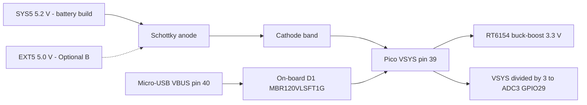
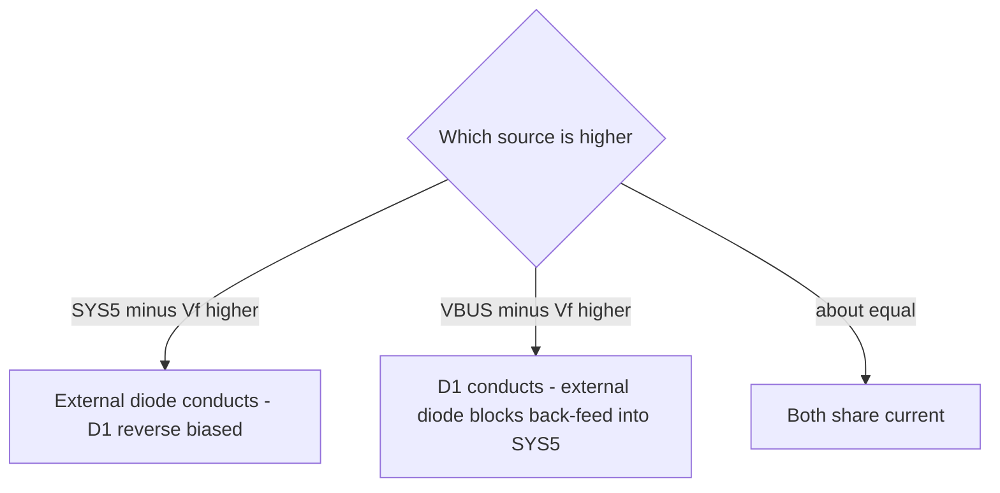

# VSYS source-ORing Schottky diode — datasheet & integration notes

> Part: 1 A Schottky rectifier (recommended MBR120VLSFT1G; alternatives SS14, 1N5817, B130) · Role in project: feeds SYS5 (or EXT5) into Pico 2 W VSYS pin 39 while blocking USB back-feed · Configuration: both

## 1. Overview

The Pico 2 W already contains a Schottky diode (D1, MBR120VLSFT1G) from micro-USB VBUS to VSYS [1]. Raspberry Pi documents that "the simplest way to safely add a second power source … is to feed it into VSYS via another Schottky diode", which ORs the two sources so the higher one powers VSYS and neither can back-power the other [1]. The build guide uses exactly this: anode on SYS5 (battery-backed) or EXT5 (Optional B), cathode on VSYS pin 39 [2]. The cost is one diode drop on the external path [1].

## 2. Key specifications

Candidate comparison (all 1 A average rating):

| Parameter | MBR120VLSFT1G (onsemi) | SS14 (Vishay SS12–SS16) | 1N5817 (Vishay) | B130 (Diodes Inc) |
|---|---|---|---|---|
| VRRM | 20 V | 40 V | 20 V | 30 V |
| IF(AV) | 1 A | 1 A | 1 A | 1 A |
| VF max at 1 A, 25 °C | ≈0.40 V (distributor summary; **verify** in onsemi PDF) | 0.50 V | 0.45 V | 0.50 V |
| VF max at 0.1 A, 25 °C | ≈0.32 V (distributor summary; **verify**) | not tabulated (curve) | not tabulated (curve) | not tabulated (curve) |
| IR max at rated VR, 25 °C | ≈0.6 mA (distributor summary; **verify**) | 0.2 mA | 1.0 mA | 0.5 mA |
| IR at 100 °C | — | 6.0 mA | 10 mA | 10 mA |
| IFSM | — | 40 A | 25 A | — |
| TJ max | — | 150 °C | 125 °C | 150 °C |
| Package | SOD-123FL (SMD) | SMA / DO-214AC (SMD) | DO-41 (through-hole) | SMA (SMD) |
| Source | [1][3] | [4] | [5] | [6] |

The Pico 2 W itself specifies VSYS 1.8–5.5 V [1].

## 3. Pinout / connections

| Terminal | Marking | Connect to |
|---|---|---|
| Anode | unmarked end | SYS5 (battery-backed) or EXT5 (Optional B) |
| Cathode | band / stripe | Pico VSYS, physical pin 39 |

Polarity band denotes the cathode on all candidates [4][5][6].

## 4. Wiring in this project

| Diode terminal | Net | Pico pin |
|---|---|---|
| Anode | SYS5 (PowerBoost 5V out) or EXT5 in Optional B | — |
| Cathode | VSYS | Pin 39 |
| — | Pico VBUS | Pin 40: do **not** connect SYS5 here [2] |
| — | 3V3_EN | Pin 37: leave at default [2] |

### Expected VSYS

VSYS = source − VF. VF values: 0.32–0.40 V from MBR120VLSFT1G summary figures; 0.45–0.50 V is the 1 A maximum for 1N5817/SS14/B130 [3][4][5][6]. Light-load VF is lower than the 1 A figure (read from each datasheet's forward curve — not tabulated, estimate).

| Source | Diode | VF used | VSYS |
|---|---|---|---|
| SYS5 = 5.2 V | MBR120VLSFT1G at ≈0.1 A | 0.32 V | ≈4.88 V |
| SYS5 = 5.2 V | MBR120VLSFT1G at 1 A | 0.40 V | ≈4.80 V |
| SYS5 = 5.2 V | 1N5817 at 1 A (max) | 0.45 V | ≈4.75 V |
| SYS5 = 5.2 V | SS14 / B130 at 1 A (max) | 0.50 V | ≈4.70 V |
| EXT5 = 5.0 V | MBR120VLSFT1G at ≈0.1 A | 0.32 V | ≈4.68 V |
| EXT5 = 5.0 V | MBR120VLSFT1G at 1 A | 0.40 V | ≈4.60 V |
| EXT5 = 5.0 V | SS14 / B130 at 1 A (max) | 0.50 V | ≈4.50 V |

All are inside VSYS 1.8–5.5 V [1]. Worst case high: PowerBoost FB tolerance ±3 % gives SYS5 up to ≈5.33 V [7]; with VF ≈0.2 V at very light load (estimate) VSYS ≈5.13 V — still below 5.5 V.

## 5. Power requirements & consumption

| Condition | Value | Basis |
|---|---|---|
| Dissipation at 0.3 A, VF 0.35 V | ≈0.1 W | estimate |
| Dissipation at 1 A, VF 0.45 V | ≈0.45 W | estimate from [5] |
| Energy cost at 0.2 A from SYS5 | ≈0.06–0.07 W lost in diode (≈6–7 % of Pico input power) | estimate |
| Reverse leakage into SYS5 when USB powers VSYS and SYS5 is off | ≤ IR at rated VR (≤0.2–1 mA at 25 °C); much lower at ≈4.7 V reverse — **unverified**, read IR-vs-VR curve | [3][4][5][6] |

Pico 2 W VSYS current depends on firmware and Wi-Fi activity; the datasheet gives no single figure in the power section [1] — measure.

## 6. Programming / configuration

None. Firmware can read VSYS/3 on ADC3 (GPIO29) to confirm the diode path, but only when the CYW43 wireless SPI is idle (GPIO29 is shared with wireless CLK) [1].

## 7. Design notes, limits & gotchas

- **Recommendation:** MBR120VLSFT1G — same part Raspberry Pi uses for D1, lowest VF of the candidates, SOD-123FL [1][3]. For perfboard/through-hole builds, 1N5817 (DO-41) [5]. SS14 if a higher VRRM (40 V) is desired [4].
- **Do not exceed 5.5 V on VSYS** including overshoot [1][2]. Never connect EXT5 or SYS5 directly to VSYS without the diode if USB may be plugged in.
- **Temperature raises leakage** strongly (SS14: 0.2 → 6 mA from 25 → 100 °C at rated VR) [4]; in a sun-heated enclosure, leakage back into an unpowered SYS5 is still small but non-zero.
- **USB vs SYS5 sharing:** with SYS5 at 5.2 V and USB at ≈5.0 V, the external path normally dominates; in Optional B (EXT5 ≈ 5.0 V) both paths may share current — harmless [1].
- **Better efficiency option:** Raspberry Pi shows a P-FET (e.g. Diodes DMG2305UX, Vt ≤0.9 V, 100 mΩ at 2.5 V VGS) gated by VBUS [1]; that topology disconnects the secondary source when USB is present, which changes priority — not used by the build guide.
- **GPIO back-power** is a separate issue: the diode does not stop Pico GPIO back-powering unpowered peripherals [2].

## 8. Bring-up / test checklist

1. Confirm band (cathode) faces VSYS pin 39 before soldering; diode-test with a DMM (≈0.15–0.35 V forward reading typical for Schottky — meter-dependent).
2. Power SYS5 only; measure VSYS at pin 39 (expect ≈4.7–4.9 V).
3. Power USB only (SYS5 off); confirm SYS5 stays ≈0 V (no back-feed) and Pico runs.
4. Power both; confirm VSYS ≤5.5 V and Pico stable during Wi-Fi transmit.
5. Measure diode temperature under worst-case firmware load.
6. Read ADC3 (VSYS/3) in firmware and compare with DMM.

## 9. References

1. Raspberry Pi Ltd, "Raspberry Pi Pico 2 W Datasheet" (RP-008304-DS), sections 2.1 (pin descriptions), 2.3 (operating conditions), 3.4–3.6 (power, power ORing, battery charger) — https://pip.raspberrypi.com/documents/RP-008304-DS (also https://datasheets.raspberrypi.com/picow/pico-2-w-datasheet.pdf)
2. Project build guide — docs/pico_2_w_anchor_alarm_build_guide_v2.md, sections 4–5 and Optional B
3. onsemi, "MBR120VLSFT1 — Surface Mount Schottky Power Rectifier" — https://www.onsemi.com/download/data-sheet/pdf/mbr120vlsft1-d.pdf ; values cross-checked via LCSC listing C223608 — https://www.lcsc.com/product-detail/C223608.html (onsemi PDF could not be text-extracted; VF/IR figures marked verify)
4. Vishay, "SS12, SS13, SS14, SS15, SS16 Surface-Mount Schottky Barrier Rectifiers" (doc 88746) — https://www.vishay.com/docs/88746/ss12.pdf
5. Vishay, "1N5817, 1N5818, 1N5819 Schottky Barrier Plastic Rectifier" (doc 88525) — https://www.vishay.com/docs/88525/1n5817.pdf
6. Diodes Incorporated, "B120/B – B160/B 1.0A Schottky Barrier Rectifier" (DS13002) — https://www.diodes.com/assets/Datasheets/ds13002.pdf
7. Texas Instruments, TPS61030 datasheet (VFB tolerance) — https://www.ti.com/lit/ds/symlink/tps61030.pdf
