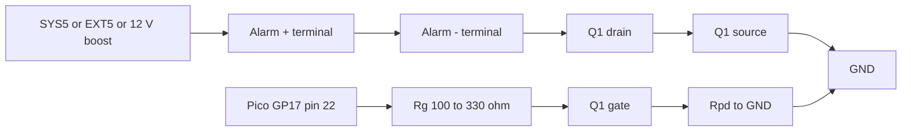

# SparkFun Large Piezo Alarm, 16 Tone (COM-13939) — datasheet & integration notes

> Part: SparkFun COM-13939 (Challenge Electronics CED-ME516AQSW) · Role in project: optional loud external alarm, low-side switched from GP17 · Configuration: Optional A

## 1. Overview

COM-13939 is a self-driven (internally oscillating) panel-mount piezo alarm with a DIP switch that selects a sound pattern [1][2]. It runs from 5–16 VDC, nominally 12 V, producing about 90 dBA at 5 V and 102–103 dBA at 12–16 V measured at 61 cm (24 in) [1][2]. It needs only DC power: switching its supply on and off starts and stops the sound. In this project it is the Optional A deck/cabin alarm, powered from SYS5 (battery build) or EXT5 (Optional B), optionally via a 12 V boost (A4), and switched by a logic-level N-MOSFET on GP17 [3].

## 2. Key specifications

| Parameter | Value | Source |
|---|---|---|
| Manufacturer part | Challenge Electronics CED-ME516AQSW | [2] |
| Operating voltage | 5–16 VDC (nominal 12 VDC) | [1][2] |
| Surge voltage | 20 % above max (19.2 V) for < 5 min | [2] |
| Frequency | 3000 ± 50 Hz; warble tones 2.8 / 3.2 kHz | [1][2] |
| SPL at 61 cm, 5 V | 90 dBA (+8 / −5) | [2] |
| SPL at 61 cm, 12 V | 102 dBA (+7 / −4) | [2] |
| SPL at 61 cm, 16 V | 103 dBA (+6 / −3) | [2] |
| Current, 5 V | 15 mA typ / 25 mA max | [2] |
| Current, 12 V | 30 mA typ / 40 mA max | [2] |
| Current, 16 V | 40 mA typ / 60 mA max | [2] |
| Reverse polarity | Protected up to max rated voltage | [2] |
| Operating temperature | −30 to +65 °C | [2] |
| Storage temperature | −40 to +85 °C | [2] |
| Ingress protection | Hermetically sealed, IP-68; NEMA 3R / 4X / 12 with gasket (gasket not supplied) | [2] |
| Salt spray | 300 h, ASTM B117 | [2] |
| Diaphragm / case | Stainless steel 304 / black Noryl, UL94-V0; silicone + epoxy potting | [2] |
| Terminals | 2 × 0.25" (6.4 mm) tin-plated brass quick-connect blades; polarity marked on back | [2] |
| Terminal pull strength | 15 lb | [2] |
| Mounting | Rear panel mount, 1.125"-24 UNS thread with ring nut | [2] |
| Panel hole / thickness | 1.128" (28.7 mm) hole; panel 0.03–0.25" (0.75–6.4 mm) | [2] |
| Optional gasket | ID 30 mm, OD 35.6 mm, 2.54 mm thick | [2] |
| Size | Ø35.8 mm × 35.7 mm height | [1] |
| Mass | ≈ 35 g | [2] |
| Life test | 1000 h intermittent (1 min on / 4 min off) | [2] |
| Tone select | 4-pole DIP switch (red, gold contacts); no volume control | [2] |

> ⚠️ Discrepancy with build guide / product name: SparkFun sells it as "16 Tone", but the datasheet tables only 15 patterns; the all-ON DIP setting is undocumented [1][2]. The guide's "12 V / 40 mA" figure is the datasheet **maximum** at 12 V; typical is 30 mA [2][3].

> ⚠️ Wire colours: the task brief asked for wire colours, but this part has **no wire leads** — it has two 6.4 mm quick-connect blades with polarity marked on the housing [2]. Use crimped, insulated 6.4 mm female receptacles with your own red (+) / black (−) tinned wire.

### DIP switch tone table (switches 1-2-3-4) [2]

| Tone | Pattern | SW1-SW2-SW3-SW4 |
|---|---|---|
| 1 | Continuous | Off-Off-Off-Off |
| 2 | Moderate chime, 1 Hz | On-On-Off-On |
| 3 | Fast chime, 2 Hz | Off-On-On-On |
| 4 | Slow intermittent, 1 Hz, 50 % duty | On-Off-Off-Off |
| 5 | Fast intermittent, 3 Hz | Off-On-Off-Off |
| 6 | Very-fast intermittent, 6 Hz | On-On-Off-Off |
| 7 | Ultra-fast intermittent, 10 Hz | On-Off-Off-On |
| 8 | Slow warble 2.8 / 3.2 kHz, 1 Hz | Off-Off-On-Off |
| 9 | Fast warble, 3 Hz | Off-Off-Off-On |
| 10 | Very-fast warble, 6 Hz | On-Off-On-Off |
| 11 | Warble, 10 Hz | Off-On-On-Off |
| 12 | Fast pulsating: 4 pulses in 0.5 s, 0.5 s off | On-On-On-Off |
| 13 | Slow pulsating: 4 pulses in 0.5 s, 1.0 s off | Off-On-Off-On |
| 14 | Gentle pulsating: 8 pulses in 1 s, 1 s off | Off-Off-On-On |
| 15 | Tender pulsating: 8 pulses in 1 s, 4 s off | On-Off-On-On |
| (16) | Undocumented | On-On-On-On — unverified |

Suggested default: tone 1 (continuous) and let firmware pulse the MOSFET, or tone 5/8 for a distinctive alarm pattern. Note that if firmware also pulses GP17, the internal pattern restarts on every power-up, so prefer either firmware cadence with tone 1 or a DIP pattern with GP17 held on.

## 3. Pinout / connections

| Terminal | Function |
|---|---|
| + (marked) | Supply positive: SYS5 / EXT5 or +12 V boost output |
| − (marked) | Supply negative: to MOSFET drain (low-side switch) |

## 4. Wiring in this project

| Alarm terminal | Net | Connects to | Notes |
|---|---|---|---|
| + | ALARM_V+ | SYS5 (battery build) or EXT5 (Optional B), or boost VOUT (A4) | Fuse or polyfuse recommended at source (proposal) |
| − | ALARM_SW | Q1 drain | Q1 source to GND |
| — | GATE | GP17 (pin 22) via 100–330 Ω | 100 kΩ gate-to-source pull-down per guide; see MOSFET file for RP2350-E9 note [3] |



## 5. Power requirements & consumption

| Supply | Typ current | Max current | Power (max) | Basis |
|---|---|---|---|---|
| 5 V (SYS5 / EXT5 direct) | 15 mA | 25 mA | 0.125 W | datasheet [2] |
| 5.2 V (SYS5 nominal) | ≈ 16 mA | ≈ 26 mA | ≈ 0.14 W | estimate (interpolated) |
| 12 V (boost) | 30 mA | 40 mA | 0.48 W | datasheet [2] |
| 16 V | 40 mA | 60 mA | 0.96 W | datasheet [2] |
| Off (MOSFET off) | ≈ 0 | MOSFET leakage only (≤ 1 µA class) | — | estimate |

## 6. Programming / configuration

The alarm has no data interface. Firmware switches GP17; see logic-level-n-mosfet-driver.md for the full driver. Minimal cadence example:

```c
#include "pico/stdlib.h"

#define ALARM_GATE_PIN 17

void alarm_init(void) {
    gpio_init(ALARM_GATE_PIN);
    gpio_disable_pulls(ALARM_GATE_PIN);
    gpio_put(ALARM_GATE_PIN, 0);          // latch low before enabling output
    gpio_set_dir(ALARM_GATE_PIN, GPIO_OUT);
}

static inline void alarm_set(bool on) { gpio_put(ALARM_GATE_PIN, on); }

// Example: 1 s on / 1 s off cadence with DIP tone 1 (continuous).
void alarm_cadence_step(uint32_t now_ms) {
    alarm_set(((now_ms / 1000u) & 1u) == 0u);
}
```

## 7. Design notes, limits & gotchas

- At 5 V the alarm gives ≈ 90 dBA; the extra ≈ 12 dB at 12 V requires the optional boost (A4) [2][3].
- The alarm's internal electronics make it a self-oscillating load; it is not a bare inductive transducer, so no flyback diode is strictly required for the switch (see MOSFET file).
- Reverse-polarity protected only up to rated voltage [2]; still observe the marked polarity.
- IP68 applies to the potted sounder; the rear blade terminals are exposed — insulate them (heat-shrink boots) and seal the panel with the optional gasket for NEMA 4X [2].
- Operating range −30 to +65 °C [2]; avoid direct mounting on dark surfaces in full sun.
- Very loud: 103 dBA at 61 cm [2]. Test with ear protection and mount where crew are not closer than necessary.
- Do not exceed 16 V continuous; Pololu U3V40F12 overvoltage protection is ≈ 16.5 V, within the 19.2 V surge rating [2][4].

## 8. Bring-up / test checklist

1. Set DIP switches to the chosen tone (e.g., Off-Off-Off-Off continuous) before mounting.
2. Bench test: connect directly to a current-limited 5 V supply; confirm sound and ≤ 25 mA.
3. If using the boost, repeat at 12 V; confirm ≤ 40 mA.
4. Wire through Q1; with GP17 unconfigured (Pico in reset / BOOTSEL), confirm alarm stays silent.
5. Drive GP17 high; confirm sound; measure V_DS of Q1 (expect a few mV at 25–40 mA).
6. Drive GP17 low; confirm silence.
7. Check terminal crimps with a pull test and insulate.
8. Fit gasket, tighten ring nut; spray-test the panel area before final install.

## 9. References

1. SparkFun, "Large Piezo Alarm - 16 Tone" COM-13939 — https://www.sparkfun.com/large-piezo-alarm-16-tone.html
2. Challenge Electronics, CED-ME516AQSW datasheet (rev 0-2016) — http://cdn.sparkfun.com/datasheets/Components/General/CED-ME516AQSW.pdf
3. Project build guide, `docs/pico_2_w_anchor_alarm_build_guide_v2.md` (Optional A, A4, GP17)
4. Pololu, U3V40F12 12 V step-up regulator — https://www.pololu.com/product/4016
