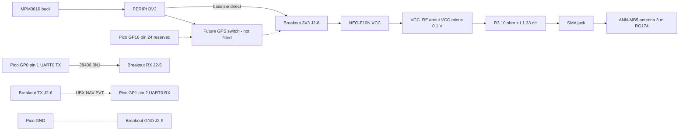
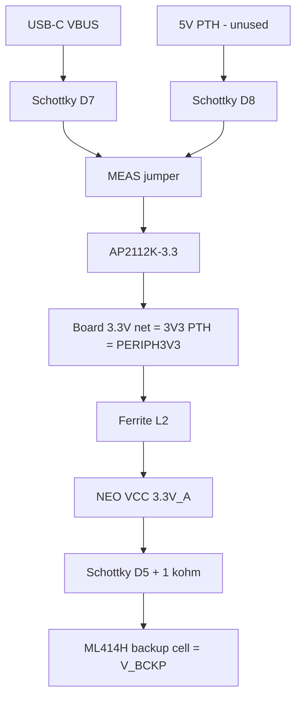

# SparkFun GNSS L1/L5 Breakout – NEO-F10N, SMA — datasheet & integration notes

> Part: SparkFun GPS-24114 (u-blox NEO-F10N-00B, firmware SPG 6.00) · Role in project: position source for the anchor watch, UART0 to the Pico 2 W · Configuration: Both

## 1. Overview

The breakout carries a u-blox NEO-F10N dual-band (L1 + L5) standard-precision GNSS module. It also has an AP2112K-3.3 regulator, a CH340C USB-to-serial bridge on a USB-C connector, a rechargeable backup cell on V_BCKP, an edge-mount SMA jack with an antenna bias feed, PWR/PPS LEDs, a 9-pin 0.1" edge header and a 1×6 "External Serial" header [1][2][4].

- **Interfaces:** the NEO-F10N has a **single UART and nothing else**. There is no I²C, SPI, USB device port, or Qwiic connector. The u-blox data sheet says "The receiver supports communication over UART only" [5]. SparkFun confirms there is "no USB, I2C, SPI, or secondary UART port" [2]. (§3.2 of integration manual R04 mentions "UART and I2C", but the module pin table has no I²C pins. Treat that mention as an error in the manual [6].)
- **Constellations:** GPS/QZSS L1C/A+L5, Galileo E1+E5a, BeiDou B1C+B2a and NavIC L5. The default is GPS+Galileo+BeiDou with SBAS [5].
- **GPS L5:** this signal is still pre-operational and marked unhealthy, so **the receiver does not use it by default**. Galileo E5a and BeiDou B2a are still used. u-blox says not to override the L5 health status for safety-of-life or other critical purposes [6]. Leave that override off in this alarm.
- **Power-save mode:** the cyclic power-save mode (PSM) is **not supported** on F10. Only **software standby** (UBX-RXM-PMREQ) and **hardware backup** (VCC off, V_BCKP on) are available [6].

## 2. Key specifications

| Parameter | Value | Source |
|---|---|---|
| Main supply VCC (module) | 2.7 – 3.6 V, 3.0 V typ.; absolute maximum 3.6 V | [5] |
| VCC ramp rate | 25 – 35 000 µs/V (abs. max; faster ramp can permanently damage module) | [5] |
| Breakout 5V input (USB VBUS or 5V PTH) | ≤ 6 V; AP2112K-3.3 600 mA LDO to 3.3 V | [2] |
| Breakout 3V3 pin | "should only be provided with a clean 3.3V power signal" | [2] |
| Logic level | 3.3 V; PIO voltage relative to VCC; abs. max VCC + 0.3 V | [2][5] |
| V_IL max / V_IH min | 0.63 V / 0.68 × VCC | [5] |
| V_OL / V_OH (±2 mA) | ≤ 0.4 V / ≥ VCC − 0.4 V | [5] |
| Digital IO pull-up | 8 – 40 kΩ (18 kΩ typ.); RESET_N pull-up 7 – 13 kΩ | [5] |
| UART | 9600 – 921 600 baud; **default 38 400 8N1**; no flow control | [5][6] |
| Default output | NMEA GGA, GLL, GSA, GSV, RMC, VTG, TXT | [2] |
| Navigation rate (max) | 10 Hz multi-GNSS, 20 Hz single GNSS | [5] |
| Position accuracy (CEP 50 %) | 1 m (GPS+GAL+BDS, L5 health override enabled in test); 1.5 m GPS only | [5] |
| TTFF (default constellations) | Cold 28 s, hot 2 s, AssistNow Autonomous 4 s | [5] |
| Sensitivity (default) | Tracking −167 dBm, cold start −148 dBm, hot start −159 dBm | [5] |
| Time pulse | 1 PPS default (0.25 Hz – 10 MHz), 30 ns RMS; 4 mA drive | [5] |
| VCC_RF (antenna bias source) | VCC − 0.1 V; 50 mA operating, 250 mA abs. max source current | [5] |
| RF_IN | 50 Ω, built-in DC block; external gain up to 25 dB in normal LNA mode; max 0 dBm | [5] |
| V_BCKP | 1.65 – 3.6 V | [5] |
| Operating temperature | −40 to +85 °C (module) | [5] |
| Board size | 50.8 × 38.1 mm excl. SMA; 4× 4-40 mounting holes | [2] |

## 3. Pinout / connections

Header numbers come from schematic v10 (J2 = 9-pin edge header, J4 = 1×6 External Serial) [4]. Check the silkscreen order on the board you receive.

| Connector / pin | Label | Function |
|---|---|---|
| J2-1 | RST / RESET | NEO RESET_N via 33 Ω; 10 kΩ pull-up to 3.3V_A on board. Active low, ≥ 1 ms. **Clears BBR (config, RTC, orbits) → cold start** [4][6] |
| J2-2 | EVENT | NEO EXTINT via 33 Ω. Input with internal pull-up. Can be a PMREQ wake source [4][5][7] |
| J2-3 | PPS | NEO TIMEPULSE via 33 Ω. Also drives the PPS LED through a BSS138 [4] |
| J2-4 | SAFE | NEO SAFEBOOT_N via 33 Ω. Internally tied to TIMEPULSE through 1 kΩ. Low at start-up = safeboot (firmware update only) [4][6] |
| J2-5 | RX | Into NEO RXD (pin 21) via 33 Ω [4] |
| J2-6 | TX | Out of NEO TXD (pin 20) via 33 Ω [4] |
| J2-7 | 5V | 5 V input to AP2112K (through Schottky D8) [4] |
| J2-8 | 3V3 | Board 3.3 V net (regulator output; feeds NEO VCC through ferrite L2) [4] |
| J2-9 | GND | Ground |
| J4-2 / J4-3 | TXD / RXD | Same UART nets as J2 (for BlueSMiRF etc.) [2][4] |
| J4-4 | 3.3V | Through jumper EXT-3V3 (JP8, closed) [2][4] |
| J4-6 | GND | Ground [4] |
| J4-1, J4-5 | — | Not connected on schematic v10 [4] |
| J1 USB-C | — | VBUS → 5V regulator path; D+/D− → CH340C [4] |
| J5 SMA (jack) | ANT | RF_IN through 47 pF DC block. DC bias from VCC_RF through R3 10 Ω + L1 33 nH [4] |
| BT1 | — | ML414H rechargeable cell on V_BCKP. Charged from 3.3V_A through Schottky D5 + 1 kΩ R7 [4] |

Solder jumpers (bottom side) [2][4]:

| Jumper | Default | Function / project setting |
|---|---|---|
| USB-TX (JP1) | Closed | CH340 RX ↔ NEO TX. **Cut** (required for Pico UART) |
| USB-RX (JP4) | Closed | CH340 TX ↔ NEO RX. **Cut** (otherwise CH340 contends with GP0) |
| PWR (JP2) | Closed | Red power LED. Optional cut to save LED current |
| PPS (JP3) | Closed | Yellow PPS LED. Keep for bring-up; optional cut later |
| MEAS (JP5) | Closed | Current-measurement break in the **5 V** path (VBUS/5V → regulator). Not in the 3V3-pin path |
| USB-5V (JP6) | Open | Ties 5V PTH to VBUS. Leave open |
| EXT-3V3 (JP8) | Closed | 3.3 V to J4. Leave as-is (J4 unused) or cut |
| SHLD (JP7) | Closed | USB-C shield to GND |

## 4. Wiring in this project

The design matches the build guide §6 / GPS section [8]. PERIPH3V3 powers the module, and UART0 uses GP0/GP1 explicitly.

| Breakout pin | Net | Pico 2 W | Notes |
|---|---|---|---|
| 3V3 (J2-8) | PERIPH3V3 | — | From MPM3610 buck. **Not** Pico 3V3 OUT (pin 36) |
| GND (J2-9) | GND | Pin 3 (or any GND) | Common ground |
| RX (J2-5) | GPS_RX | GP0 / pin 1 (UART0 TX) | Requires USB-RX jumper cut |
| TX (J2-6) | GPS_TX | GP1 / pin 2 (UART0 RX) | Requires USB-TX jumper cut |
| 5V (J2-7) | — | — | Leave unconnected. Do not connect SYS5 or EXT5 |
| PPS, EVENT, SAFE, RST | — | — | Leave open (internal or board pull-ups). No GPIO allocated |
| USB-C | — | — | Not used in installed system (see §7) |
| SMA | ANT | — | ANN-MB5 L1/L5 active antenna, bias from VCC_RF |
| (future) | GPS 3V3 switch | GP18 / pin 24 | Reserved. Unused in baseline |





The second diagram shows why the USB-C port must stay unplugged in the installed system. VBUS would drive the AP2112K output straight onto PERIPH3V3 [4].

## 5. Power requirements & consumption

All currents are drawn from PERIPH3V3 through the 3V3 pin. Module figures are u-blox typical values at 3.0 V and 25 °C with default configuration [5].

| State | Module (NEO-F10N) | Antenna bias (ANN-MB5) | Board extras | Basis |
|---|---|---|---|---|
| Supply range | 2.7 – 3.6 V (PERIPH3V3 3.3 V nominal) | Needs ≥ 3.0 V at antenna [9] | — | Datasheet |
| Acquisition (avg to first fix) | 26 mA typ. (GPS+GAL+BDS) | ≈ 17 mA | PWR LED ≈ 0.3 mA | Datasheet [5][9]; LED estimate |
| Tracking, 1 Hz | 21 mA typ. (GPS only 18 mA) | ≈ 17 mA | PWR LED ≈ 0.3 mA; PPS LED pulsed | Datasheet [5][9]; LED estimate |
| Inrush / peak at start-up | up to 100 mA | — | — | Datasheet [5] |
| Software standby (PMREQ) | 49 µA | **≈ 17 mA – still powered** | PWR LED ≈ 0.3 mA | Datasheet [5]; schematic [4] |
| Hardware backup (3V3 removed, future GP18 switch) | 31 µA from V_BCKP (backup cell) | 0 | 0 | Datasheet [5] |
| V_BCKP draw in normal operation | ≈ 3 µA | — | — | Datasheet [5] |
| Backup-cell charging | — | — | ≤ (3.3 − 0.42 − V_cell) / 1 kΩ, < 1 mA | Estimate from schematic [4] |

Notes:
- The ANN-MB5 current is specified only at 5 V (17 mA typ.) [9]. The value at the ≈ 3.1 V bias this board provides is **unverified**. Measure it (§8).
- PWR LED estimate: (3.3 V − ≈1.8 V red V_f) / 4.7 kΩ ≈ 0.3 mA. The PPS LED uses 2.2 kΩ and is on only during the pulse [4]. Both are estimates, not measured.
- **Estimated rail totals (to be measured):** tracking ≈ 38–40 mA, acquisition ≈ 43–45 mA, software standby ≈ 17–18 mA. On this board, **software standby saves only the module's ~21 mA**. VCC_RF is "available whenever VCC is supplied" [6], and SparkFun feeds the antenna from VCC_RF without using LNA_EN [4]. To remove the antenna load, VCC itself has to be switched off (the reserved GP18 switch). The guide's caution that "software standby … is not a promise that antenna power is off" [8] is confirmed for this hardware.
- Backup cell: SparkFun does not state ML414H capacity. Hold-up time in hardware backup at 31 µA is therefore **unverified**. Ephemeris is typically valid for a hot start for up to 4 h [6].

## 6. Programming / configuration

### 6.1 Hardware configuration
1. **Before installation**, optionally use USB-C with u-center 2 to read firmware (UBX-MON-VER). Then **cut USB-TX and USB-RX** [2][3]. After that, the USB port cannot reach the module.
2. Optionally cut PWR LED (and later PPS LED) to save current.
3. No I²C address applies. UART only.

### 6.2 UBX protocol essentials [7]
- Frame format: `0xB5 0x62 | class | id | length (U2 LE) | payload | CK_A CK_B`.
- Checksum: 8-bit Fletcher over class, id, length and payload (`CK_A += b; CK_B += CK_A`).
- Configuration uses **UBX-CFG-VALSET (0x06 0x8A)**. Payload: `version=0, layers, reserved[2]`, then key (U4 LE) + value pairs, up to 64 per message.
- Layers bits: RAM = 0x01, BBR = 0x02, Flash = 0x04. Success returns UBX-ACK-ACK (0x05 0x01); failure returns ACK-NAK (0x05 0x00).
- **Software standby clears RAM including configuration.** Write runtime settings to **RAM + BBR (0x03)**. BBR survives standby and VCC loss while V_BCKP is present. It is cleared by RESET_N or a hardware-reset CFG-RST [6].
- u-blox recommends writing **flash** once (e.g. production), not at every start-up [6]. RESET_N does not clear flash [6].

| Key | ID | Type | Project value |
|---|---|---|---|
| CFG-RATE-MEAS | 0x30210001 | U2, ms | 1000 (1 Hz) |
| CFG-MSGOUT-UBX_NAV_PVT_UART1 | 0x20910007 | U1 | 1 (every epoch) |
| CFG-UART1OUTPROT-UBX | 0x10740001 | L | 1 |
| CFG-UART1OUTPROT-NMEA | 0x10740002 | L | 0 (disables all NMEA output) |
| CFG-UART1INPROT-UBX | 0x10730001 | L | 1 (default) |
| CFG-UART1-BAUDRATE | 0x40520001 | U4 | leave 38400 unless measured need |
| CFG-NAVSPG-DYNMODEL | 0x20110021 | E1 | default PORT=0. Options include STAT=2 and SEA=5 (zero vertical velocity, sea level) [6]. Evaluate before changing |
| CFG-HW-RF_LNA_MODE | 0x20a30057 | E1 | NORMAL=0 (keep; see antenna datasheet) |
| CFG-MSGOUT-NMEA_ID_GGA/GLL/GSA/GSV/RMC/VTG_UART1 | 0x209100bb / ca / c0 / c5 / ac / b1 | U1 | Alternative: set 0 individually |

Verified example frame (RAM+BBR, the four keys in the code below):
`B5 62 06 8A 19 00 00 03 00 00 01 00 74 10 01 02 00 74 10 00 07 00 91 20 01 01 00 21 30 E8 03 AE 35`

Software standby, wake on UART RX (UBX-RXM-PMREQ 0x02 0x41, 16-byte form: duration 0 = until wake pin, flags backup|force = 0x06, wakeupSources uartrx = 0x08) [7]:
`B5 62 02 41 10 00 00 00 00 00 00 00 00 00 06 00 00 00 08 00 00 00 61 6B`

### 6.3 Pico SDK C example

The framing and parser were compiled and unit-tested on a host with stubbed SDK calls. They have not been run on hardware.

```c
#include "pico/stdlib.h"
#include "hardware/uart.h"
#include <stdio.h>

#define GPS_UART    uart0
#define GPS_TX_PIN  0      // Pico TX -> NEO-F10N RX
#define GPS_RX_PIN  1      // Pico RX <- NEO-F10N TX
#define GPS_BAUD    38400  // NEO-F10N default

#define LAYER_RAM   0x01
#define LAYER_BBR   0x02
#define LAYER_FLASH 0x04

static void ubx_send(uint8_t cls, uint8_t id, const uint8_t *pl, uint16_t len) {
    uint8_t hdr[6] = {0xB5, 0x62, cls, id, (uint8_t)len, (uint8_t)(len >> 8)};
    uint8_t ck[2] = {0, 0};
    for (int i = 2; i < 6; i++)        { ck[0] += hdr[i]; ck[1] += ck[0]; }
    for (uint16_t i = 0; i < len; i++) { ck[0] += pl[i];  ck[1] += ck[0]; }
    uart_write_blocking(GPS_UART, hdr, sizeof hdr);
    uart_write_blocking(GPS_UART, pl, len);
    uart_write_blocking(GPS_UART, ck, sizeof ck);
}

// Append one little-endian key/value pair to a VALSET payload.
static size_t put_kv(uint8_t *p, uint32_t key, uint32_t val, int size) {
    for (int i = 0; i < 4; i++)    p[i]     = (uint8_t)(key >> (8 * i));
    for (int i = 0; i < size; i++) p[4 + i] = (uint8_t)(val >> (8 * i));
    return 4 + (size_t)size;
}

static void gps_configure(uint8_t layers) {
    uint8_t pl[32] = {0x00, layers, 0x00, 0x00};   // version 0, layers, reserved
    size_t n = 4;
    n += put_kv(pl + n, 0x10740001, 1, 1);    // CFG-UART1OUTPROT-UBX  = 1
    n += put_kv(pl + n, 0x10740002, 0, 1);    // CFG-UART1OUTPROT-NMEA = 0
    n += put_kv(pl + n, 0x20910007, 1, 1);    // CFG-MSGOUT-UBX_NAV_PVT_UART1 = 1
    n += put_kv(pl + n, 0x30210001, 1000, 2); // CFG-RATE-MEAS = 1000 ms
    ubx_send(0x06, 0x8A, pl, (uint16_t)n);    // UBX-CFG-VALSET
}

static void gps_standby(void) {               // UBX-RXM-PMREQ
    uint8_t pl[16] = {0};                     // version 0, duration 0 = until wake pin
    pl[8]  = 0x06;                            // flags: backup | force
    pl[12] = 0x08;                            // wakeupSources: uartrx
    ubx_send(0x02, 0x41, pl, sizeof pl);
}

static void gps_wake(void) {
    const uint8_t w = 0xFF;                   // any RX edge wakes the receiver
    uart_write_blocking(GPS_UART, &w, 1);
    sleep_ms(100);                            // settle time: verify on hardware
}

typedef struct {
    uint32_t itow_ms;
    uint8_t  fix_type;                        // 3 = 3D fix
    bool     fix_ok;                          // flags bit0 gnssFixOK
    uint8_t  num_sv;
    int32_t  lat_e7, lon_e7;                  // degrees * 1e7
    uint32_t h_acc_mm;
} gps_pvt_t;

static uint8_t frame[6 + 92 + 2];

// Feed one byte; returns (class << 8 | id) when a checksum-valid frame is in frame[].
static uint16_t ubx_feed(uint8_t b) {
    static uint16_t idx = 0, len = 0;
    if (idx == 0 && b != 0xB5) return 0;
    if (idx == 1 && b != 0x62) { idx = (b == 0xB5); return 0; }
    frame[idx++] = b;
    if (idx == 6) {
        len = (uint16_t)(frame[4] | (frame[5] << 8));
        if (len > 92) { idx = 0; return 0; }  // larger than anything we buffer
    }
    if (idx < 6 || idx < 6u + len + 2u) return 0;
    idx = 0;
    uint8_t a = 0, c = 0;
    for (uint16_t i = 2; i < 6 + len; i++) { a += frame[i]; c += a; }
    if (a != frame[6 + len] || c != frame[7 + len]) return 0;
    return (uint16_t)((frame[2] << 8) | frame[3]);
}

static uint32_t u32le(const uint8_t *p) {
    return p[0] | (p[1] << 8) | (p[2] << 16) | ((uint32_t)p[3] << 24);
}

static bool decode_nav_pvt(gps_pvt_t *o) {     // UBX-NAV-PVT 0x01 0x07, 92 bytes
    if (frame[4] != 92 || frame[5] != 0) return false;
    const uint8_t *p = &frame[6];
    o->itow_ms  = u32le(p + 0);
    o->fix_type = p[20];
    o->fix_ok   = p[21] & 0x01;
    o->num_sv   = p[23];
    o->lon_e7   = (int32_t)u32le(p + 24);
    o->lat_e7   = (int32_t)u32le(p + 28);
    o->h_acc_mm = u32le(p + 40);
    return true;
}

void gps_init(void) {
    uart_init(GPS_UART, GPS_BAUD);            // SDK default framing is 8N1
    gpio_set_function(GPS_TX_PIN, GPIO_FUNC_UART);
    gpio_set_function(GPS_RX_PIN, GPIO_FUNC_UART);
    gps_configure(LAYER_RAM | LAYER_BBR);     // then wait for ACK-ACK 0x06 0x8A
}

void gps_poll(void) {
    gps_pvt_t pvt;
    while (uart_is_readable(GPS_UART)) {
        uint16_t msg = ubx_feed((uint8_t)uart_getc(GPS_UART));
        if (msg == 0x0107 && decode_nav_pvt(&pvt)) {
            bool usable = pvt.fix_ok && pvt.fix_type == 3;
            printf("fix=%u ok=%d sv=%u lat=%ld lon=%ld hAcc=%lu mm%s\n",
                   pvt.fix_type, pvt.fix_ok, pvt.num_sv, (long)pvt.lat_e7,
                   (long)pvt.lon_e7, (unsigned long)pvt.h_acc_mm, usable ? "" : " (reject)");
        } else if (msg == 0x0501 || msg == 0x0500) {
            printf("%s for %02X %02X\n", msg == 0x0501 ? "ACK" : "NAK", frame[6], frame[7]);
        }
    }
}
```

Usage notes:
- Production firmware should time-stamp each accepted PVT on the Pico. It should reject fixes that are stale, not 3D, not `gnssFixOK`, or have `hAcc` above the alarm-radius budget, as the guide requires [8]. Satellite count alone is not a quality check.
- Backup30 / Emergency60 cycle: `gps_standby()` → sleep → `gps_wake()` → read NAV-PVT until a valid fix or timeout. Configuration persists because it was written to BBR.
- Wake-to-fix time depends on ephemeris age (hot start 2 s typ. [5]). Measure it. The guide's 4 s window is only a hypothesis [8].
- Enabling the GPS L5 health override (raw strings in [6] Table 4) is **not recommended** for this safety function [6].

## 7. Design notes, limits & gotchas

- **USB-C port vs PERIPH3V3:** VBUS → D7 → AP2112K output, which is the same net as the 3V3 pin [4]. Plugging USB in while installed puts a second 3.3 V source on PERIPH3V3. The AP2112K's reverse-current behaviour is **unverified**. Cutting USB-TX/USB-RX isolates the CH340 data lines only; it does not isolate this power path. Keep the port unplugged or covered while installed [8].
- **Do not use the 5V PTH pin** for this design. Power through 3V3 only.
- **Backfeeding through UART:** the NEO input absolute maximum is VCC + 0.3 V [5]. If GPS power is off while the Pico runs (bench programming, or the future GP18 switch), GP0 idling high would feed the module through RXD. Set GP0 to input / high-Z whenever GPS 3V3 is absent [8]. Also, do not drive any pins in hardware backup mode [5].
- **Future GP18 power switch:**
  - Ramp rate: the module requires a VCC ramp **no faster than 25 µs/V** (about 83 µs for 0 → 3.3 V) [5]. Pick a load switch with controlled slew, and check the ramp with a scope.
  - Inrush: allow up to 100 mA at start-up [5].
  - Retained data: with 3V3 removed, the backup cell keeps BBR/RTC for hot starts. Configuration stored in BBR survives too, provided the cell is charged.
- **Antenna bias margin:** VCC_RF = VCC − 0.1 V [5], followed by 10 Ω on the board [4]. With a 3.3 V rail and about 17 mA, the SMA sees roughly 3.0–3.1 V. The ANN-MB5 minimum is 3.0 V [9]. See the ANN-MB5 sheet and measure under load. Do not let PERIPH3V3 sag below nominal.
- **Antenna short:** the board has no antenna supervisor or current limit beyond R3 10 Ω [4]. A coax short could draw more than the 250 mA VCC_RF absolute maximum [5] (estimate: 3.2 V / 10 Ω). Do not short the SMA centre during cable work.
- **PPS / SAFEBOOT:** TIMEPULSE shares the SAFEBOOT_N function. Any load that pulls PPS low at power-up puts the module into safeboot [6]. If PPS is ever wired to the Pico, do not enable a pull-down on that GPIO.
- **RESET:** asserting RST erases BBR, which means a cold start of about 28 s and loss of BBR configuration [5][6]. It is a last-resort recovery only, and no GPIO is allocated in the baseline.
- **Supply ripple:** u-blox asks for less than 0.2 Ω series resistance in VCC [6]. Use short, adequately sized PERIPH3V3/GND wires. Keep the board away from the buck/boost converters and the Pico Wi-Fi antenna, because in-band interference cannot be filtered [6].
- **Marine environment:** the board has no conformal coat or weather protection. Mount it inside the enclosure and strain-relieve the SMA cable. Hot start and orbit retention rely on the small backup cell, which is rated for −40 to +85 °C at module level only [5].
- **Wrong-band antennas:** L1/L2 antennas such as the look-alike u-blox ANN-MB are not suitable [3]. Use an L1/L5 antenna.

## 8. Bring-up / test checklist

1. Do this with the jumpers still intact and only USB-C connected (no Pico wiring). In u-center 2 at 38400, confirm NMEA output and read UBX-MON-VER (documents in [5][6] apply to firmware EXT SPG 6.00) [2][6].
2. Unplug USB. Cut **USB-TX** and **USB-RX**. Check with a meter that the CH340 pins are isolated from NEO TX/RX. Optionally cut the PWR LED jumper.
3. Wire 3V3 → PERIPH3V3, GND, GP0 → RX, GP1 ← TX. Leave 5V, RST, SAFE, EVENT and PPS unconnected.
4. Power PERIPH3V3 with the antenna connected. Confirm the 3V3 pin reads 3.2–3.4 V. Measure DC on the SMA centre (or at the R3/L1 node) under load: it must be **≥ 3.0 V**.
5. Run a raw UART0 echo at 38400 and confirm `$G…` NMEA sentences arrive on GP1.
6. Run `gps_configure(LAYER_RAM|LAYER_BBR)`. Expect ACK-ACK for 0x06 0x8A. NMEA stops and a 100-byte NAV-PVT frame (`B5 62 01 07 5C 00 …`) arrives every 1 s.
7. Under open sky, confirm `fixType = 3`, `gnssFixOK = 1`, plausible lat/lon and `hAcc` of a few metres. The PPS LED should blink at 1 Hz.
8. Measure PERIPH3V3 current to the breakout during acquisition and during tracking. Record the antenna share by comparing with the antenna disconnected.
9. Send PMREQ. Confirm the current falls by about the module tracking current only (the antenna stays on). Send `gps_wake()`. Confirm NAV-PVT resumes **without** reconfiguration (proves BBR retention), and log wake-to-`gnssFixOK` time over many cycles.
10. Power-cycle PERIPH3V3 after the backup cell has charged. Confirm a hot start (~2 s) and retained config. Repeat after RESET to confirm the expected cold start.
11. With the antenna in its installed position, log fix age, `hAcc`, `numSV` and C/N0 (UBX-NAV-SAT/SIG) for hours. Repeat with Wi-Fi, display refresh and converters active [8].

## 9. References

1. SparkFun, "SparkFun GNSS L1/L5 Breakout – NEO-F10N, SMA" (GPS-24114), https://www.sparkfun.com/sparkfun-gnss-l1-l5-breakout-neo-f10n-sma.html
2. SparkFun, NEO-F10N Hookup Guide – Hardware Overview, https://docs.sparkfun.com/SparkFun_u-blox_NEO-F10N/hardware_overview/
3. SparkFun, NEO-F10N Hookup Guide – Hardware Hookup, https://docs.sparkfun.com/SparkFun_u-blox_NEO-F10N/hardware_hookup/
4. SparkFun, GNSS L1/L5 Breakout NEO-F10N schematic v10, https://docs.sparkfun.com/SparkFun_u-blox_NEO-F10N/assets/board_files/SparkFun_GNSS_L1_L5_BreakoutNEO-F10N_Schematic_V10.pdf
5. u-blox, NEO-F10N Data sheet, UBX-23002117 R03, https://docs.sparkfun.com/SparkFun_u-blox_NEO-F10N/assets/component_documentation/NEO-F10N_DataSheet_UBX-23002117.pdf
6. u-blox, NEO-F10N Integration manual, UBXDOC-963802114-12193 R04, https://content.u-blox.com/sites/default/files/documents/NEO-F10N_IntegrationManual_UBXDOC-963802114-12193.pdf
7. u-blox, u-blox F10 SPG 6.00 Interface description, UBX-23002975 R01, https://docs.sparkfun.com/SparkFun_u-blox_NEO-F10N/assets/component_documentation/u-blox-F10-SPG-6.00_InterfaceDescription_UBX-23002975.pdf
8. Moorpheus build guide, `docs/pico_2_w_anchor_alarm_build_guide_v2.md` (§5, §6 GPS, §7, §8)
9. u-blox, ANN-MB5 Data sheet, UBX-22038811 R03, https://cdn.sparkfun.com/assets/0/b/a/5/2/ANN-MB5_Datasheet.pdf
