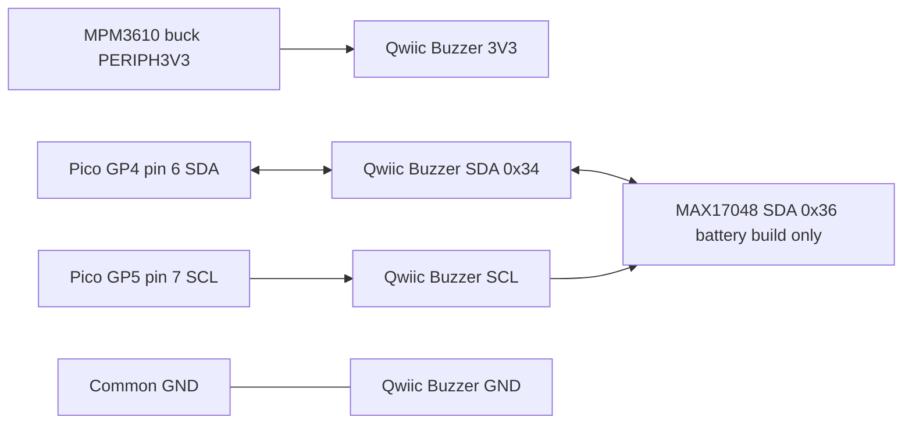

# SparkFun Qwiic Buzzer (BOB-24474) — datasheet & integration notes

> Part: SparkFun Qwiic Buzzer, BOB-24474 · Role in project: baseline local audible alarm sounder on I2C0 · Configuration: Both

## 1. Overview

The SparkFun Qwiic Buzzer is a 1.0" × 1.0" breakout carrying an ATtiny84 microcontroller that runs SparkFun's I2C-peripheral firmware and drives a CUI CBT-09427-SMT-TR magnetic buzzer through a transistor stage with selectable series resistors (volume) [1][2][4][5]. The host writes frequency, volume and duration registers over I2C (default address 0x34) and then sets an "active" register to start or stop the sound [3][4]. A TRIG pin allows a hardware (GPIO-only) trigger, and settings can be saved to the ATtiny84 EEPROM [2][4]. In this project it is the baseline anchor-drag sounder on PERIPH3V3 / I2C0 (GP4/GP5) [7].

## 2. Key specifications

| Parameter | Value | Source |
|---|---|---|
| Default I2C address | 0x34 (7-bit) | [1][3] |
| Allowed addresses (software change) | 0x08–0x77 | [3] |
| Device ID register value | 0x5E | [3] |
| Firmware version (as released) | v1.0 (major 0x01, minor 0x00) | [4] |
| Controller | Microchip ATtiny84 | [1][2] |
| Buzzer | CUI CBT-09427-SMT-TR, magnetic, Ø9 × 2.5 mm | [2][5] |
| Buzzer rated voltage | 3.6 V0-p (operating 2.5–4.5 V0-p) | [5] |
| Buzzer rated current | 110 mA max at rated voltage, 2730 Hz square wave, ½ duty | [5] |
| Buzzer resonant frequency | 2730 Hz (library default `kSfeQwiicBuzzerResonantFreq`) | [3][5] |
| Buzzer SPL | 83 dBA min / 87 dBA typ at 10 cm, rated voltage | [5] |
| Buzzer operating temperature | −40 to +85 °C | [5] |
| Volume levels implemented | 0 = off, 1 = min, 2 = low, 3 = mid, 4 = max | [3][4] |
| Duration | 16-bit, milliseconds; 0 = sound until turned off | [3][4] |
| Supply (recommended) | 3.3 V via Qwiic | [1][2] |
| Current at max volume | "~95 mA" (SparkFun) | [1] |
| On-board I2C pull-ups | 2.2 kΩ on SDA and SCL to 3.3 V, removable via "I2C" jumper | [2][6] |
| LEDs | PWR (red, jumper-removable), STAT (blue, jumper-removable) | [2][6] |
| Board size | 1.0" × 1.0" (25.4 × 25.4 mm) | [2] |
| Connectors | 2 × Qwiic (JST SH 4-pin), PTH: GND/3V3/SDA/SCL, RST/TRIG/GND | [2][6] |
| Flyback diode | PMEG4005EJ Schottky across buzzer | [6] |

### Register map (from the Arduino library `sfDevBuzzerRegisters.h` and firmware) [3][4]

| Reg | Name | Access | Description |
|---|---|---|---|
| 0x00 | ID | R | Reads 0x5E |
| 0x01 | FIRMWARE_MINOR | R | Firmware minor version |
| 0x02 | FIRMWARE_MAJOR | R | Firmware major version |
| 0x03 | TONE_FREQUENCY_MSB | R/W | Frequency in Hz, high byte |
| 0x04 | TONE_FREQUENCY_LSB | R/W | Frequency in Hz, low byte; 0 Hz = rest (silence) |
| 0x05 | VOLUME | R/W | 0 off, 1 min, 2 low, 3 mid, 4 max |
| 0x06 | DURATION_MSB | R/W | Duration in ms, high byte |
| 0x07 | DURATION_LSB | R/W | Duration in ms, low byte; 0 = forever |
| 0x08 | ACTIVE | R/W | 1 = buzz, 0 = stop; firmware clears to 0 when a non-zero duration expires |
| 0x09 | SAVE_SETTINGS | W | Write 1 to store frequency, volume and duration in EEPROM (power-on defaults) |
| 0x0A | I2C_ADDRESS | R/W | New 7-bit address; stored to EEPROM immediately |

Library sequence: `configureBuzzer()` writes 5 bytes starting at 0x03 (freq MSB, freq LSB, volume, duration MSB, duration LSB); `on()` writes 0x01 to 0x08; `off()` writes 0x00 to 0x08 [3].

> ⚠️ Discrepancy with vendor documentation: the hookup guide hardware overview says the four volume GPIOs give "7 levels of loudness", but the firmware and library implement only 4 levels plus off [2][3][4]. Use levels 0–4.

> ⚠️ Note: the hookup guide materials list links BOB-24474 text to a different SparkFun product number (17257); use the product page for the correct SKU [1][2].

## 3. Pinout / connections

| Pin | Function | Notes |
|---|---|---|
| Qwiic GND | Ground | Black wire [8] |
| Qwiic 3V3 | Supply | Red wire; 3.3 V [1][8] |
| Qwiic SDA | I2C data | Blue wire; 2.2 kΩ pull-up on board [6][8] |
| Qwiic SCL | I2C clock | Yellow wire; 2.2 kΩ pull-up on board [6][8] |
| TRIG (PTH) | Active-low hardware trigger | ATtiny internal pull-up; debounced in firmware (10 consecutive reads); buzzes while held low if duration = 0, else plays the stored duration [4] |
| RST (PTH) | ATtiny84 reset, active low | 10 kΩ pull-up on board [6] |
| GND (PTH) | Ground | — |

Factory reset: hold TRIG low for more than 1 s while powering up; firmware erases EEPROM (address returns to 0x34) [4].

Volume stage (derived from the Eagle schematic nets and firmware pin mapping, not stated as a table by SparkFun) [4][6]: an MMBT3906 PNP high-side switch (base via 100 Ω) is PWM-driven at the tone frequency; the buzzer low side returns through one of four NPN paths: level 4 direct (no series R), level 3 via 100 Ω, level 2 via 330 Ω, level 1 via 2.2 kΩ (JP1; cut JP1 to substitute the user through-hole resistor). Label: derived.

## 4. Wiring in this project

| Qwiic Buzzer pin | Net | Pico 2 W pin | Notes |
|---|---|---|---|
| 3V3 | PERIPH3V3 | — (MPM3610 buck output) | Not from Pico 3V3 OUT pin 36 [7] |
| GND | GND | any GND, e.g. pin 8 | Common ground |
| SDA | I2C0 SDA | GP4 (pin 6) | Shared with MAX17048 in battery build [7] |
| SCL | I2C0 SCL | GP5 (pin 7) | Shared with MAX17048 in battery build [7] |
| TRIG | not connected | — | Optional; leave open (internal pull-up) |
| RST | not connected | — | — |



## 5. Power requirements & consumption

| State | Current | Basis |
|---|---|---|
| Max volume (level 4), sounding | ~95 mA | datasheet (SparkFun product page) [1] |
| Buzzer alone, rated drive | 110 mA max | datasheet (CUI) [5] |
| Level 3 (100 Ω series) sounding | ≈ 10–27 mA | estimate: (3.3 V − ~0.3 V) / (100 Ω + 13–19 Ω coil) peak ≈ 25–27 mA, averaged by ½-duty PWM |
| Level 2 (330 Ω) sounding | ≈ 4–9 mA | estimate: ≈ 9 mA peak, ½ duty |
| Level 1 (2.2 kΩ) sounding | ≈ 0.7–1.4 mA | estimate: ≈ 1.4 mA peak, ½ duty |
| Idle (not sounding) | unverified | Not published. ATtiny84 sleeps in SLEEP_MODE_IDLE with ADC/BOD disabled [4]; PWR LED (4.7 kΩ) adds ≈ 0.3 mA estimate; cut PWR LED jumper to save it |

Budget PERIPH3V3 for ≈ 100 mA peak while the alarm sounds at volume 4.

## 6. Programming / configuration

Pico SDK C, I2C0 on GP4/GP5 at 100 kHz, derived from the library register writes [3]:

```c
#include "pico/stdlib.h"
#include "hardware/i2c.h"

#define QB_I2C        i2c0
#define QB_SDA_PIN    4
#define QB_SCL_PIN    5
#define QB_ADDR       0x34
#define QB_REG_ID     0x00
#define QB_REG_FREQ   0x03   // MSB, then LSB, VOLUME, DUR_MSB, DUR_LSB
#define QB_REG_ACTIVE 0x08
#define QB_ID_VALUE   0x5E
#define QB_TIMEOUT_US 5000

static bool qb_write(const uint8_t *buf, size_t len) {
    return i2c_write_timeout_us(QB_I2C, QB_ADDR, buf, len, false, QB_TIMEOUT_US) == (int)len;
}

bool qb_init(void) {
    i2c_init(QB_I2C, 100 * 1000);
    gpio_set_function(QB_SDA_PIN, GPIO_FUNC_I2C);
    gpio_set_function(QB_SCL_PIN, GPIO_FUNC_I2C);
    // Board has 2.2 kOhm pull-ups; internal pull-ups are not needed.

    uint8_t reg = QB_REG_ID, id = 0;
    if (i2c_write_timeout_us(QB_I2C, QB_ADDR, &reg, 1, true, QB_TIMEOUT_US) != 1) return false;
    if (i2c_read_timeout_us(QB_I2C, QB_ADDR, &id, 1, false, QB_TIMEOUT_US) != 1) return false;
    return id == QB_ID_VALUE;
}

// volume: 0 off, 1 min, 2 low, 3 mid, 4 max. duration_ms 0 = until qb_stop().
bool qb_configure(uint16_t freq_hz, uint8_t volume, uint16_t duration_ms) {
    if (volume > 4) volume = 4;
    uint8_t buf[6] = {
        QB_REG_FREQ,
        (uint8_t)(freq_hz >> 8), (uint8_t)(freq_hz & 0xFF),
        volume,
        (uint8_t)(duration_ms >> 8), (uint8_t)(duration_ms & 0xFF)
    };
    return qb_write(buf, sizeof buf);
}

bool qb_start(void) { uint8_t b[2] = { QB_REG_ACTIVE, 1 }; return qb_write(b, 2); }
bool qb_stop(void)  { uint8_t b[2] = { QB_REG_ACTIVE, 0 }; return qb_write(b, 2); }

int main(void) {
    stdio_init_all();
    if (!qb_init()) {
        // Treat as sounder fault: report on display / status page.
    }
    qb_configure(2730, 4, 0);   // resonant frequency, max volume, continuous
    qb_start();
    sleep_ms(500);
    qb_stop();
    while (true) tight_loop_contents();
}
```

Notes: the firmware applies new register values in its main loop, so allow a few milliseconds between `qb_configure()` and `qb_start()` if a glitch is heard [4]. Do not write SAVE_SETTINGS (0x09) or I2C_ADDRESS (0x0A) in normal operation; each EEPROM byte write takes ≈ 3.4 ms on the ATtiny84 and has finite endurance [4][9].

## 7. Design notes, limits & gotchas

- Loudness: 87 dBA typ at 10 cm is a cockpit-level sounder, not a deck-wide alarm; Optional A adds the 90–103 dBA piezo alarm for that [5][7].
- Use the resonant 2730 Hz for maximum SPL; off-resonance tones are noticeably quieter (buzzer SPL is specified only at 2730 Hz) [5].
- Pull-ups: 2.2 kΩ on this board in parallel with 10 kΩ on the Adafruit MAX17048 gives ≈ 1.8 kΩ per line — acceptable at 3.3 V (see qwiic-cables-and-connectors.md) [6][10].
- I2C bus failure must be detectable: check the ID at boot and verify writes; the guide treats the I2C sounder as a single point of failure and recommends Optional A for redundancy [7].
- TRIG gives a GPIO-only fallback path that does not depend on I2C; it is not wired in the guide but could be connected to a spare GPIO (proposal, not in guide).
- Address change via 0x0A persists in EEPROM; if lost, use the TRIG factory-reset procedure [4].
- Magnetic buzzer contains a coil; the on-board Schottky handles flyback [6].
- Not waterproof: the buzzer has an open sound port; mount behind a protected opening (see passive-components-and-general-hardware.md).

## 8. Bring-up / test checklist

1. With PERIPH3V3 off, confirm no short between 3V3 and GND on the Qwiic lead.
2. Power PERIPH3V3; confirm PWR LED on and 3.3 V ± 5 % at the board.
3. Run an I2C scan on I2C0; confirm 0x34 (and 0x36 in the battery build).
4. Read register 0x00; confirm 0x5E. Read 0x01/0x02 and log firmware version.
5. Configure 2730 Hz, volume 1, duration 200 ms, start; confirm short quiet beep and that ACTIVE (0x08) reads 0 afterwards.
6. Repeat at volume 4 with duration 0; measure PERIPH3V3 current (expect ≈ 95 mA); call stop and confirm silence.
7. Disconnect the Qwiic cable while running; confirm firmware reports a sounder/I2C fault instead of hanging (timeouts).
8. Confirm the ACK button silences the buzzer within the guide's bounded silence logic.

## 9. References

1. SparkFun, "SparkFun Qwiic Buzzer" BOB-24474 product page — https://www.sparkfun.com/sparkfun-qwiic-buzzer.html
2. SparkFun, "Qwiic Buzzer Hookup Guide" (single page) — https://docs.sparkfun.com/SparkFun_Qwiic_Buzzer/single_page/ (also https://sparkfun.github.io/SparkFun_Qwiic_Buzzer/single_page/)
3. SparkFun Qwiic Buzzer Arduino Library, `src/sfTk/sfDevBuzzerRegisters.h`, `sfDevBuzzer.h`, `sfDevBuzzer.cpp` — https://github.com/sparkfun/SparkFun_Qwiic_Buzzer_Arduino_Library
4. SparkFun Qwiic Buzzer firmware, `Firmware/QwiicBuzzerFirmware/` — https://github.com/sparkfun/SparkFun_Qwiic_Buzzer
5. CUI Devices, CBT-09427-SMT-TR datasheet — https://docs.sparkfun.com/SparkFun_Qwiic_Buzzer/assets/component_documentation/cbt-09427-smt-tr.pdf
6. SparkFun Qwiic Buzzer schematic v10 — https://docs.sparkfun.com/SparkFun_Qwiic_Buzzer/assets/board_files/SparkFun_Qwiic_Buzzer_Schematic_V10.pdf and `Hardware/SparkFun_Qwiic_Buzzer.sch` in [4]
7. Project build guide, `docs/pico_2_w_anchor_alarm_build_guide_v2.md` (I2C0 GP4/GP5, PERIPH3V3, Optional A)
8. Adafruit, "STEMMA QT technical specs" (Qwiic colour convention) — https://learn.adafruit.com/introducing-adafruit-stemma-qt/technical-specs
9. Microchip, ATtiny24A/44A/84A datasheet (EEPROM write time, endurance) — https://ww1.microchip.com/downloads/en/DeviceDoc/ATtiny24A-44A-84A-DataSheet-DS40002269A.pdf
10. Adafruit, MAX17048 pinouts (10 kΩ I2C pull-ups) — https://learn.adafruit.com/adafruit-max17048-lipoly-liion-fuel-gauge-and-battery-monitor/pinouts
