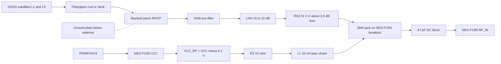

# u-blox ANN-MB5 multi-band active GNSS antenna (L1/L5) — datasheet & integration notes

> Part: u-blox ANN-MB5-00 (SparkFun GPS-25071) · Role in project: L1/L5 active antenna for the NEO-F10N, mounted under the fiberglass deck/roof · Configuration: Both

## 1. Overview

The ANN-MB5 is an active GNSS antenna covering the L1 and L5/E5a/B2a/NavIC bands. It contains a single-feed RHCP stacked-patch element, a built-in LNA with SAW pre-filtering, and a fixed 3 m RG174 cable that ends in an SMA plug. It has a magnetic base [1][2]. u-blox positions it as the matching antenna for the F10 platform, which the NEO-F10N uses [1][3].

The LNA is powered over the coax centre conductor. On the SparkFun NEO-F10N breakout, that DC comes from the module's VCC_RF output through a 10 Ω resistor and a 33 nH bias inductor [4]. The antenna needs no firmware.

It must be an L1/L5 antenna. The visually similar u-blox ANN-MB is L1/L2 and will not work with the F10N's second band [5]. Do not substitute by appearance or name [6].

## 2. Key specifications

| Parameter | L1 band | L5 / E5a / B2a / NavIC band | Source |
|---|---|---|---|
| Frequency | 1559 – 1608 MHz | 1164 – 1186 MHz | [1] |
| Patch gain (zenith, Ø12 cm ground plane) | 4.5 dBic typ. | 4.0 dBic typ. | [1] |
| Axial ratio (zenith) | 3.2 dB typ. | 6.3 dB typ. | [1] |
| Patch efficiency | 43 % typ. | 65 % typ. | [1] |
| Polarization / impedance | RHCP / 50 Ω | RHCP / 50 Ω | [1] |
| LNA gain (incl. SAW, at 5 V) | 15 ± 3 dB | 16 ± 3 dB | [1] |
| LNA noise figure | 2.0 dB typ. | 2.0 dB typ. | [1] |
| Output VSWR | 2.0 typ. | 2.0 typ. | [1] |
| Cable insertion loss (RG174, 3 m) | 3.6 dB typ. | 3.3 dB typ. | [1] |
| Total gain at SMA (LNA − cable) | 11.4 dB typ. | 12.7 dB typ. | [1] |
| Out-of-band rejection | 45 dB (< 1459 MHz), 35 dB (> 1708 MHz) | 40 dB (< 1064 MHz), 25 dB (> 1288 MHz) | [1] |
| Rejection at 698/785/915/1710/2170/2690 MHz | 35/35/35/40/45/40 dB | 35/40/40/45/45/45 dB | [1] |
| Supply voltage (single supply, both bands) | 3.0 – 5.0 V | — | [1] |
| Supply current | 17 mA typ. (measured at 5.0 V) | — | [1] |
| Absolute max supply | 0.0 – 6.0 V; no over-voltage/reverse protection | — | [1] |
| ESD | ±15 kV (IEC 61000-4-2) | — | [1] |
| Ingress protection | IPX7 (temporary immersion to 1 m) | — | [1] |
| Operating / storage temperature | −40 to +85 °C | — | [1] |
| Vibration / humidity | MIL-STD-810G 514.7; 95 %RH, 60 °C, 96 h | — | [1] |
| Size / weight | 49.14 × 46.14 × 15.94 mm; 104 g incl. cable | — | [1] |
| Cable / connector | RG174, 3.0 m, SMA plug | — | [1][2] |
| Mounting | Magnetic base | — | [1][2] |

## 3. Pinout / connections

| Terminal | Function |
|---|---|
| SMA plug, centre pin | RF output (50 Ω) to receiver **and** DC supply input (3.0 – 5.0 V) to the LNA [1] |
| SMA plug, shell / braid | Ground / RF return |
| Magnetic base | Mechanical only. Needs a ferrous surface or plate |

## 4. Wiring in this project

| From | To | Notes |
|---|---|---|
| ANN-MB5 SMA plug | NEO-F10N breakout SMA jack (J5) | Finger-tight using the SMA nut [5] |
| Breakout VCC_RF → R3 10 Ω → L1 33 nH → SMA centre | Antenna LNA supply | ≈ VCC − 0.1 V − I × 10 Ω [3][4] |
| SMA centre → C7 47 pF → NEO RF_IN | RF path | DC-blocked; RF_IN also has an internal DC block [3][4] |
| Breakout VCC | PERIPH3V3 | Antenna power follows GPS power (and the future GP18 switch) [6] |

## 5. Power requirements & consumption

| Item | Value | Basis |
|---|---|---|
| Required supply at antenna | 3.0 – 5.0 V | Datasheet [1] |
| Current | 17 mA typ. at 5.0 V | Datasheet [1] |
| Current at ≈ 3.0–3.1 V (this design) | **Unverified.** No datasheet figure at 3 V; measure | — |
| Available bias at breakout SMA, 3.3 V rail | 3.2 V open-circuit; ≈ 3.03 V at 17 mA (3.2 V − 17 mA × 10 Ω) | Estimate from [3][4] |
| VCC_RF limits | 50 mA operating, 250 mA abs. max | Datasheet [3] |
| Behaviour in NEO software standby | **Stays powered** (VCC_RF always on while VCC present; LNA_EN unused on breakout) | [4][7] |
| Behaviour with GPS 3V3 removed (future GP18 switch) | Off | [4] |

⚠️ **Compatibility margin.** The breakout supplies about 3.2 V minus the drop across R3 and the cable. The ANN-MB5 minimum is 3.0 V [1]. On paper that leaves only about 0–0.2 V of margin, depending on the actual current at 3 V and the RG174 DC resistance (not specified, **unverified**). SparkFun and u-blox both present this antenna as a match for F10 receivers [2][8]. Still, measure the DC voltage at the SMA under load during bring-up and confirm it is ≥ 3.0 V. Keep PERIPH3V3 at nominal 3.3 V, not lower. Do not add series resistance, extension cables or adapters.

Budget the antenna as a **continuous ~17 mA load whenever the GPS board is powered**, including NEO software standby. This is why the guide says software standby is "not a promise that antenna power is off" [6].

## 6. Programming / configuration

No firmware: the antenna is a passive component from the Pico's point of view. Related receiver-side settings:

- **Leave the NEO-F10N internal LNA at NORMAL** (`CFG-HW-RF_LNA_MODE` 0x20a30057 = 0) [9]. u-blox suggests the low-gain or bypass modes only with a *high-gain* external antenna [7]. The ANN-MB5's net gain at the receiver is just 11–13 dB [1], well below the 25 dB external gain the F10N accepts in normal mode [3].
- The breakout has no antenna-supervisor circuit [4], so receiver antenna open/short status cannot be relied on. Detect antenna faults by degraded C/N0, `numSV` or fix loss in firmware.
- Hardware: no jumpers on the antenna itself. Keep the breakout's bias path (R3/L1) as fitted.

## 7. Design notes, limits & gotchas

- **Ground plane:** the gain figures are measured on a Ø12 cm ground plane [1], and SparkFun recommends an antenna ground plate [5]. Place a metal plate (≥ 12 cm suggested by the test condition) **below** the antenna, with nothing metallic between the antenna and the sky [6].
- **Magnetic base on a boat:** fiberglass will not hold the magnet. Attach a steel plate (it can double as the ground plate if it is ferrous) and fix it mechanically. Do not rely on the magnet alone against vibration or boat motion. Whether SparkFun's ground plate is ferrous is **unverified**.
- **Mounting under fiberglass:** mount the antenna flat and label-down, top facing the sky, under the least obstructed area [6]. Check the laminate for carbon fibre, foil, metal mesh, solar panels or wiring looms. Standing water or wet core can also attenuate signals. No attenuation figure is available for a specific laminate (**unverified**). Compare C/N0 and `hAcc` open-sky versus installed over hours [6].
- **Keep-away from Wi-Fi and switching converters:** 2.4 GHz rejection is not specified. The datasheet lists only 1710, 2170 and 2690 MHz, at 35–45 dB [1]. In-band noise from the MPM3610 buck, the PowerBoost, the e-paper driver or digital lines cannot be filtered after the LNA [7]. Keep the antenna and its cable away from the converters and from the Pico 2 W's onboard antenna keep-out [6]. No minimum distance is specified, so verify empirically: compare C/N0 (UBX-NAV-SAT/SIG) or UBX-MON-SPAN with converters and Wi-Fi on versus off [7].
- **Cable routing:**
  - The 3 m RG174 is permanently attached, and its 3.3–3.6 dB loss is already included in the total-gain figure [1]. Do not cut or splice it. Every added adapter or extension adds loss and DC resistance (see §5 margin).
  - Do not run the cable parallel to power wiring or around converters.
  - Coil any excess loosely, away from noise sources.
  - Add a drip loop, strain-relieve both ends, and protect the cable where it passes through bulkheads.
  - The minimum bend radius is not specified (**unverified**). Avoid sharp bends.
- **Water:** the IPX7 rating covers the antenna and cable assembly [1]. The SMA mating at the breakout is not weatherproof, so keep it inside the enclosure. Long-term salt-spray and UV performance is not specified (**unverified**). Under-deck mounting avoids most exposure.
- **Electrical:** the antenna has no over-voltage or reverse-voltage protection, and its absolute maximum is 6 V [1]. Never connect an external bias supply in parallel with the breakout's VCC_RF. A short on the coax can stress VCC_RF (250 mA abs. max [3]), and only R3 limits the current [4].
- **Bands:** GPS L5 is unused by default on the F10N while pre-operational. The L5-band benefit currently comes from Galileo E5a and BeiDou B2a [7].

## 8. Bring-up / test checklist

1. Confirm the label reads **ANN-MB5-00** (L1/L5), not ANN-MB (L1/L2) [1][5].
2. Connect it to the breakout SMA finger-tight before powering. Never hot-plug with the centre conductor touching the shell.
3. With PERIPH3V3 at nominal, measure DC at the SMA centre under load (e.g. at the breakout's R3/L1 node). Record the voltage. It must be **≥ 3.0 V** [1].
4. Measure the antenna current: compare breakout supply current with and without the antenna, or measure the drop across R3 (V/10 Ω). Record it for the power budget.
5. Under open sky, check that the receiver tracks both L1 and L5-band signals (Galileo E5a / BeiDou B2a in UBX-NAV-SIG or u-center 2). Note typical C/N0.
6. Repeat at the installed location under fiberglass on the ground plate. Log C/N0, `numSV`, `hAcc` and fix age for several hours [6].
7. Repeat with Wi-Fi transmitting, the display refreshing and all converters loaded. Accept the install only if C/N0 and `hAcc` show no meaningful degradation.
8. Check the mechanical fixing, strain relief and drip loop, and that the cable stays clear of power wiring.

## 9. References

1. u-blox, ANN-MB5 Data sheet, UBX-22038811 R03, https://cdn.sparkfun.com/assets/0/b/a/5/2/ANN-MB5_Datasheet.pdf
2. SparkFun, "u-blox Multi-band Active GNSS Antenna – L1, L5 (ANN-MB5)" (GPS-25071), https://www.sparkfun.com/u-blox-multi-band-active-gnss-antenna-l1-l5-ann-mb5.html
3. u-blox, NEO-F10N Data sheet, UBX-23002117 R03, https://docs.sparkfun.com/SparkFun_u-blox_NEO-F10N/assets/component_documentation/NEO-F10N_DataSheet_UBX-23002117.pdf
4. SparkFun, GNSS L1/L5 Breakout NEO-F10N schematic v10, https://docs.sparkfun.com/SparkFun_u-blox_NEO-F10N/assets/board_files/SparkFun_GNSS_L1_L5_BreakoutNEO-F10N_Schematic_V10.pdf
5. SparkFun, NEO-F10N Hookup Guide – Hardware Hookup, https://docs.sparkfun.com/SparkFun_u-blox_NEO-F10N/hardware_hookup/
6. Moorpheus build guide, `docs/pico_2_w_anchor_alarm_build_guide_v2.md` (§7 Antenna placement, §8)
7. u-blox, NEO-F10N Integration manual, UBXDOC-963802114-12193 R04, https://content.u-blox.com/sites/default/files/documents/NEO-F10N_IntegrationManual_UBXDOC-963802114-12193.pdf
8. u-blox, ANN-MB5 Product summary, UBX-21047823 R04, https://cdn.sparkfun.com/assets/c/6/b/0/c/ANN-MB5_ProductSummary.pdf
9. u-blox, u-blox F10 SPG 6.00 Interface description, UBX-23002975 R01, https://docs.sparkfun.com/SparkFun_u-blox_NEO-F10N/assets/component_documentation/u-blox-F10-SPG-6.00_InterfaceDescription_UBX-23002975.pdf
