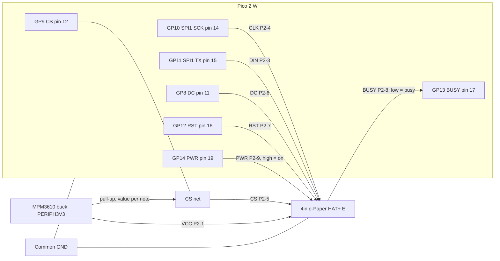
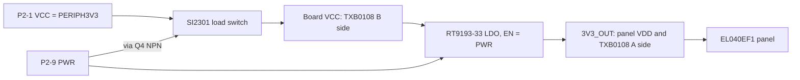
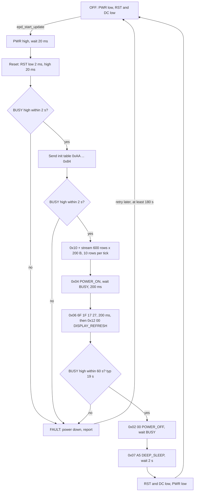

# Waveshare 4inch e-Paper HAT+ (E) — datasheet & integration notes

> Part: Waveshare "4inch e-Paper HAT+ (E)", SKU 27367, panel EL040EF1 (E Ink Spectra 6) · Role in project: low-power 6-colour status display driven over SPI1 · Configuration: Both

## 1. Overview

The board is a 4.0 in E Ink Spectra 6 panel (black, white, yellow, red, blue, green) on a Waveshare HAT+ driver board [2][3]. Natively the panel is **400 (H) × 600 (V) portrait**. Waveshare markets it as 600 × 400 [1][2]. The panel controller includes the source/gate drivers, TCON, PMIC and OTP waveform memory [3]. The driver board adds the following [4]:

- An SI2301 P-MOSFET load switch from VCC_INT to VCC, controlled by the **PWR** pin.
- An RT9193-33 LDO (VCC → 3V3_OUT, enabled by PWR) that supplies the panel.
- A TXB0108 auto-direction level translator between the host side (VCC) and the panel side (3V3_OUT).
- A CAT24C32 HAT+ ID EEPROM.
- A 40-pin Raspberry Pi header and a 9-pin GH1.25 header.

This project does **not** plug the HAT onto the Pico. It uses the 9-pin header and cable, as the build guide specifies [12]. A full refresh takes about 19 s, and partial refresh is not supported for this model [1][2]. The image stays on screen with no power, so a displayed screen does not prove that the alarm is running [12].

## 2. Key specifications

| Parameter | Value | Source |
|---|---|---|
| Diagonal / resolution | 4.0 in; 400 (H) × 600 (V) px (marketed as 600 × 400) | [3], [1] |
| Colours | 6: black, white, yellow, red, blue, green (E6 / Spectra 6) | [3], [2] |
| Pixel pitch / density | 0.141 × 0.141 mm, 180 ppi | [3] |
| Active area | 56.4 × 84.6 mm (H × V) | [3] |
| Panel outline | 66.0 × 99.0 × 0.85 mm | [3] |
| Driver board outline | 101.0 × 68.0 mm | [1], [2] |
| Board supply (VCC) | 3.3 V or 5 V; "IO level voltage should be the same as the supply voltage" | [1], [2] |
| Panel logic supply VDD | 2.4–3.6 V (typ 3.0 V); abs-max 2.4–3.6 V | [3] |
| Panel digital VIL / VIH | ≤ 0.2 × VDD / ≥ 0.8 × VDD | [3] |
| Interface | SPI mode 0 (CPOL 0, CPHA 0), MSB first, 4-wire with D/C; 3-wire 9-bit selectable via BS0 | [1], [3], [4], [6] |
| SPI clock used by Waveshare | 4 MHz (Python), 10 MHz (C, lg/spidev) | [9], [6] |
| Full refresh time | 19 s (Waveshare measured); panel spec "update time" 12 s typ @ 25 °C | [1], [3] |
| Refresh power | < 70 mW typ (board) | [1], [2] |
| Panel operating current | 15.4 mA typ, 22.7 mA max (typ pattern); 32.3/48.3 mA (high-load pattern) | [3] |
| Panel operating power | 46.2 mW typ / 68.2 mW max (typ pattern); 96.9 / 144.9 mW (high-load) @ VDD 3.0 V | [3] |
| Inrush current | 61.7 mA typ, 65.4 mA max | [3] |
| Panel standby current | 55.6 µA typ | [3] |
| Panel deep-sleep current | 1.1 µA typ | [3] |
| Board standby (PWR off) | < 0.01 µA "raw display", < 0.01 mW typ "driver board version" | [1], [2] |
| Operating temperature | 0–50 °C | [1], [3] |
| Storage temperature | −25 to 60 °C | [1], [3] |
| Generic e-paper working humidity | 35–65 %RH (Waveshare FAQ, all e-paper) | [1] |
| Min refresh interval | ≥ 180 s recommended | [1] |
| Max interval between refreshes | refresh at least once every 24 h | [1] |
| Refresh lifetime | ~1,000,000 refreshes "ideally" | [1] |
| Frame buffer | 4 bits/pixel → 200 B/row × 600 rows = 120,000 B | [6], [7] |
| White reflectance / contrast | 34 % typ / 22:1 typ | [3] |

### Colour encoding (4 bpp, two pixels per byte, high nibble = left pixel)

| Colour | Nibble | Byte for two pixels of this colour |
|---|---|---|
| Black | `0x0` | `0x00` |
| White | `0x1` | `0x11` |
| Yellow | `0x2` | `0x22` |
| Red | `0x3` | `0x33` |
| (unused) | `0x4` | — |
| Blue | `0x5` | `0x55` |
| Green | `0x6` | `0x66` |

Source: `EPD_4in0e.h` and the `epd4in0e.py` palette [6][7][8].

> ⚠️ The wiki's "Programming Principles" table (black 0, white 1, green 2, blue 3, red 4, yellow 5) does **not** match the official 4in0e driver. That table looks like it was copied from the 7-colour ACeP pages. Use the driver values above [1][7]. The wiki's Photoshop step that says "800*480" is also a copy-paste error [1].

## 3. Pinout / connections

### 9-pin GH1.25 header (P2) — used in this project

| P2 pin | Name | Dir (host view) | Function | Source |
|---|---|---|---|---|
| 1 | VCC (VCC_INT) | Power in | Board supply 3.3 V/5 V; feeds the PWR load switch | [4] |
| 2 | GND | — | Ground | [4] |
| 3 | DIN | Out | SPI MOSI → panel SI0 (via TXB0108) | [4] |
| 4 | CLK | Out | SPI SCK | [4] |
| 5 | CS | Out | Chip select, active low | [1], [3] |
| 6 | DC | Out | Low = command, high = data | [1], [3] |
| 7 | RST | Out | Reset, active low | [3] |
| 8 | BUSY | In | **Low = busy, high = idle** (BUSY_N) | [3], [6] |
| 9 | PWR | Out | **High = board powered**: switches the VCC load switch and enables the LDO. Low = board off | [4], [9] |

The kit ships a 20 cm GH1.25 9-pin cable [2]. The far-end connector type and the wire colours are unverified, so check them against the silkscreen.

### 40-pin HAT header (P1) — not used here

| Signal | RPi physical pin (BCM) | Source |
|---|---|---|
| VCC_INT | 2, 4 (5 V) | [4] |
| GND | 6, 9, 14, 20, 25, 30, 34, 39 | [4] |
| DIN | 19 (MOSI, GPIO10) | [1] |
| CLK | 23 (SCLK, GPIO11) | [1] |
| CS | 24 (CE0, GPIO8) | [1] |
| DC | 22 (GPIO25) | [1] |
| RST | 11 (GPIO17) | [1] |
| BUSY | 18 (GPIO24) | [1] |
| PWR | 12 (GPIO18) | [1] |
| HAT+ EEPROM | 27/28 (ID_SD/ID_SC); EEPROM VCC from RPi 3V3 via R19 0 Ω | [4] |

### On-board configuration parts

| Ref | Function | Setting for this project | Source |
|---|---|---|---|
| J2 "BS" (BS0) | VCC/1 → 3-line 9-bit SPI; GND/0 → 4-line SPI. BS1 is tied to GND | **0 / GND (4-line SPI with DC)**. The factory position is unverified, so check it | [4], [3] |
| R7 "NC/47K" | Fitted: PWR is pulled up to VCC_INT (always on). NC: PWR is controlled by a pin | Must be **NC** so GP14 controls power. Fitting is unverified, so measure it (see §8) | [4] |
| R8 10 kΩ / R11 100 kΩ | PWR → NPN Q4 base resistor and base pull-down. PWR defaults to off when floating | — | [4] |

## 4. Wiring in this project

### Step 1: isolated USB-powered bench setup

Start the build with [Step 1: Pico/toolchain/display bring-up](../display-bring-up.md)
and the sample in `examples/display-hello/`. For this isolated setup only, P2-1
VCC comes from **Pico 3V3 OUT, physical pin 36**, instead of PERIPH3V3.
P2-2 connects to Pico GND pin 13. Keep all seven GPIO connections in the table
below and use a **100 kΩ CS pull-up to Pico 3V3 OUT**, per the translator
restriction in this section [10][12][14].

No other peripheral or external supply is connected. The panel's documented
65.4 mA maximum inrush [3] is below the Pico's recommended external-load budget
of less than 300 mA (actual available current depends on MCU load and VSYS) [14].
Whole-board current and panel-side LDO voltage in this arrangement are unverified;
measure them at bring-up. Keep the panel rail at 2.5–3.6 V as noted below [1][3].
Never tie an external PERIPH3V3 regulator output to Pico 3V3 OUT [12].

The sample performs one refresh of black text on white, then deep-sleeps and
powers down the display. Resetting it can violate the 180 s minimum interval;
the operator must observe that interval between runs [1].

### Full alarm wiring

| HAT P2 pin | Signal | Pico 2 W | Pico pin | Net / note |
|---|---|---|---|---|
| 1 | VCC | — | — | PERIPH3V3 (MPM3610 buck output) [12] |
| 2 | GND | GND | 13 (or any GND) | Common GND |
| 3 | DIN | GP11 SPI1 TX | 15 | |
| 4 | CLK | GP10 SPI1 SCK | 14 | |
| 5 | CS | GP9 (SIO, software CS) | 12 | Pull-up to PERIPH3V3 (see ⚠️ below) |
| 6 | DC | GP8 (SIO) | 11 | |
| 7 | RST | GP12 (SIO) | 16 | |
| 8 | BUSY | GP13 (SIO input) | 17 | No internal pull (see §7) |
| 9 | PWR | GP14 (SIO) | 19 | High = on |
| — | MISO | not connected | — | Display is write-only [12] |

The 40-pin header stays unconnected. On this board, VCC_INT is tied to the 40-pin "5 V" pins 2/4, so those pins carry PERIPH3V3 whenever P2-1 is powered. Insulate the header [4].

> ⚠️ **Discrepancy with build guide (CS pull-up value).** The guide calls for a **10 kΩ** CS-to-PERIPH3V3 pull-up [12]. CS reaches the panel through the board's TXB0108. TI requires any external pull-up or pull-down on TXB0108 data I/Os to be **> 50 kΩ**, so it does not contend with the translator's weak output drivers [10]. The Pico is the only driver of CS, so 10 kΩ will probably work. To stay inside TI's guidance, consider **100 kΩ**. This is a design decision for the guide owner, so the guide is not changed here.

> ⚠️ **Discrepancy with build guide (VCC level).** The guide feeds VCC from PERIPH3V3 (3.3 V), and Waveshare permits 3.3 V or 5 V [1]. However, the on-board RT9193-33 LDO then runs in dropout, so the panel VDD (3V3_OUT) sits slightly below PERIPH3V3. Its exact value is unverified. It must stay ≥ 2.4 V (panel min) [3], and Waveshare recommends ≥ 2.5 V [1]. This also keeps the TXB0108 rule VCCA ≤ VCCB satisfied [10]. Measure it at bring-up.





## 5. Power requirements & consumption

| State | Supply | Current / power | Basis |
|---|---|---|---|
| Supply range at P2-1 | 3.3 V or 5 V (project: PERIPH3V3) | — | Datasheet/wiki [1] |
| Board off (PWR low) | PERIPH3V3 | < 0.01 mW typ board standby. Plus leakage of signal pins into the unpowered TXB0108 (Ioff ≤ ±2 µA per pin [10]). Plus any CS pull-up current | Product page [2], TI datasheet [10]. Total is unverified, so measure it |
| Panel deep sleep (PWR high, after 0x07 0xA5) | 3V3_OUT | 1.1 µA typ (panel only). The LDO/TXB quiescent current comes on top | Panel spec [3]. Board total unverified |
| Panel standby | 3V3_OUT | 55.6 µA typ | Panel spec [3] |
| Refresh, typical pattern | 3V3_OUT @ 3.0 V | 15.4 mA typ / 22.7 mA max; 46.2 / 68.2 mW | Panel spec [3] |
| Refresh, high-load (6-colour noise) | 3V3_OUT @ 3.0 V | 32.3 / 48.3 mA; 96.9 / 144.9 mW | Panel spec [3] |
| Inrush | 3V3_OUT | 61.7 mA typ, 65.4 mA max | Panel spec [3] |
| Board refresh power | VCC | < 70 mW typ | Wiki/product page [1][2] |
| PWR pin drive | GP14 | ≈ 0.25 mA. Estimate: (3.3 V − ~0.7 V V_BE) / 10 kΩ, less the 100 kΩ shunt | Estimate from schematic [4] |

**Energy per refresh (estimate):** 70 mW × 19 s ≈ 1.3 J, which is ≈ 0.11 mAh at 3.3 V. This is derived from [1] and has not been measured.

**PERIPH3V3 budget:** allow ≥ 70 mA peak for inrush [3] in addition to GPS and buzzer loads.

## 6. Programming / configuration

**Hardware configuration:**
- BS0 = 0 (4-line SPI).
- R7 not fitted.
- SPI mode 0, MSB first.
- No I²C use. The HAT+ EEPROM is only on the unused 40-pin header.

**Command set.** These sequences come from Waveshare's official `EPD_4in0e.c` and `epd4in0e.py`. The GitHub copy is byte-identical to the wiki zip [5][6][8]. There is **no 4in0e driver** in `waveshareteam/Pico_ePaper_Code` [11], so port this sequence yourself. Waveshare does not publish a controller command reference. Only the names in Waveshare's own comments are confirmed; other names are labelled "unverified".

| Step | Cmd | Data | Notes |
|---|---|---|---|
| Reset | — | — | RST high 20 ms → low 2 ms → high 20 ms, then wait BUSY high [6] |
| Wait | — | — | 30 ms after BUSY idle [6] |
| CMDH | `0xAA` | `49 55 20 08 09 18` | Named in driver [6] |
| (power setting, unverified name) | `0x01` | `3F` | [6] |
| (panel setting, unverified name) | `0x00` | `5F 69` | [6] |
| (unverified) | `0x05` | `40 1F 1F 2C` | [6] |
| (unverified) | `0x08` | `6F 1F 1F 22` | [6] |
| (booster, unverified name) | `0x06` | `6F 1F 17 17` | [6] |
| (unverified) | `0x03` | `00 54 00 44` | [6] |
| (TCON, unverified name) | `0x60` | `02 00` | [6] |
| (PLL, unverified name) | `0x30` | `08` | [6] |
| (VCOM/data interval, unverified name) | `0x50` | `3F` | [6] |
| Resolution | `0x61` | `01 90 02 58` | 0x0190 = 400, 0x0258 = 600 [6] |
| (unverified) | `0xE3` | `2F` | [6] |
| (unverified) | `0x84` | `01` | Then wait BUSY high [6] |
| Image data | `0x10` | 120,000 bytes | Row-major from top-left, 200 B/row [6] |
| POWER_ON | `0x04` | — | Wait BUSY, then 200 ms [6] |
| Second booster setting | `0x06` | `6F 1F 17 27` | Then 200 ms [6] |
| DISPLAY_REFRESH | `0x12` | `00` | Wait BUSY (~19 s) [6] |
| POWER_OFF | `0x02` | `00` | Wait BUSY [6] |
| DEEP_SLEEP | `0x07` | `A5` | Python then waits 2 s, drives RST/DC low and PWR low [8][9] |

Waveshare's `ReadBusyH` polls until BUSY is **high** and then adds 100 ms [6]. After deep sleep, the panel ignores data until it is reset and initialised again [1].

### Update sequence (state diagram)



### Pico SDK C — pins, low-level I/O

```c
#include "pico/stdlib.h"
#include "hardware/spi.h"

#define EPD_SPI   spi1
#define PIN_DC    8
#define PIN_CS    9
#define PIN_SCK   10
#define PIN_MOSI  11
#define PIN_RST   12
#define PIN_BUSY  13
#define PIN_PWR   14
#define EPD_W     400                 /* native pixels per row */
#define EPD_H     600
#define EPD_ROW_BYTES (EPD_W / 2)     /* 200 */

enum { EPD_BLACK = 0x0, EPD_WHITE = 0x1, EPD_YELLOW = 0x2,
       EPD_RED = 0x3, EPD_BLUE = 0x5, EPD_GREEN = 0x6 };

static void out_pin(uint pin, bool level) {
    gpio_init(pin); gpio_put(pin, level); gpio_set_dir(pin, GPIO_OUT);
}

void epd_gpio_init(void) {
    spi_init(EPD_SPI, 4000 * 1000);   /* Waveshare Python uses 4 MHz */
    spi_set_format(EPD_SPI, 8, SPI_CPOL_0, SPI_CPHA_0, SPI_MSB_FIRST);
    gpio_set_function(PIN_SCK, GPIO_FUNC_SPI);
    gpio_set_function(PIN_MOSI, GPIO_FUNC_SPI);
    out_pin(PIN_CS, 1);
    out_pin(PIN_DC, 0);
    out_pin(PIN_RST, 0);
    out_pin(PIN_PWR, 0);              /* board off */
    gpio_init(PIN_BUSY); gpio_set_dir(PIN_BUSY, GPIO_IN);
    gpio_disable_pulls(PIN_BUSY);
}

static inline bool epd_idle(void) { return gpio_get(PIN_BUSY); } /* high = idle */

static void epd_cmd(uint8_t c) {
    gpio_put(PIN_DC, 0); gpio_put(PIN_CS, 0);
    spi_write_blocking(EPD_SPI, &c, 1);   /* returns after shift completes */
    gpio_put(PIN_CS, 1);
}

static void epd_data(const uint8_t *d, size_t n) {
    gpio_put(PIN_DC, 1); gpio_put(PIN_CS, 0);
    spi_write_blocking(EPD_SPI, d, n);
    gpio_put(PIN_CS, 1);
}

static const uint8_t init_seq[] = {        /* cmd, len, data... */
    0xAA, 6, 0x49, 0x55, 0x20, 0x08, 0x09, 0x18,
    0x01, 1, 0x3F,
    0x00, 2, 0x5F, 0x69,
    0x05, 4, 0x40, 0x1F, 0x1F, 0x2C,
    0x08, 4, 0x6F, 0x1F, 0x1F, 0x22,
    0x06, 4, 0x6F, 0x1F, 0x17, 0x17,
    0x03, 4, 0x00, 0x54, 0x00, 0x44,
    0x60, 2, 0x02, 0x00,
    0x30, 1, 0x08,
    0x50, 1, 0x3F,
    0x61, 4, 0x01, 0x90, 0x02, 0x58,
    0xE3, 1, 0x2F,
    0x84, 1, 0x01,
};

static void epd_send_init(void) {
    for (size_t i = 0; i < sizeof init_seq; ) {
        uint8_t n = init_seq[i + 1];
        epd_cmd(init_seq[i]);
        epd_data(&init_seq[i + 2], n);
        i += 2u + n;
    }
}
```

Waveshare toggles CS around every data byte [6]. The code above holds CS low for a whole block, which is normal for this controller family but has not been verified for this panel. If the image is corrupted, fall back to sending one byte per CS cycle.

### Non-blocking update state machine

Call `epd_task()` from the main loop, alongside the GNSS, alarm and button services. Only short SPI bursts block: one row chunk at 4 MHz is about 4 ms for 2 kB. The 19 s refresh is handled as a polled BUSY wait with a timeout, so sounding and GNSS work keep running. A row callback renders each 200-byte row on demand. This means no 120,000-byte frame buffer is needed (that would be ≈ 23 % of the 520 kB SRAM [12]). A full 4 bpp buffer also fits if preferred.

```c
typedef void (*epd_row_fn)(uint16_t y, uint8_t row[EPD_ROW_BYTES]);
typedef enum { S_OFF, S_DELAY, S_BUSY, S_RST_LOW, S_RST_HIGH, S_RST_DONE,
               S_INIT, S_DTM, S_STREAM, S_PON, S_DRF_SET, S_DRF, S_POF, S_DSLP,
               S_PWR_OFF, S_FAULT } epd_state_t;

static struct {
    epd_state_t st, next;
    absolute_time_t t;
    uint32_t post_ms;
    uint16_t row;
    epd_row_fn fn;
} e = { .st = S_OFF };

static void go_delay(uint32_t ms, epd_state_t nx) {
    e.t = make_timeout_time_ms(ms); e.next = nx; e.st = S_DELAY;
}
static void go_busy(uint32_t timeout_ms, uint32_t post_ms, epd_state_t nx) {
    e.t = make_timeout_time_ms(timeout_ms); e.post_ms = post_ms;
    e.next = nx; e.st = S_BUSY;
}
static void epd_power_down(void) {      /* mirrors epdconfig.module_exit() */
    gpio_put(PIN_RST, 0); gpio_put(PIN_DC, 0); gpio_put(PIN_PWR, 0);
}

bool epd_start_update(epd_row_fn fn) {
    if (e.st != S_OFF && e.st != S_FAULT) return false;
    e.fn = fn; e.row = 0;
    gpio_put(PIN_PWR, 1);                 /* load switch + LDO on */
    gpio_put(PIN_RST, 1);
    go_delay(20, S_RST_LOW);              /* RST high 20 ms */
    return true;
}

bool epd_busy_fault(void) { return e.st == S_FAULT; }

void epd_task(void) {
    static uint8_t row[EPD_ROW_BYTES];
    switch (e.st) {
    case S_DELAY:
        if (time_reached(e.t)) e.st = e.next;
        break;
    case S_BUSY:
        if (epd_idle()) go_delay(e.post_ms, e.next);
        else if (time_reached(e.t)) { epd_power_down(); e.st = S_FAULT; }
        break;
    case S_RST_LOW:  gpio_put(PIN_RST, 0); go_delay(2, S_RST_HIGH); break;
    case S_RST_HIGH: gpio_put(PIN_RST, 1); go_delay(20, S_RST_DONE); break;
    case S_RST_DONE: go_busy(2000, 130, S_INIT); break;   /* 100 + 30 ms */
    case S_INIT: epd_send_init(); go_busy(2000, 100, S_DTM); break;
    case S_DTM:  epd_cmd(0x10); e.st = S_STREAM; break;  /* image data start */
    case S_STREAM:
        for (int n = 0; n < 10 && e.row < EPD_H; n++, e.row++) {
            e.fn(e.row, row);
            epd_data(row, EPD_ROW_BYTES);
        }
        if (e.row == EPD_H) e.st = S_PON;
        break;
    case S_PON:  epd_cmd(0x04); go_busy(2000, 300, S_DRF_SET); break;
    case S_DRF_SET: {
        static const uint8_t b[] = { 0x6F, 0x1F, 0x17, 0x27 };
        epd_cmd(0x06); epd_data(b, sizeof b);
        go_delay(200, S_DRF);
        break;
    }
    case S_DRF: {
        static const uint8_t z = 0x00;
        epd_cmd(0x12); epd_data(&z, 1);
        go_busy(60000, 100, S_POF);       /* ~19 s typ; 60 s project timeout */
        break;
    }
    case S_POF: {
        static const uint8_t z = 0x00;
        epd_cmd(0x02); epd_data(&z, 1);
        go_busy(2000, 100, S_DSLP);
        break;
    }
    case S_DSLP: {
        static const uint8_t k = 0xA5;
        epd_cmd(0x07); epd_data(&k, 1);
        go_delay(2000, S_PWR_OFF);        /* Python driver waits 2 s */
        break;
    }
    case S_PWR_OFF: epd_power_down(); e.st = S_OFF; break;
    default: break;
    }
}
```

The timeouts (2 s and 60 s) and the 10-rows-per-tick chunk size are project choices, not Waveshare values. In `S_FAULT` the board is powered down. Report a display fault and retry later, and never block alarm sounding.

The row callback packs pixels as `row[x/2] = (left << 4) | right`, matching `getbuffer()` [8]. To draw a landscape 600 × 400 layout, rotate it in the renderer. The native row is 400 px [7].

## 7. Design notes, limits & gotchas

- **BUSY polarity:** BUSY is active-low on this E model: low = busy, high = idle [3][6]. If you port code from a model where BUSY is high when busy, it will return immediately.
- **Power-down sequence:** after refresh, always run POWER_OFF (0x02) and then DEEP_SLEEP (0x07 0xA5), or cut PWR. Waveshare warns that leaving the panel at high voltage for long periods can damage it permanently [1]. Before driving PWR low, drive RST and DC low, as `module_exit()` does [9]. This reduces signal back-feed into the unpowered board.
- **PWR default:** R8/R11/Q4 hold the board off while GP14 floats during Pico reset or boot [4]. Confirm that R7 is not fitted.
- **Reset pulse:** keep the RST low pulse short (2 ms, as in the driver [6]). Waveshare's FAQ links "BUSY always busy" faults to bad resets [1].
- **Level translator:** the TXB0108 limits apply [10]:
  - Keep pull resistors > 50 kΩ (see the §4 CS note).
  - Do not enable a Pico internal pull on GP13 BUSY. The RP2350 pad pulls are around 50 kΩ, and erratum RP2350-E9 affects internal pull-downs [13]. If GP13 needs a defined level while the board is off, add an external pull-down of ≥ 100 kΩ. Then treat "low while unpowered" as busy, which the timeout catches.
  - With PWR low, the TXB isolates both sides (outputs high-Z), and Ioff on each pin is ≤ ±2 µA [10].
- **Refresh rate limits:**
  - Waveshare recommends **≥ 180 s** between refreshes and **at least one refresh every 24 h** [1].
  - Normal mode updates every 5 min, which complies. A STATUS tap could request a refresh within 180 s of the last one. Defer it until 180 s have passed and give feedback through the buzzer or LED instead [12].
  - Emergency60 updates only on entry and at selected SOC crossings, so it may go longer than 24 h without a refresh. Add a daily refresh, or a white clear before long storage [1].
- **No partial refresh:** use full refresh only. Each update takes about 19 s with flicker [1].
- **Temperature:**
  - The operating range is 0–50 °C [3]. Below that, refresh quality is not specified. Waveshare reports a colour cast at low temperature and suggests 6 h at 25 °C before refreshing [1].
  - In a cockpit, sun can push the panel past 50 °C. Mount it inside or shaded, and skip or postpone refreshes outside 0–50 °C (use a board or GNSS temperature if available).
- **Marine, UV and humidity:**
  - Waveshare recommends indoor use. UV or strong light can permanently disable the particles [1].
  - The panel's acceptable humidity is lower than marine air (generic 35–65 %RH [1]).
  - Use a UV-filtering window and a sealed enclosure with desiccant. The panel spec recommends a transparent protective plate [3].
  - Keep the FPC tail covered and avoid flexing the fragile FPC [1].
- **Back-powering:** follow the build guide's mixed-power rules. Do not drive DIN, CLK, CS, DC or RST high into the HAT while PERIPH3V3 is absent for long periods. Drive them low or set them to input [12].
- **Header power exposure:** the 40-pin header's 5 V pins sit on VCC_INT (PERIPH3V3). Do not let them short inside the enclosure [4].
- **SPI speed:** start at 4 MHz. Waveshare's C driver uses 10 MHz on the Pi [6]. Higher rates through the TXB0108 and a 20 cm cable are untested in this project.
- **Display ≠ liveness:** the image persists with no power. Do not rely on the screen to show that the alarm is alive [12].

## 8. Bring-up / test checklist

1. **Check the board before wiring.** Confirm that J2/BS0 is in the GND / "0" (4-line) position. Confirm that R7 (next to Q3/Q4) is not fitted [4].
2. **Power the board with PWR held low.** Power P2-1 from a 3.3 V bench supply with a current limit of about 100 mA, and tie PWR (P2-9) to GND. Measure supply current; expect only leakage (well under 1 mA). Check that 3V3_OUT (LDO output or C27) reads ≈ 0 V.
3. **Raise PWR to 3.3 V.** Check that 3V3_OUT is ≥ 2.5 V and ≤ 3.6 V [1][3]. Record the value.
4. **Wire the board to the Pico 2 W per §4**, with PERIPH3V3 off. Then power up and run `epd_gpio_init()`. Check that GP14 is low and that the board draws no load current.
5. **Check the reset response.** Start an update and scope BUSY (GP13) during reset. It should go high (idle) after reset and after init, within the 2 s timeout.
6. **Check the SPI signals.** Scope CLK and DIN: mode 0, 4 MHz, CS low framing each transfer, DC low for command bytes.
7. **Show colour bars.** Use a row callback that draws six horizontal bands: black, yellow, red, blue, green and white (`0x00`, `0x22`, `0x33`, `0x55`, `0x66`, `0x11`). Check the colours. A wrong colour means the nibble mapping is wrong.
8. **Time the refresh.** Measure from 0x12 until BUSY goes high. Expect about 19 s [1]. Log the PERIPH3V3 current: peak (expect < 70 mA [3]) and average.
9. **Confirm the main loop keeps running during refresh.** While the refresh runs, check that GNSS NMEA parsing at 1 Hz continues and that an alarm or buzzer test still sounds.
10. **Check sleep and power-off.** After 0x02, 0x07 0xA5 and PWR low, confirm that the board draws no current and the image is retained.
11. **Test the fault path.** Disconnect BUSY or hold it low, and confirm that the 60 s timeout leads to `S_FAULT`, power-down and a reported fault, with no hang.
12. **Test refresh rate limiting.** Confirm that a STATUS request within 180 s is deferred, and that a refresh happens at least once every 24 h in every mode.
13. **Test temperature behaviour (optional).** Run a refresh at the cold and hot ends of the expected enclosure temperature, and record any colour cast or timing change.

## 9. References

[1] Waveshare, "4inch e-Paper HAT+ (E) Manual" (wiki): https://www.waveshare.com/wiki/4inch_e-Paper_HAT+_(E)_Manual
[2] Waveshare, "4inch e-Paper HAT+ (E)" product page (SKU 27367): https://www.waveshare.com/4inch-e-paper-hat-plus-e.htm
[3] Waveshare, "4inch e-Paper User Manual" (EL040EF1 panel specification, v1.0 2024-09-05): https://files.waveshare.com/wiki/4inch-e-Paper-HAT%2B-(E)/4-inch-e-paper-user-manual.pdf
[4] Waveshare, "4inch e-Paper HAT+ Schematic": https://files.waveshare.com/wiki/4inch-e-Paper-HAT%2B-(E)/4inch_e-Paper_HAT%2B_Schematic.pdf
[5] Waveshare, 4inch e-Paper (E) demo code archive: https://files.waveshare.com/wiki/4inch-e-Paper-HAT%2B-(E)/4inch_e-Paper_E.zip
[6] Waveshare, `EPD_4in0e.c` (C driver): https://github.com/waveshareteam/e-Paper/blob/master/E-paper_Separate_Program/4inch_e-Paper_E/RaspberryPi_JetsonNano/c/lib/e-Paper/EPD_4in0e.c (SPI speed in `../Config/DEV_Config.c` in the same tree)
[7] Waveshare, `EPD_4in0e.h`: https://github.com/waveshareteam/e-Paper/blob/master/E-paper_Separate_Program/4inch_e-Paper_E/RaspberryPi_JetsonNano/c/lib/e-Paper/EPD_4in0e.h
[8] Waveshare, `epd4in0e.py` (Python driver): https://github.com/waveshareteam/e-Paper/blob/master/E-paper_Separate_Program/4inch_e-Paper_E/RaspberryPi_JetsonNano/python/lib/waveshare_epd/epd4in0e.py
[9] Waveshare, `epdconfig.py` (PWR/RST/DC handling, 4 MHz SPI mode 0): https://github.com/waveshareteam/e-Paper/blob/master/E-paper_Separate_Program/4inch_e-Paper_E/RaspberryPi_JetsonNano/python/lib/waveshare_epd/epdconfig.py
[10] Texas Instruments, TXB0108 datasheet: https://www.ti.com/lit/ds/symlink/txb0108.pdf
[11] Waveshare, Pico_ePaper_Code repository (no 4in0e driver present): https://github.com/waveshareteam/Pico_ePaper_Code
[12] Project build guide: docs/pico_2_w_anchor_alarm_build_guide_v2.md (sections 4–6, 8, 9)
[13] Raspberry Pi, RP2350 datasheet (GPIO pads, errata RP2350-E9): https://datasheets.raspberrypi.com/rp2350/rp2350-datasheet.pdf
[14] Raspberry Pi, Pico 2 W datasheet (3V3 OUT, power and pinout): https://pip.raspberrypi.com/documents/RP-008304-DS
