# Waveshare ESP32-S3-Touch-LCD-4 — datasheet & integration notes

> Part: Waveshare ESP32-S3-Touch-LCD-4, touch version (SKU 28154), latest revision V4.0 assumed · Role in project: controller, 4" 480 × 480 touch display, buzzer, RTC and boat-side interfaces for the planned ESP32-S3 touch edition · Configuration: ESP32 touch edition only (not used in the Pico 2 W edition)

## 1. Overview

A 4-inch square IPS touch display board built around an ESP32-S3-WROOM-1-N16R8 module [1][2]. The display is a 480 × 480 ST7701 panel driven over a 16-bit parallel RGB interface. A GT911 capacitive touch controller sits on the shared I²C bus [2][3]. The board also carries:

- a microSD slot, a PCF85063 RTC and a buzzer
- a 7–36 V DC input buck regulator
- a single-cell Li-ion charger and boost on a PH2.0 connector
- RS485 and CAN transceivers
- a native USB-C port [1][2][3]

The RGB panel uses almost every free GPIO. External signals are only available on a 10-pin 3.5 mm screw terminal: VIN/GND, RS485 A/B, CAN L/H, and a level-shifted I²C port with its own supply pin [2][3]. There is no general-purpose UART pin, no free GPIO header and no Qwiic socket.

Revision matters. V1/V2/V3 use a TCA9554 GPIO expander and an SW6106 power-bank IC. V4 replaces them with a CH32V003 helper MCU, an ETA6098 charger and an SCT12A0 boost converter [3][4][5][6]. The revision is printed on the silkscreen under the screen line; boards with no print are V1.0 [2]. Check the physical board before wiring anything.

Nothing in this file has been measured on hardware. All schematic readings are taken from the published PDFs and are marked "from schematic". Behaviour inferred from a schematic is marked **inferred** and still needs checking on a real board.

## 2. Key specifications

| Parameter | Value | Source |
|---|---|---|
| Module | ESP32-S3-WROOM-1-N16R8: 16 MB quad-SPI flash, 8 MB octal-SPI PSRAM | [2][7][10] |
| SoC | ESP32-S3, dual-core Xtensa LX7 up to 240 MHz, 512 KB SRAM, 384 KB ROM | [2][9] |
| Wireless | 2.4 GHz Wi-Fi 802.11 b/g/n, Bluetooth 5 LE, onboard PCB antenna | [2][10] |
| Display | 4", 480 × 480, IPS, 65K colours, ST7701 controller, RGB interface | [1][2] |
| Viewing angle | 160° | [1] |
| Display brightness (cd/m²) | Not published — **measure** | [1][2] |
| Touch | GT911 capacitive, 5 points, I²C plus interrupt | [2] |
| Board outline, touch version | 84.2 × 84.2 mm | [1] |
| DC input (VIN terminal) | Silkscreen "DC 7-36V"; V4 schematic text "DC 5~36V" (see §7) | [3][7] |
| VIN buck | XL1509-ADJE1, 2 A, datasheet input range 4.5–40 V | [3][12] |
| VIN buck output | ≈ 5.2 V, **calculated** from R42 12 kΩ / R43 39K and the 1.23 V reference | [3][12] |
| VIN reverse-polarity element | 1N5822 series Schottky (D11) | [3] |
| VIN onboard TVS | SMAJ40CA, bidirectional (D9) | [3] |
| 3.3 V rail | MP1658GTF-Z buck from the internal 5 V rail, schematic note "3A MAX" | [3] |
| USB | USB-C to ESP32-S3 native USB (GPIO19/20): power, flashing, logs | [2][3] |
| Battery connector | PH2.0, 2-pin, 3.7 V 1S Li-ion/LiPo | [2] |
| Battery charger, V4 | ETA6098; R_ISET 82 kΩ, which the ETA6098 datasheet lists as 2 A fast charge | [3][11] |
| Battery charger, V1–V3 | SW6106 power-bank IC; datasheet constant-current charge 2.5 A at 5 V input. Setting used on this board **unverified** | [4][5][6][17] |
| Charge termination voltage, V4 | 4.2 V (ETA6098 internal preset) | [11] |
| Battery temperature sensing | No NTC input on the V4 charger path — **inferred** from schematic | [3][11] |
| RTC | PCF85063ATL, 32.768 kHz crystal, BAT1 header for a rechargeable cell only | [2][3] |
| Buzzer | Onboard, driven by an SS8050 transistor from BEE_EN; sound level not published — **measure** | [3] |
| RS485 | V4: SP3485EN at 3.3 V, automatic direction control; V3: MAX13487 at 5 V | [3][4] |
| CAN | TJA1051T/3 transceiver, SM24CANB TVS, switchable 120 Ω termination | [3] |
| RS485/CAN isolation | None (shares board ground) | [3] |
| CAN/RS485 termination switch | 2-way DIP switch SW1, default off | [2][3] |
| External I²C | NDC7002N MOSFET level shifter, 4.7 kΩ pull-ups on both sides | [3] |
| Module ambient temperature, N16R8 | −40 to 65 °C (limited by the R8 octal PSRAM) | [10] |
| LCD/touch operating temperature | Not published — **unverified** | [1][2] |
| IP rating | None. Bare PCB with bonded glass | [1] |
| Board current draw | Not published — **measure** (see §5) | [1][2] |

## 3. Pinout / connections

### 3.1 10-pin screw terminal (H4)

The pin order is the same on all four schematics [3][4][5][6]. Silkscreen labels are grouped as "DC 7-36V VIN GND | RS485 A B | CAN L H | I2C VCC GND SDA SCL" [3].

| Pin | Net (schematic) | Silkscreen | Notes |
|---|---|---|---|
| 1 | VIN | VIN | 7–36 V DC. Goes through series 1N5822 and SMAJ40CA to the XL1509 [3] |
| 2 | GND | GND | Board ground |
| 3 | RS485_TX+ | A | Through PTC fuse F2. TVS and GDT to EARTH [3] |
| 4 | RS485_TX− | B | Through PTC fuse F1 [3] |
| 5 | CANL | L | SM24CANB TVS [3] |
| 6 | CANH | H | |
| 7 | I2C_VCC | VCC | 3V3 by default. Selected by solder pads H3, "0R default fitted to 3V3"; can be moved to 5V [3] |
| 8 | GND | GND | |
| 9 | D_SDA | SDA | Terminal side of the level shifter, pulled up to I2C_VCC [3] |
| 10 | D_SCL | SCL | |

The product page says two screw-terminal styles (vertical and horizontal) are supplied [1]. Terminal wire range and current rating are not published — **unverified**.

The net names "RS485_TX+/TX−" are historical. The pins are a half-duplex A/B pair [3].

### 3.2 GPIO map (V4.0)

From the V4.0 schematic GPIO table [3] and Waveshare's V4 hardware reference [7]:

| GPIO | Function | Notes |
|---|---|---|
| 0 | CAN RX (TJA1051 RXD) | Boot strapping pin (see §7) |
| 1 / 2 | LCD SPI SDA / SCL (ST7701 init); microSD CMD / CLK | Shared |
| 3, 5, 8–14, 17, 18, 21, 45–48 | RGB data lines | Not available |
| 4 | microSD D0 | |
| 6 | CAN TX | |
| 7 | I²C SCL: touch, RTC, CH32 helper, external terminal | |
| 15 | I²C SDA: same bus | |
| 16 | SYS_OUT (PWR key sense) | V1–V3: TP_INT |
| 19 / 20 | USB D− / D+ | Native USB |
| 38 / 39 / 40 / 41 / 42 | HSYNC / VSYNC / DE / PCLK / LCD_CS | |
| 43 | RS485 RX (transceiver RO) | Default UART0 TX pin (see §7) |
| 44 | RS485 TX (transceiver DI) | Default UART0 RX pin |

The V4 schematic table labels GPIO43 "RS485_TX/TX0" and GPIO44 "RS485_RX/RX0", which names the transceiver side. Waveshare's V4 reference and the Arduino demo (`Serial2.begin(115200, SERIAL_8N1, 43, 44)`, RX first) give ESP32 RX = GPIO43 and TX = GPIO44 [2][7].

No GPIO is free for a second UART, a button or an alarm driver.

### 3.3 I/O expander / helper MCU

**V4.0: CH32V003F4U6 at I²C address 0x24** [3][7][8]. It has registers for direction (0x02), output (0x03), input (0x04), PWM (0x05), ADC (0x06) and RTC interrupt (0x07) [8].

| EXIO | Function (V4) | Source |
|---|---|---|
| EXIO1 | TP_RST (touch reset) | [3][8] |
| EXIO2 | TP_INT (touch interrupt) | [3] |
| EXIO3 | LCD_RST | [3][8] |
| EXIO4 | SD_CS | [3] |
| EXIO5 | SYS_EN (battery power latch) | [3][8] |
| EXIO6 | BEE_EN (buzzer) | [3][8] |
| EXIO7 | RTC_INT | [3][8] |
| EXIO_PWM | Backlight dimming into the AP3032 feedback node (**inferred**) | [3][8] |
| EXIO_ADC | Battery voltage through a 20 kΩ / 10 kΩ divider (÷3) | [3][8] |
| EXIO0 / STAT | Charger STAT input through R12 0R (**inferred**) | [3] |

Waveshare warns that display reset, touch reset, backlight, buzzer, system power and battery measurement all depend on this helper. A CH32 or shared-bus failure can therefore look like several unrelated faults [7].

**V1/V2/V3: TCA9554PWR at 0x20** (A0 pulled to GND through R13 0R; A1/A2 to GND) [4][5][6]. The schematic tables number the outputs EXIO1–EXIO8:

| Schematic EXIO | TCA9554 port | Function | Wiki name |
|---|---|---|---|
| EXIO1 | P0 | TP_RST | EXIO0 |
| EXIO2 | P1 | BL_EN | EXIO1 |
| EXIO3 | P2 | LCD_RST | EXIO2 |
| EXIO4 | P3 | SD_CS | EXIO3 |
| EXIO5 | P4 | — (wiki: BLC) | EXIO4 |
| EXIO6 | P5 | BEE_EN | EXIO5 |
| EXIO7 | P6 | RTC_INT | EXIO6 |
| EXIO8 | P7 | IRQ (wiki: DO1) | EXIO7 |

The wiki uses 0-based names and lists EXIO7 as "DO1" [2]. **None of the four schematics routes a DO1 or any digital output to the 10-pin terminal** [3][4][5][6]. On V4 there is no DO1 net at all. Do not plan an external alarm driver around DO1.

### 3.4 I²C devices on the shared bus

| Device | Address | Revision | Source |
|---|---|---|---|
| GT911 touch | 0x5D or 0x14 (7-bit; the datasheet gives 8-bit 0xBA/0x28), selected by INT level during reset | All | [13] |
| PCF85063 RTC | 0x51 | All | [7] |
| CH32V003 helper | 0x24 | V4 | [7][8] |
| TCA9554 expander | 0x20 | V1–V3 | [4][5][6] |
| SW6106 power IC | 0x3C | V1–V3 | [2][17] |
| QMI8658 IMU | Footprint only, marked NC (not fitted) | V3, V4 | [3][4] |

On V1/V2 the expander uses a separate bus on GPIO8/GPIO9. From V3 onward GPIO8/9 are RGB data and everything shares GPIO7/GPIO15 [2][4][5][6]. Waveshare's V4 code runs this bus at 400 kHz [8].

## 4. Wiring in this project

This board is the controller of the planned [ESP32-S3 touch edition](../esp32_s3_touch_lcd_4_anchor_alarm_build_guide.md). Planned terminal use (not built):

| Terminal pin | Connection in this project | See |
|---|---|---|
| 1 VIN / 2 GND | Fused, switched, protected boat 12 V | [marine-12v-direct-input-protection.md](marine-12v-direct-input-protection.md) |
| 3 A / 4 B | NEO-F10N through a TTL-to-RS485 adapter | [sparkfun-neo-f10n-gnss.md](sparkfun-neo-f10n-gnss.md) §10, [waveshare-ttl-to-rs485-b.md](waveshare-ttl-to-rs485-b.md) |
| 5 L / 6 H | Unused in baseline. Reserved for an NMEA 2000 option | Build guide §6 |
| 7 VCC / 8 GND | 3.3 V supply for the GNSS breakout and adapter TTL side; optional BMP390 VIN/GND in parallel after supply-budget review | [sparkfun-neo-f10n-gnss.md](sparkfun-neo-f10n-gnss.md) §10; [adafruit-bmp390.md](adafruit-bmp390.md) §4 |
| 9 SDA / 10 SCL | Unused in baseline. Optional sounder, ACK button or BMP390 on shared I²C | Build guide §6; [adafruit-bmp390.md](adafruit-bmp390.md) |
| PH2.0 battery | Protected 1S pack | [lipo-1s-protected-battery.md](lipo-1s-protected-battery.md) §10 |
| USB-C | Service and flashing only. Unplugged when installed | §7 |

**Optional BMP390, not built.** Inspect H3 and measure I2C_VCC at 3.3 V before connecting H4 pins 7/8/9/10 to sensor VIN/GND/SDA/SCL. Use a short QT-to-flying-lead adapter; there is no onboard QT socket. The default 0x77 (ADDR bridged: 0x76) conflicts with none of the devices in §3.4; sensor pinout and address sources are in [adafruit-bmp390.md](adafruit-bmp390.md) §§2–4. Review combined pull-ups, capacitance, mixed-power paths and current with GNSS and converter. Leave sensor 3Vo, CS, SDO and INT disconnected. Keep sensor transactions bounded and below buzzer/SYS_EN priority, with visible missing/stale/fault status and no shared-rail cycling to reset the sensor. A physical bus short still threatens alarm control (§7). Thermal separation, a protected atmospheric vent and installed accuracy/current all need qualification; the bare breakout is not waterproof.

### 4.1 Power paths (V4.0, from schematic [3])

```mermaid
flowchart LR
    VIN["Terminal VIN 7-36 V"] --> D11["1N5822 series diode"]
    D11 --> TVS["SMAJ40CA TVS"]
    TVS --> XL["XL1509 buck about 5.2 V"]
    XL --> VCCIN["VCCIN / DC_5V"]
    VCCIN --> Q5["AO3401 ideal diode"]
    USBC["USB-C VBUS + TVS"] --> U5V["USB0_5V"]
    Q5 --> U5V
    U5V --> D1["MBR230 diode"]
    D1 --> R5["Internal 5V rail"]
    U5V --> CHG["ETA6098 charger"]
    CHG --> BAT["PH2.0 battery B+"]
    BAT --> BST["SCT12A0 boost to Boost_5V"]
    BST --> Q4["AO3401 latch: PWR key or SYS_EN"]
    Q4 --> Q2["AO3401 to 5V rail"]
    Q2 --> R5
    R5 --> BUCK["MP1658 buck"]
    BUCK --> V33["VCC3V3: ESP32-S3, LCD logic, touch, RTC, CH32, SP3485"]
    V33 --> I2CV["Terminal I2C_VCC default"]
    R5 --> BL["AP3032 backlight boost"]
    R5 --> CAN["TJA1051 VCC"]
```



Notes (all **inferred** from the schematic, not measured):

- **VIN start-up.** With VIN present, the 5 V rail and MP1658 (EN pulled up) start without a key press. The board should restart by itself when boat power returns.
- **Boost hand-off.** The boost EN is pulled low through Q3 while USB0_5V is present. The boost should only run when VIN and USB are both absent.
- **Battery latch.** Battery power reaches the 5 V rail only while Q4 is on. Q4 turns on from the PWR key (Key1) or from SYS_EN (EXIO5 → T1). Firmware must assert SYS_EN early, or a VIN loss will turn the board off instead of switching to battery. Waveshare's V4 code sets SYS_EN in its display power-on sequence [8].
- **PWR key sense.** The key is also sensed on GPIO16 (SYS_OUT). The wiki describes press to power on and double-click to power off [2].
- **Charger supply.** The ETA6098 is fed from USB0_5V, which is fed from VIN as well as USB. VIN therefore charges the battery.
- **Hand-off timing.** The time to switch from VIN to battery, and whether the ESP32-S3 browns out during it, is **unverified — measure**.

**V1–V3 power path.** These revisions use the SW6106 for charge, discharge and the 5 V output. Its LED pins double as an I²C slave on the shared bus, and its key input is the PWR button [4][5][6]. The BSET resistor table sets the charge-termination voltage: NC = 4.2 V, 62 kΩ = 4.35 V, 30 kΩ = 4.4 V, 10 kΩ = 4.3 V [4]. R15 is marked "NC/62K", so the fitted value needs checking — **unverified**. A 4.35 V setting would overcharge a standard 4.2 V pack.

### 4.2 Backlight

V4 backlight path [3]:

- An AP3032KTR-G1 boost converter is fed from the 5 V rail and drives LED_A/LED_K of the panel.
- Its CTRL pin is pulled up through R28 100 kΩ (net BL_EN).
- EXIO_PWM from the CH32 is injected into the feedback node through R40 10 kΩ / C27. This looks like analogue dimming set by the CH32 PWM register (**inferred**).
- The current-sense resistor is R37 5.1 Ω.

On V1–V3, BL_EN comes from the expander (schematic EXIO2) [4][5][6]. The schematic does not show whether those revisions can dim smoothly or only switch on and off — **unverified**.

Minimum stable brightness, flicker and backlight current at each level are **unverified — measure**. They decide whether a night mode is usable (build guide §9).

### 4.3 Buzzer

BEE_EN drives an SS8050 NPN transistor through 1 kΩ, which switches a 3.3 V buzzer (B1) [3]. It is controlled through the expander, so a stuck I²C bus can also silence it. Sound pressure level is not published. It is very unlikely to be heard below deck over wind and engine noise, but this is **unverified — measure**. See build guide §9 for the external sounder options.

## 5. Power requirements & consumption

Waveshare publishes no current figures [1][2]. The numbers below are datasheet figures for single parts or are labelled estimates. **Measure the real board at VIN.**

| Load | Value | Source / status |
|---|---|---|
| ESP32-S3, Wi-Fi TX peak (802.11b, 21 dBm) | 340 mA at 3.3 V | [9] datasheet, chip only |
| ESP32-S3, Wi-Fi RX (HT20) | 88 mA at 3.3 V | [9] |
| ESP32-S3, modem-sleep, 240 MHz, dual core | 51.2–107.9 mA depending on load and peripheral clocks | [9] |
| ESP32-S3, light-sleep / deep-sleep | 240 µA / 7–8 µA, plus about 140 µA for 8 MB octal PSRAM in light-sleep | [9] |
| WROOM-1 supply requirement | ≥ 0.5 A external supply capability | [10] |
| RGB panel streaming from PSRAM | Keeps the CPU, PSRAM and LCD peripheral active; sleep modes do not apply while the screen is on | [14]; **measure** |
| Backlight | **measure** at full, night and off | — |
| Board quiescent (LEDs, CH32, regulators) | **measure** | PWR LED is fed from 3V3 through 1 kΩ [3] |
| Battery charging | Up to 2 A into the cell on V4 (R_ISET 82 kΩ) | [3][11]; **measure** the actual current |
| XL1509 output limit | 2 A at ≈ 5.2 V, shared by the system load and the charger | [3][12]; **calculated** |

The XL1509 can supply about 10 W at its output (2 A × 5.2 V, **calculated**). If the charger really draws 2 A from a low battery while the backlight and Wi-Fi are on, the VIN buck may reach its current limit. Measure the VIN current during a low-battery recharge before you size the fuse and choose the battery.

### 5.1 Dark vs light background

On this board the screen colours should make little difference to power. The panel is a backlit IPS LCD [1]. The AP3032 drives the LED backlight at a level set by BL_EN and the CH32 PWM, not by the image [3]. The liquid crystal only passes or blocks that light, so a black screen uses about the same backlight power as a white one [18][19].

- A display maker gives the dark-mode saving on LCDs as typically 1–5 % [19]. That figure is generic, not for this panel — **unverified**.
- In a measured phone LCD the panel itself drew 33.1 mW on a white screen and 74.2 mW on a black screen. The backlight on the same phone ranged from 7.8 mW to 414 mW [18]. So the content effect is small, and it can even go the other way (dark costing more), depending on the panel type. Whether this IPS panel draws more or less on black is **unverified — measure**.
- At a very low night backlight level, the panel's content effect may be a larger share of a small total. In absolute terms it is still small (**inferred** from [18]).
- This differs from OLED, where black pixels are switched off and save real power [19], and from the Pico edition's e-paper, which keeps its image without power and draws its operating power mainly while refreshing (see [waveshare-4in-epaper-hat-plus-e.md](waveshare-4in-epaper-hat-plus-e.md)).

Practical consequence: choose the dark/night palette for night vision and glare, not to save power. Save power by dimming the backlight and by switching it off after an idle timeout with wake-on-touch. Backlight-off must never delay or hide an alarm: the alarm forces full backlight and the buzzer.

Measurement to do: at a fixed backlight level, measure the VIN current with a full-screen white image and a full-screen black image, at full and at night backlight levels (bring-up step 9).

## 6. Programming / configuration

- **Frameworks.** Waveshare supports ESP-IDF ≥ v5.3.1 and Arduino-ESP32 core 3.0.7. The RS485 FAQ recommends ESP-IDF v5.5.2 [2].
- **Arduino libraries** used by the demos [2]:
  - ESP32_Display_Panel v0.1.8
  - ESP32_IO_Expander v0.0.4
  - LVGL v8.4.0
  - PSRAM must be set to OPI.
- **V4 demo repository.** github.com/waveshareteam/ESP32-S3-Touch-LCD-4 has ESP-IDF and Arduino examples, a managed BSP and the CH32 helper library [7][8].
- **Display driver.** The display uses the ESP-IDF `esp_lcd` RGB panel driver with framebuffers in PSRAM [14].
- **LVGL performance.** Waveshare's ESP-IDF v5.3 LVGL demo reports about 26 fps average on one core, with a 21 MHz PCLK [2].
- **Waveshare menuconfig settings** [2]:
  - flash QIO at 120 MHz
  - octal PSRAM at 120 MHz, which needs `CONFIG_IDF_EXPERIMENTAL_FEATURES`
  - FreeRTOS tick 1000 Hz
  - CPU 240 MHz

  Treat the 120 MHz PSRAM setting as experimental. Qualify it over temperature before relying on it.
- **Flashing.** Flash over USB-C (native USB-Serial-JTAG). For recovery, hold BOOT while powering on to force download mode, flash, then power-cycle [2]. Waveshare reports that the VS Code ESP-IDF plugin can produce a pixel-offset build and recommends building from the command line [2].
- **V1–V3 auto power-off fix.** On boards with the SW6106, the light-load auto power-off must be disabled. The wiki gives two options [2]:
  - write 0x0A to register 0x38 of I²C device 0x3C at each power-up, or
  - write 0x01 to register 0x03 every second.

Illustrative ESP-IDF fragment for V4 power latching. It is not compiled or tested, and the register meaning comes from [8]:

```c
// Assert SYS_EN early so a VIN loss hands over to battery instead of shutting down.
#define CH32_ADDR   0x24
#define CH32_REG_OUT 0x03
#define CH32_SYS_EN  (1 << 5)
uint8_t out[2] = { CH32_REG_OUT, CH32_SYS_EN | (1 << 3) | (1 << 1) }; // SYS_EN, LCD_RST, TP_RST high
i2c_master_transmit(ch32_dev, out, sizeof out, 50 /* ms timeout */);
```

## 7. Design notes, limits & gotchas

- **VIN rating discrepancy.**
  - The silkscreen says 7–36 V [3]. The V4 schematic text and Waveshare's V4 reference say 5–36 V [3][7].
  - The XL1509 itself is rated 4.5–40 V [12], but it cannot hold 5.2 V out from a 5 V input.
  - Use **7–36 V** as the planning range.
  - The onboard SMAJ40CA does not start clamping until above 40 V. It does not protect against a boat load dump (79–101 V unsuppressed). External protection is required: see [marine-12v-direct-input-protection.md](marine-12v-direct-input-protection.md).
- **Fast-charge USB sources.** Waveshare reports that some fast-charge USB ports can over-volt the input TVS and ideal-diode MOSFET and burn them. Their fix is to remove those parts, after which the board needs a PWR key press to start [2]. Use a plain 5 V USB port for service.
- **UART0 pins and RS485.**
  - The ESP32-S3 defaults are U0TXD = GPIO43 and U0RXD = GPIO44 [9]. On this board GPIO43 is the RS485 receiver output (RO) [3][7].
  - ROM boot messages go to UART0 and USB-Serial-JTAG by default [9]. During boot the ESP32 may therefore drive GPIO43 against RO, or send boot text into the RS485 path.
  - Move the IDF console to USB-Serial-JTAG.
  - Treat bytes received during boot as garbage.
  - Whether ROM UART printing should be disabled is a separate decision. The control is GPIO46 strapping plus eFuse [9], and an eFuse change is permanent. **Unverified on hardware.**
- **GPIO0 is CAN RX and a boot strapping pin.** GPIO0 selects the boot mode [9]. If a CAN bus holds TJA1051 RXD dominant (low) during reset, the board could start in download mode (**inferred**). The wiki says the V1/V2 CAN fix requires removing parts [2]. Keep CAN disconnected in the baseline.
- **I²C stuck low on V1–V3.** On wide-voltage (VIN) power without a battery, the SW6106 can pull the I²C lines low, and no devices are found. Waveshare's fix is to fit a battery or cut the SW6106 I²C lines [2]. This takes out touch, the RTC and the expander, including the buzzer enable. It is a strong reason to prefer V4.
- **Single shared I²C bus.** Touch, RTC, the helper/expander (buzzer, backlight, power latch) and the external terminal all share GPIO7/GPIO15 [3][7]. An external device or cable fault on the terminal I²C can disable the buzzer and the power latch. Keep the alarm-critical design off the terminal I²C, use bounded timeouts and implement bus recovery [8].
- **RS485 and CAN are not isolated.**
  - The board ground is common with VIN negative.
  - The RS485 surge path goes to a net called EARTH, which is tied to GND by R71 0R [3].
  - NMEA 0183 listeners are expected to be opto-isolated [15]. A direct connection from this board to boat NMEA 0183 or NMEA 2000 needs an isolator. See build guide §6.
- **Module temperature.** The N16R8 module is rated −40 to 65 °C ambient [10]. A sealed, sun-heated enclosure in the cockpit can exceed that. Keep the board below deck or shaded, and log the enclosure temperature.
- **RTC battery.** BAT1 is charged directly from 3V3 through a Schottky diode with no current limit. Fit only a rechargeable cell (for example ML1220 class), never a CR coin cell [2][3].
- **Bonded screen.** Do not pry the screen off the board [2].
- **IPS in sunlight.** No brightness figure is published [1][2]. Treat direct-sun readability as unknown until measured.
- **USB-C VBUS also feeds USB0_5V**, and from there the charger and the 5 V rail [3]. Bench USB power and VIN can be present together through the ideal-diode OR. A powered USB cable still powers the GNSS through I2C_VCC.

## 8. Bring-up / test checklist

1. Read the revision under the screen line. Photograph both sides of the board. Confirm the CH32V003 (V4) or the TCA9554/SW6106 (V1–V3) [2].
2. Power from USB-C only. Flash a Waveshare V4 demo. Confirm display, touch and an I²C scan (expect 0x24, 0x51, 0x5D or 0x14 on V4) [7][8].
3. Bench supply on VIN at 7, 12, 14.8, 16 and 36 V with a current limit. Record the current with the backlight at full, at night level and off, with Wi-Fi idle, and during a Wi-Fi scan.
4. Measure the XL1509 output (≈ 5.2 V expected, **calculated**) and the 3V3 rail under load.
5. Fit a protected 1S pack (polarity checked). Measure the charge current at 3.6 V cell voltage, the VIN current while charging, and the board temperature after 30 minutes.
6. Assert SYS_EN, then remove VIN while logging the 3V3 rail and the ESP32 reset reason. Repeat 20 times. Then repeat without SYS_EN to confirm the board shuts down.
7. Test the PWR key: power on from battery only, then double-click off [2].
8. Buzzer: measure dB(A) at 1 m and through a closed cabin door.
9. Backlight: find the lowest stable level for night use, check for flicker, and measure the current at that level. At full and at night level, measure the VIN current with a full-screen white image and a full-screen black image to check the dark-background difference (§5.1).
10. RS485 loopback with the adapter (see [waveshare-ttl-to-rs485-b.md](waveshare-ttl-to-rs485-b.md)). Confirm boot-time output on GPIO43 does not upset the link.
11. Wet-glass touch test: water drops and spray on the screen while the alarm screen is shown. Log false touches.
12. Heat soak in the planned enclosure. Log the internal temperature against the 65 °C module limit [10].

## 9. References

1. Waveshare, "ESP32-S3 4inch Display Development Board, 480×480, 65K Colors, Optional for Touch Function" product page (SKU 28154 touch / 30871 non-touch) — https://www.waveshare.com/esp32-s3-touch-lcd-4.htm
2. Waveshare Wiki, "ESP32-S3-Touch-LCD-4" (revision oldid 111125: hardware description, GPIO table, FAQ, development environment) — https://www.waveshare.com/wiki/ESP32-S3-Touch-LCD-4
3. Waveshare, "ESP32-S3-Touch-LCD-4 V4.0" schematic — https://files.waveshare.com/wiki/ESP32-S3-Touch-LCD-4/ESP32-S3-Touch-LCD-4%20V4.0.pdf
4. Waveshare, "ESP32-S3-Touch-LCD-4 V3.0" schematic — https://files.waveshare.com/wiki/ESP32-S3-Touch-LCD-4/ESP32-S3-Touch-LCD-4_V3.0.pdf
5. Waveshare, ESP32-S3-Touch-LCD-4 V2 schematic (the title block reads "V1.1") — https://files.waveshare.com/wiki/ESP32-S3-Touch-LCD-4/ESP32-S3-Touch-LCD-4-V2-Sch.pdf
6. Waveshare, original ESP32-S3-Touch-LCD-4 schematic (published as "datasheet", no revision in the title block) — https://files.waveshare.com/wiki/ESP32-S3-Touch-LCD-4/ESP32-S3-Touch-LCD-4datasheet.pdf
7. Waveshare, `hardware/HARDWARE_REFERENCE.md` in waveshareteam/ESP32-S3-Touch-LCD-4 (V4.0 summary, CH32 0x24, RTC 0x51, RS485 and CAN pins) — https://github.com/waveshareteam/ESP32-S3-Touch-LCD-4/blob/main/hardware/HARDWARE_REFERENCE.md
8. Waveshare, `WS_CH32_IO.h` CH32V003 helper library (registers, EXIO bit map, I²C 400 kHz, battery divider) — https://github.com/waveshareteam/ESP32-S3-Touch-LCD-4/blob/main/examples/arduino/libraries/WS_CH32_IO/src/WS_CH32_IO.h
9. Espressif, ESP32-S3 Series Datasheet v1.6 — https://files.waveshare.com/wiki/common/Esp32-s3_datasheet_en.pdf (also see [espressif-esp32-s3.md](espressif-esp32-s3.md))
10. Espressif, ESP32-S3-WROOM-1 / WROOM-1U Datasheet v1.2 — https://files.waveshare.com/wiki/common/Esp32-s3-wroom-1_wroom-1u_datasheet_en.pdf
11. ETA Solutions, ETA6098 "32V Input Standoff Voltage, 2.5A Switching Mode Battery Charger" datasheet V1.1 — https://www.eta-semi.com/wp-content/uploads/2022/03/ETA6098_V1.1.pdf
12. XLSEMI, XL1509 "150KHz 40V 2A Switching Current Mode Step-Down Converter" datasheet — https://www.alldatasheet.com/datasheet-pdf/pdf/1134347/XLSEMI/XL1509.html
13. Goodix, GT911 datasheet (I²C slave addresses 0xBA/0xBB and 0x28/0x29) — https://files.waveshare.com/wiki/common/GT911_EN_Datasheet.pdf
14. Espressif, ESP-IDF Programming Guide (ESP32-S3), "RGB Interfaced LCD" — https://docs.espressif.com/projects/esp-idf/en/stable/esp32s3/api-reference/peripherals/lcd/rgb_lcd.html
15. Actisense, "The NMEA 0183 Information sheet" (listener opto-isolation, RS-422 levels) — https://actisense.com/wp-content/uploads/2020/01/NMEA-0183-Information-sheet-issue-4-1-1.pdf
16. MaxLinear, SP3485 datasheet — https://www.maxlinear.com/ds/sp3485.pdf
17. Zhuhai iSmartWare, SW6106 "Bidirectional Fast Charge Power Bank" datasheet DS008_v2.2 (charge current, I²C slave address 0x3C) — https://files.waveshare.com/wiki/common/SW6106%20Datasheet.pdf
18. A. Carroll and G. Heiser, "An Analysis of Power Consumption in a Smartphone", USENIX ATC 2010 (§3.1.3: backlight 7.8–414 mW; LCD panel 33.1 mW white vs 74.2 mW black) — https://www.usenix.org/legacy/event/atc10/tech/full_papers/Carroll.pdf
19. Reshine Display, "Does Dark Screen Save Power on LCD?" (LCD dark-mode saving typically 1–5 %; OLED comparison) — https://www.reshine-display.com/does-dark-screen-save-power-on-lcd.html
