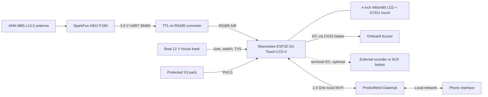
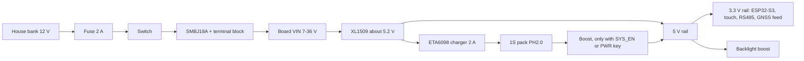

# ESP32-S3 touch boat anchor alarm — build guide

Revision 1.0 · 23 October 2026

Copyright (c) 2026 Sam Jarvinen. Part of
[moorpheus](https://github.com/frye/moorpheus), licensed under
[Creative Commons Attribution 4.0 International (CC BY 4.0)](LICENSE).

## 1. Scope and configuration choices

This is the ESP32-S3 touch edition of the anchor alarm. It is a second, parallel hardware edition. The [Pico 2 W edition](pico_2_w_anchor_alarm_build_guide_v2.md) stays as it is. Pins, rails and policies in this guide apply only to this edition. [R19]

This edition is at the planning stage. There is no firmware for it, and none of the hardware has been bought, assembled or tested. The firmware sections are proposals.

Baseline:

- Waveshare ESP32-S3-Touch-LCD-4, **touch version**: ESP32-S3-WROOM-1-N16R8, 4" 480 × 480 IPS LCD, GT911 capacitive touch, onboard buzzer, RTC, Li-ion charger, RS485 and CAN on a 10-pin screw terminal. Hardware revision V4.0 is assumed, and the differences from V1–V3 are recorded in the board note. [R1][R2][R3]
- SparkFun NEO-F10N L1/L5 GNSS breakout with an ANN-MB5 antenna, as in the Pico edition, connected through a TTL-to-RS485 converter. [R11][R13][R14]
- Boat 12 V house bank directly into the board's wide-input terminal, with external fuse, switch and TVS. [R18]
- Protected 1S Li-ion backup pack on the board's PH2.0 connector. [R15][R18]
- Touch screen as the main control. Physical acknowledge button optional (§9).
- PredictWind DataHub local Wi-Fi connection, as in the Pico edition. [R19]

Optional items in this guide:

- an external sounder on the terminal I²C (§9);
- a physical ACK button on the terminal I²C (§9);
- NMEA 0183 or NMEA 2000 input from the boat network instead of the NEO-F10N (§6, future only).

This is a prototype plan, not a certified marine safety system or fabrication-ready PCB schematic. Part choices, source ratings, grounding, cable routing and environmental protection must be reviewed before permanent installation. Use an independent anchor-watch method during trials.

## 2. Differences from the Pico 2 W edition

| Item | Pico 2 W edition | ESP32-S3 touch edition |
|---|---|---|
| Controller | Raspberry Pi Pico 2 W (RP2350) | ESP32-S3-WROOM-1-N16R8 on the display board [R2] |
| Display | 4" Spectra 6 e-paper, 600 × 400, ≈ 19 s full refresh, reflective | 4" IPS LCD, 480 × 480, RGB interface, backlit, continuous refresh [R1] |
| Controls | Two GPIO buttons | Capacitive touch. Optional I²C button (§9) |
| GNSS link | UART0 on GP0/GP1 | RS485 through a TTL-to-RS485 converter [R14] |
| Sounder | Qwiic Buzzer (baseline) or large piezo on GP17 (Optional A) | Onboard buzzer through the CH32 helper. External sounder optional on terminal I²C (§9) |
| Boat power | Separate 12 V → 5 V converter | Board's own 7–36 V input. External fuse, switch and TVS [R3] |
| Charger and battery boost | bq24074 + PowerBoost 1000 Basic | Onboard ETA6098 charger and SCT12A0 boost (V4) [R3] |
| Battery gauge | MAX17048 | Pack voltage on the CH32 ADC only [R4] |
| Free GPIO | Several, allocated in the Pico guide | None. All external I/O goes through the terminal [R3] |
| Firmware | Pico SDK C | ESP-IDF C with LVGL (proposal, §8) |
| Updates | Pico guide approach | ESP-IDF OTA with rollback (proposal, §8) [R8] |
| Main power concern | Display refresh rate and sleep | Backlight on time and level |

The biggest practical change is the display. E-paper keeps its image with no power and is readable in sunlight. The LCD needs its backlight to show anything, uses power the whole time it is on, and its readability in direct sun is unknown (§9).

## 3. System architecture



Monitoring, the stored anchor reference and the alarm logic stay on the board. The DataHub and the phone are optional interfaces. Sounding the local alarm must not depend on them.

## 4. Shopping list

Product links identify parts. They are not guarantees of stock or price. Check connector polarity on every battery and power lead.

### Required

| Qty | Item | Link / sourcing | Notes |
|---|---|---|---|
| 1 | Waveshare ESP32-S3-Touch-LCD-4, **touch version** | [Waveshare product page](https://www.waveshare.com/esp32-s3-touch-lcd-4.htm) | SKU 28154 is the touch version. Ask for V4.0 and check the revision on arrival [R1][R2] |
| 1 | NEO-F10N GNSS breakout, SMA | [SparkFun GPS-24114](https://www.sparkfun.com/sparkfun-gnss-l1-l5-breakout-neo-f10n-sma.html) | Same part as the Pico edition [R11] |
| 1 | ANN-MB5 active L1/L5 antenna | [SparkFun GPS-25071](https://www.sparkfun.com/u-blox-multi-band-active-gnss-antenna-l1-l5-ann-mb5.html) | Same as the Pico edition [R13] |
| 1 | TTL-to-RS485 converter, 3.3 V, automatic direction | [Waveshare TTL TO RS485 (B)](https://www.waveshare.com/ttl-to-rs485-b.htm) | Candidate. A smaller non-isolated module is acceptable [R14] |
| 1 | Protected 1S Li-ion/LiPo pack with PH2.0 lead | Battery supplier | Must accept 2 A charge on V4. Capacity after measurement (§11) [R15] |
| 1 | Fuse holder and 2 A slow-blow fuse | Marine chandler | Within 7 in of the source [R18] |
| 1 | Panel breaker or switch, labelled | Marine chandler | Dedicated circuit [R18] |
| 1 | SMBJ18A TVS diode | Electronics supplier | Across VIN–GND at the board end [R18] |
| As needed | Tinned 16 AWG duplex cable, ferrules, terminal block | Marine chandler | [R18] |
| As needed | Short twisted pair and 3.3 V leads for GNSS and converter | Electronics supplier | Inside the enclosure |
| 1 | Enclosure with gasketed bezel or dry below-deck mount | Installation-dependent | See §5 and §9 |

### Optional

| Qty | Item | Link | Notes |
|---|---|---|---|
| 1 | SparkFun Qwiic Buzzer | [SparkFun](https://www.sparkfun.com/sparkfun-qwiic-buzzer.html) | External sounder on terminal I²C, default 0x34 [R18] |
| 1 | I²C push button with LED (e.g. SparkFun Qwiic Button) | [SparkFun](https://www.sparkfun.com/sparkfun-qwiic-button-red-led.html) | Physical ACK. Not yet evaluated, no data file [R20] |
| 1 | Large Piezo Alarm + driver | [SparkFun COM-13939](https://www.sparkfun.com/large-piezo-alarm-16-tone.html) | Needs an I²C-controlled switch. Method not chosen (§9) [R18] |
| As needed | Qwiic cable to screw-terminal leads | [SparkFun Qwiic cables](https://www.sparkfun.com/qwiic-cable-breadboard-jumper-4-pin.html) | Only with a Qwiic accessory |

Already included with the board: two 3.5 mm 10-pin pluggable terminal blocks and the board itself with bonded glass [R1].

## 5. Boat power

Full details: [marine-12v-direct-input-protection.md](data/marine-12v-direct-input-protection.md). [R18]

- **Input.** Plan for **7–36 V** at the VIN terminal. The silkscreen says 7–36 V. The V4 schematic text says 5–36 V. [R3]
- **Boat bus.** 10.5–14.8 V normally, up to 16 V during equalisation. Load dumps can reach 79–101 V unsuppressed. [R18]
- **Onboard protection is not enough.** The board has a 1N5822 series diode (reverse polarity) and an SMAJ40CA TVS that only clamps above 40 V. [R3]
- **External protection:**
  - 2 A slow-blow fuse within 7 in of the source;
  - dedicated labelled switch or breaker;
  - SMBJ18A across VIN–GND at the board;
  - 16 AWG tinned cable to a terminal block, then a short ferruled pigtail into the terminal;
  - a review of the boat's alternator and battery-switch protection for load dumps. [R18]
- **Ground.** Board GND = VIN negative. Connect it to the DC negative bus only. [R3][R18]
- **Battery.** The PH2.0 pack is charged from VIN through the V4 charger at up to 2 A. It reaches the system only while firmware holds SYS_EN on (or the PWR key was pressed). [R3][R4][R15]
- **USB-C.** For service only. Use a plain 5 V port, not a fast-charge adapter. [R2]



## 6. Interface and pin allocation

The RGB panel uses almost every GPIO. There are no free GPIO for buttons, a sounder driver or a second UART. Everything external goes through the 10-pin terminal. [R3][R4]

| Terminal pin | Signal | Use in this edition |
|---|---|---|
| 1 | VIN | Protected boat 12 V (§5) |
| 2 | GND | Boat DC negative |
| 3 | RS485 A | GNSS converter A |
| 4 | RS485 B | GNSS converter B |
| 5 | CAN L | Unused. Reserved for a future isolated NMEA 2000 interface |
| 6 | CAN H | Unused |
| 7 | I2C_VCC (3V3 by default) | 3.3 V feed for the GNSS breakout and converter |
| 8 | GND | GNSS and converter ground |
| 9 | SDA | Optional external sounder or ACK button |
| 10 | SCL | Optional external sounder or ACK button |

| Internal resource | Use | Note |
|---|---|---|
| UART on GPIO43 (RX) / GPIO44 (TX) | GNSS through RS485 | GPIO43 is also the ESP32-S3 UART0 default TX, so boot output may appear (§8) [R5] |
| I²C GPIO7 (SCL) / GPIO15 (SDA) | Touch, RTC, CH32 helper, terminal I²C | One shared bus at 400 kHz [R4] |
| CH32V003 helper at 0x24 | Backlight PWM, LCD and touch reset, buzzer, SYS_EN power latch, battery ADC | Alarm-critical (§8) [R4] |
| GPIO16 | PWR key sense | Also powers the board on and off [R2] |
| USB-C (GPIO19/20) | Flashing and console | Unplugged when installed |
| GPIO0 / GPIO6 | CAN RX / TX | GPIO0 is a boot strap. Keep CAN disconnected [R5] |

### GNSS interface choice

The NEO-F10N is UART-only. It has no I²C, so it cannot go on the terminal I²C [R11]. The options compared in [sparkfun-neo-f10n-gnss.md](data/sparkfun-neo-f10n-gnss.md) §10 are:

- **A. TTL-to-RS485 converter** into the board's RS485 port. **Chosen.** It keeps GNSS data off the shared I²C bus.
- B. I²C-to-UART bridge on the terminal I²C. Rejected: a fault on the shared bus also stops the buzzer and the power latch.
- C. A receiver with native I²C. Fallback only, same shared-bus risk.
- D. Boat NMEA 0183 into RS485. Future option. It needs an opto-isolated input, because NMEA 0183 listeners should be isolated and the board's RS485 is not. [R16]
- E. NMEA 2000 through CAN. Future option. It needs an isolated interface, because NMEA 2000 network power is isolated from other circuits and the board's CAN is not. [R17]
- F. Re-using the CAN pins as a UART. Rejected: board modification and a boot-strap pin.

Pre-configure the NEO-F10N on the bench over its USB-C, then cut its USB jumpers. At runtime the board listens. Any UBX writes must fit into the quiet gap after a NAV-PVT frame, because RS485 is half-duplex. [R12][R14]

### I²C addresses

V4: CH32 0x24, PCF85063 0x51, GT911 0x5D or 0x14. V1–V3: TCA9554 0x20 and SW6106 0x3C instead of the CH32. Optional additions: Qwiic Buzzer 0x34, Qwiic Button 0x6F (default, **unverified**). No conflicts. [R4][R18][R20]

## 7. Antenna placement

Same as the Pico edition §7. Use the ANN-MB5 or another verified L1/L5 active antenna. Mount it flat, top upward, under the least obstructed fibreglass, with a ground plate below it. Check for carbon fibre, foil or metal in the roof. Compare open-sky and under-roof reception over hours. [R13][R19]

Additional points for this edition:

- The board's PCB Wi-Fi antenna is on the module. Do not put it against metal or behind foil-backed panels. [R6]
- Keep the antenna cable away from the VIN cable and the board's 150 kHz buck. [R18]
- The antenna bias comes from the board's 3.3 V through the breakout. The ANN-MB5 needs ≥ 3.0 V, so measure the voltage at the SMA under load. [R11][R13]

## 8. Firmware architecture (proposal, not implemented)

No firmware exists for this edition. This section records the intended structure so that later work can be checked against it.

**Framework.** ESP-IDF in C, using the `esp_lcd` RGB panel driver with framebuffers in PSRAM and LVGL for the UI. Waveshare's demos use ESP-IDF ≥ v5.3.1 and LVGL. Arduino-ESP32 is also supported by Waveshare, but ESP-IDF gives direct control of tasks, watchdogs, OTA and the console. [R2][R7]

**Tasks.** Separate FreeRTOS tasks for:

- GNSS: UART read, UBX parse with checksum, fix validation, fix age.
- Alarm: geometry, alarm state machine, buzzer pattern. **It never calls LVGL and never waits on the display.**
- I²C service: one owner of the shared bus. Handles touch reads, CH32 writes (buzzer, backlight, SYS_EN) and optional terminal devices. Every transaction has a bounded timeout. On error it runs bus recovery.
- UI: LVGL. It reads a copy of the alarm state and posts user commands to a queue.
- Network: Wi-Fi, HTTP and WebSocket.
- Persistence: anchor reference, radius and armed state in NVS, with version and integrity checking.

**Priorities.** The alarm and GNSS tasks run above the UI. The UI can drop frames. The alarm cannot miss a fix.

**Shared I²C bus.** The buzzer, the backlight and the battery power latch are all behind the CH32 helper on the same bus as touch. [R4] This is the main weak point of the board for an alarm. Firmware must:

- give buzzer writes priority over touch polling;
- detect bus failure and retry with recovery;
- if the buzzer cannot be driven, show the alarm full-screen and push it to the network as a fault.

**Watchdogs.** Use the Task Watchdog on the GNSS, alarm and I²C tasks, and keep the interrupt watchdog on. [R9]

**Console.** Put the ESP-IDF console on USB-Serial-JTAG, not UART0. GPIO43 is the RS485 receiver output on this board and the UART0 default TX pin. The GNSS parser must discard bytes until the first valid UBX frame. [R5][R10]

**Power latch.** Assert SYS_EN early at boot, so the board switches to battery when VIN is lost. Log the reset reason on every boot. [R4]

**OTA with rollback.** Two app slots plus `otadata`, with `CONFIG_BOOTLOADER_APP_ROLLBACK_ENABLE`. A new image starts as pending-verify. It confirms itself with `esp_ota_mark_app_valid_cancel_rollback()` only after a self-test: GNSS frames arriving, alarm task alive, buzzer write acknowledged and display up. Otherwise it calls `esp_ota_mark_app_invalid_rollback_and_reboot()`. Never accept an update while the alarm is armed. Authenticate update uploads. [R8]

Illustrative structure only, not compiled:

```c
// Alarm task: no LVGL calls, no display waits.
for (;;) {
    gnss_fix_t fix;
    if (xQueueReceive(fix_q, &fix, pdMS_TO_TICKS(1500)) != pdTRUE) {
        alarm_on_fix_timeout();          // distinct GNSS-loss fault
    } else {
        alarm_update(&fix);              // geometry + state machine
    }
    i2c_svc_request_buzzer(alarm_buzzer_pattern());  // bounded, prioritised
    ui_publish_state(alarm_snapshot());              // copy, non-blocking
    esp_task_wdt_reset();
}
```

**Persistence and geometry.** Same rules as the Pico edition §8. Restore the armed state after reboot, announce the restart and revalidate fixes. Never move the anchor reference to the boat's current position automatically. Account for bow offset, rode, swing and GNSS uncertainty. [R19]

## 9. Display, touch and alarm policy

UI concepts: [touch-LCD layout gallery](../layouts/touch-lcd/index.html). It has six static mockups: Watch Circle, Big Distance, Swing Trail, Instrument Grid, Alarm Takeover and Anchor Chart (MFD style), each with day and night views. They are sketches, not firmware screens.

**Prior art on this board.** The open-source Marine-Displays project already runs SignalK and NMEA 2000 instrument pages, including an anchor-alarm page, on the ESP32-S3-Touch-LCD-4. [R23] It has no licence, so Moorpheus uses its layout ideas only, with no code or assets; see the [UI design references and licence log](ui-design-references.md). Its anchor page sets the anchor where the map is tapped. Moorpheus deliberately doesn't: the anchor reference changes only after a deliberate hold or slide (see Touch below).

### Backlight and night use

| State | Backlight | Notes |
|---|---|---|
| Day, recently touched | Full or user level | Readability in direct sun is unknown. **Measure** |
| Night | Lowest stable level, dark red-on-black theme | Protects night vision. Minimum level, flicker and backlight bleed **measure** |
| Idle (watch continues) | Off after a timeout, wake on touch | Main power saving (§11) |
| Alarm | Full, alarm screen forced | Overrides night and idle |
| GNSS or system fault | Wake to a fault screen | Distinct from the drag alarm |

Dimming is through the CH32 PWM output into the backlight boost converter's feedback node. The dimming range is **inferred** from the schematic and has not been tested. [R3][R4]

**Dark backgrounds do not save significant power on this screen.** It is an IPS LCD with an LED backlight that runs at the set level whatever the image. The liquid crystal only blocks or passes the light. A display maker puts the LCD dark-mode saving at typically 1–5 %, and a measured phone LCD drew slightly *more* in its panel on black than on white, against a much larger backlight power. [R21][R22] The figure for this panel is **unverified — measure** (white vs black full screen at the same backlight level, §12 step 2). This differs from OLED, and from the Pico edition's e-paper, which uses power mainly while refreshing. So:

- choose the dark and red night palette for night vision and glare, not for power;
- save power with the backlight level and the idle timeout (wake on touch);
- never let a dimmed or dark backlight delay or hide an alarm. The alarm forces full backlight and the buzzer.

### Touch

- **Wet screen.** Spray and rain on a capacitive screen can cause false touches. Test with water on the glass (§12).
- **Touch lock.** Lock the screen after a short idle time. Unlock with a deliberate gesture, such as a long press or slide.
- **Anchor reference.** Never set or move the anchor from a single tap on the map. Dropping or moving the anchor needs a hold or slide confirmation.
- **ACK.** A deliberate hold of about 1 s in a large ACK area. ACK silences for a bounded time, for example 60 s. The watch stays armed, and the alarm re-sounds if the condition remains. A false ACK caused by water therefore costs at most one silence period.
- **Disarm and radius changes.** Use a two-step confirm. Do not allow disarm from the locked screen.
- **Through-window touch.** A separate clear cover over the screen will probably stop touch working (**inferred**). Prefer a gasketed bezel with the glass exposed, or a dry location.

### Physical ACK option

There is no free GPIO for a button. [R3] Options:

- **I²C push button on the terminal I²C** (for example a Qwiic Button with LED). This is the preferred option. It is not yet evaluated. [R20]
- PWR key (GPIO16 sense). Not recommended, because it also switches the board on and off. [R2]
- BOOT key. Not recommended. It shares GPIO0 with CAN RX and the boot strap. [R5]

### Sounder

- **Onboard buzzer.** A small 3.3 V buzzer switched by an SS8050 transistor through the CH32 helper. [R3] Its sound level is not published. It is probably a cockpit or cabin-level sounder at best. **Measure** it at 1 m and through a closed cabin door before relying on it.
- **DO1 does not exist.** The wiki mentions an expander output "DO1", but none of the schematics route it to the terminal, and V4 has no DO1 net. [R2][R3]
- **External sounder, optional.** A Qwiic Buzzer on the terminal I²C (87 dBA typical at 10 cm). [R18]
- **Large piezo, optional.** The SparkFun Large Piezo Alarm (102 dBA at 61 cm at 12 V) needs a switch controlled over I²C, plus the logic-level MOSFET driver, fed from the fused boat supply. The switching method is not chosen. [R18]
- All sounders depend on the shared I²C bus. The phone alert over Wi-Fi is a secondary path only. A suspended phone app must not be the only overnight alert.

## 10. Network

Same model as the Pico edition §10. [R19]

- Join the PredictWind DataHub 2.4 GHz network.
- Serve HTTP plus WebSocket state: fix age, armed state, mode, battery and external supply, anchor distance and alarm.
- Send full state on connect and reconnect, about every 5 s while viewed, and immediately on state changes.
- Authenticate configuration and acknowledge commands. Avoid duplicate actions on reconnect. Show stale or disconnected data clearly.

Additions for this edition:

- **OTA** over the local network, as in §8. Authenticated. Never while armed. Rollback enabled. [R8]
- **Wi-Fi power.** Wi-Fi transmit peaks reach 340 mA at 3.3 V on the chip alone. [R5] Measure the board current with Wi-Fi associated and idle.

## 11. Power budget and backup sizing

Nothing in this section has been measured. Waveshare publishes no current figures. [R1][R2]

Measure the board input power at VIN (12.8 V) and the battery-input power at the PH2.0 connector (VIN removed) in each mode:

| Mode | Screen | Wi-Fi | GNSS | Measure |
|---|---|---|---|---|
| Day watch | On, day level | Associated | Tracking 1 Hz | VIN W, battery W |
| Night watch | On, night level | Associated | Tracking 1 Hz | VIN W, battery W |
| Dark watch | Off, wake on touch | Associated | Tracking 1 Hz | VIN W, battery W |
| Dark watch, radio off | Off | Off | Tracking 1 Hz | Battery W |
| Alarm | Full | Associated | Tracking 1 Hz | Battery W, with all sounders |
| Charging | Any | Any | Any | VIN W and charge current |

Known component figures (datasheets and estimates, not board measurements):

- ESP32-S3 Wi-Fi TX peak 340 mA, modem-sleep up to 107.9 mA at 3.3 V. Light-sleep and deep-sleep cannot be used while the RGB panel shows an image. [R5][R7]
- NEO-F10N + ANN-MB5 ≈ 38–45 mA at 3.3 V (estimate). [R11]
- TTL-to-RS485 converter ≈ 54 mA at 5 V (Waveshare FAQ). Not measured at 3.3 V. [R14]
- Backlight: not published. Expected to be the largest single load (**inferred**).
- Screen content: dark vs light background is expected to change power by only a few percent, because the backlight dominates. **Unverified — measure** at full and night levels. Plan the budget on backlight level and on-time, not on palette. [R21][R22]

Sizing formulas, with power measured at the battery:

    usable_energy_Wh ≈ 3.7 × capacity_Ah × usable_fraction
    runtime_hours ≈ usable_energy_Wh / measured_battery_input_power_W
    boat_Ah_per_night ≈ (measured_VIN_power_W / 12.8 V) × hours_at_anchor

Pack constraints: the V4 charger runs at 2 A with no thermistor, so the pack must be rated for a 2 A charge (≥ 4 Ah at 0.5 C), or the charger must be reworked. Include ageing, cold and an alarm-energy reserve. The battery voltage on the CH32 ADC is not a calibrated state of charge. Shut down in a controlled way well above the pack's protection cut-off. [R15][R18]

## 12. Assembly and acceptance

Build in phases. Do not move to the next phase until the current one passes. Detailed checklists are in the component notes. [R18]

1. **Board on USB-C only.** Read the board revision. Flash a Waveshare V4 demo. Confirm display, touch and an I²C scan (0x24, 0x51 and 0x5D or 0x14 on V4). [R2][R4]
2. **Display, backlight and buzzer measurements.** Measure the backlight current and minimum stable level. Measure the VIN current with a full-screen white image and a full-screen black image at the same backlight level, at full and at night level. Check readability in sun and at night. Measure buzzer dB(A) at 1 m and through a closed door.
3. **Boat power on the bench.** Wire fuse, switch and TVS. Apply VIN from a current-limited supply at 7, 10.5, 12.8, 14.8 and 16 V. Do not apply steady 36 V to this protected assembly: the SMBJ18A begins breakdown at 20 V. Any separate bare-board qualification at 36 V must have the external TVS disconnected; refit it before testing the boat-power assembly. [R18] Test reverse polarity at limited current. Measure inrush and the current in each mode.
4. **Battery.** Check pack polarity and rating. Measure the charge current and temperature. With SYS_EN asserted, switch VIN off and on 20 times and log reset reasons.
5. **GNSS.** Bench-configure the NEO-F10N, then cut its USB jumpers. Wire the converter to the RS485 terminal. Log NAV-PVT with zero checksum errors for an hour. Measure the I2C_VCC current and the antenna bias voltage.
6. **Firmware skeleton.** Console on USB-Serial-JTAG. GNSS, alarm, I²C service and watchdog tasks with no UI. Check alarm timing and buzzer control.
7. **UI.** Add LVGL screens based on the [layout gallery](../layouts/touch-lcd/index.html). Check that a UI stall does not delay the alarm.
8. **Network and OTA.** Add the DataHub interface. Test reconnection, OTA with a deliberately failing self-test (expect rollback), and refusal of OTA while armed.
9. **Enclosure.** Heat-soak in the planned location and log the temperature against the module's 65 °C limit. Run a wet-glass false-touch test. Check condensation after a night. [R6]
10. **Audibility on board.** Test with closed cabin doors and normal boat noise. Add an external sounder if the onboard buzzer fails.
11. **Trial at anchor**, alongside an independent anchor-watch method.

Fault-injection requirements:

- VIN interruption and power flicker
- DataHub loss
- GNSS loss and stale fixes
- RS485 cable disconnected
- I²C stuck low (short SDA on the terminal)
- touch controller not responding
- restart while armed
- water on the screen during an alarm
- low battery while sounding
- an OTA image that fails its self-test
- interrupted settings writes

Report real prototype limitations rather than silently hiding them.

## 13. References

[R1] [Waveshare ESP32-S3-Touch-LCD-4 product page](https://www.waveshare.com/esp32-s3-touch-lcd-4.htm)

[R2] [Waveshare ESP32-S3-Touch-LCD-4 wiki](https://www.waveshare.com/wiki/ESP32-S3-Touch-LCD-4)

[R3] [Waveshare ESP32-S3-Touch-LCD-4 V4.0 schematic](https://files.waveshare.com/wiki/ESP32-S3-Touch-LCD-4/ESP32-S3-Touch-LCD-4%20V4.0.pdf); board note [waveshare-esp32-s3-touch-lcd-4.md](data/waveshare-esp32-s3-touch-lcd-4.md)

[R4] [Waveshare V4 hardware reference and CH32 helper library](https://github.com/waveshareteam/ESP32-S3-Touch-LCD-4/blob/main/hardware/HARDWARE_REFERENCE.md)

[R5] [Espressif ESP32-S3 Series Datasheet](https://files.waveshare.com/wiki/common/Esp32-s3_datasheet_en.pdf); note [espressif-esp32-s3.md](data/espressif-esp32-s3.md)

[R6] [Espressif ESP32-S3-WROOM-1 / WROOM-1U Datasheet](https://files.waveshare.com/wiki/common/Esp32-s3-wroom-1_wroom-1u_datasheet_en.pdf)

[R7] [ESP-IDF RGB interfaced LCD (ESP32-S3)](https://docs.espressif.com/projects/esp-idf/en/stable/esp32s3/api-reference/peripherals/lcd/rgb_lcd.html)

[R8] [ESP-IDF Over The Air Updates, app rollback (ESP32-S3)](https://docs.espressif.com/projects/esp-idf/en/stable/esp32s3/api-reference/system/ota.html)

[R9] [ESP-IDF Watchdogs (ESP32-S3)](https://docs.espressif.com/projects/esp-idf/en/stable/esp32s3/api-reference/system/wdts.html)

[R10] [ESP-IDF USB Serial/JTAG controller console (ESP32-S3)](https://docs.espressif.com/projects/esp-idf/en/stable/esp32s3/api-guides/usb-serial-jtag-console.html)

[R11] [SparkFun F10N hardware overview](https://docs.sparkfun.com/SparkFun_u-blox_NEO-F10N/hardware_overview/); note [sparkfun-neo-f10n-gnss.md](data/sparkfun-neo-f10n-gnss.md) §10

[R12] [F10N integration manual](https://content.u-blox.com/sites/default/files/documents/NEO-F10N_IntegrationManual_UBXDOC-963802114-12193.pdf)

[R13] [ANN-MB5 product](https://www.sparkfun.com/u-blox-multi-band-active-gnss-antenna-l1-l5-ann-mb5.html)

[R14] [Waveshare TTL TO RS485 (B) wiki](https://www.waveshare.com/wiki/TTL_TO_RS485_(B)); note [waveshare-ttl-to-rs485-b.md](data/waveshare-ttl-to-rs485-b.md)

[R15] [ETA6098 charger datasheet](https://www.eta-semi.com/wp-content/uploads/2022/03/ETA6098_V1.1.pdf); note [lipo-1s-protected-battery.md](data/lipo-1s-protected-battery.md) §10

[R16] [Actisense NMEA 0183 information sheet](https://actisense.com/wp-content/uploads/2020/01/NMEA-0183-Information-sheet-issue-4-1-1.pdf)

[R17] [Furuno NMEA 2000 installation guide](https://www.furunousa.com/-/media/sites/furuno/document_library/technical_info/interfacing_and_installation/interfacing_and_installation/nmea2000_installation_guide.pdf)

[R18] [Per-component references and open discrepancies](data/README.md), including [marine-12v-direct-input-protection.md](data/marine-12v-direct-input-protection.md)

[R19] [Pico 2 W edition build guide](pico_2_w_anchor_alarm_build_guide_v2.md)

[R20] [SparkFun Qwiic Button (red LED)](https://www.sparkfun.com/sparkfun-qwiic-button-red-led.html)

[R21] [Reshine Display, "Does Dark Screen Save Power on LCD?"](https://www.reshine-display.com/does-dark-screen-save-power-on-lcd.html)

[R22] [A. Carroll and G. Heiser, "An Analysis of Power Consumption in a Smartphone", USENIX ATC 2010](https://www.usenix.org/legacy/event/atc10/tech/full_papers/Carroll.pdf); summary in [waveshare-esp32-s3-touch-lcd-4.md](data/waveshare-esp32-s3-touch-lcd-4.md) §5.1

[R23] [Boatingwiththebaileys/Marine-Displays](https://github.com/Boatingwiththebaileys/Marine-Displays/tree/22f1f5f2c78c73198f9e8ee392407172ae29d951), `ESP32-S3_Square_Display`, reviewed at commit 22f1f5f (no licence: ideas only); details in [ui-design-references.md](ui-design-references.md)
