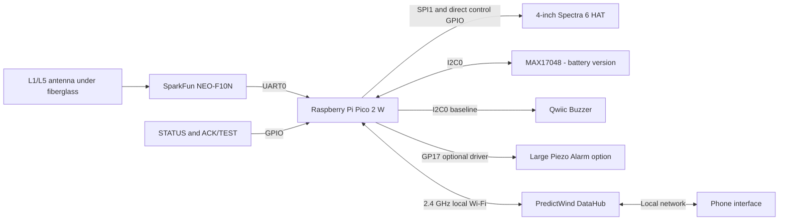
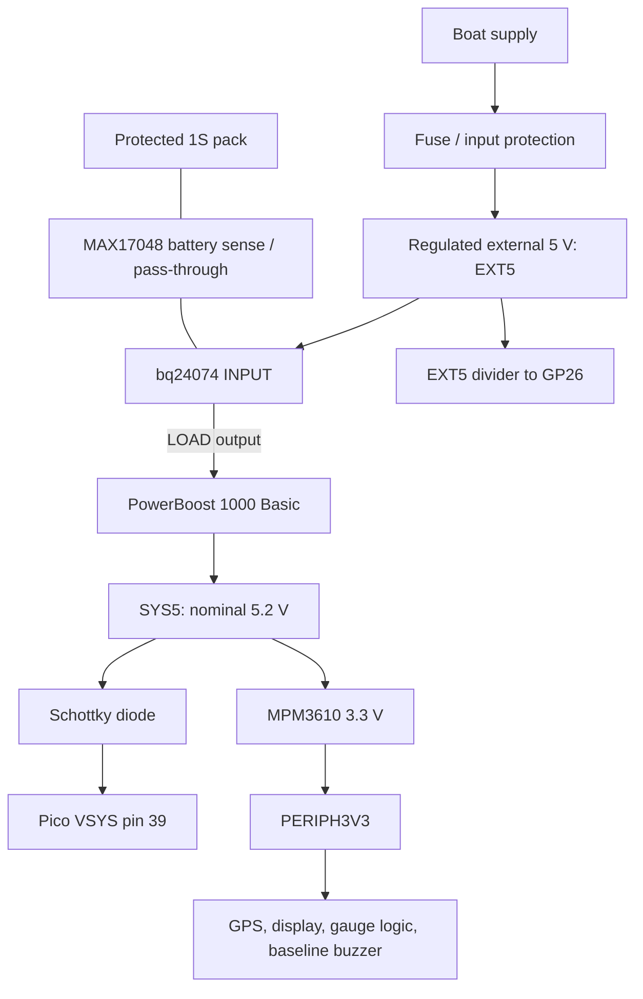
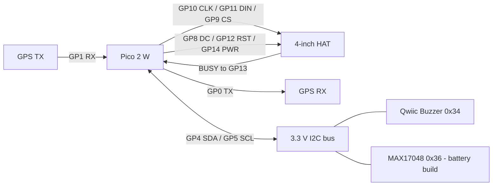
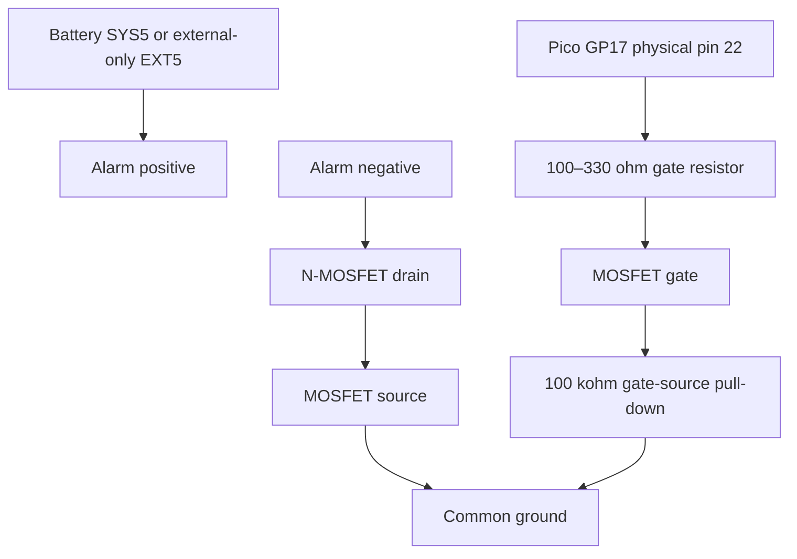
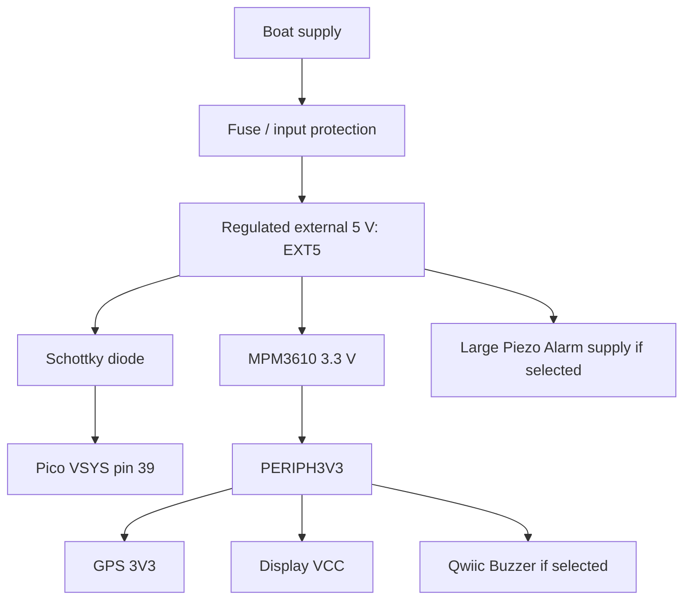

# Pico 2 W boat anchor alarm — build guide

Revision 2.0 · 22 October 2026

Copyright (c) 2026 Sam Jarvinen. Part of
[moorpheus](https://github.com/frye/moorpheus), licensed under
[Creative Commons Attribution 4.0 International (CC BY 4.0)](LICENSE).

## 1. Scope and configuration choices

This is the Pico 2 W edition of the anchor-alarm build. It replaces the XIAO ESP32C3 rather than adding a second controller.

Baseline:

- Raspberry Pi Pico 2 W, already owned.
- SparkFun NEO-F10N L1/L5 GNSS breakout with external antenna.
- Waveshare 4-inch e-Paper HAT+ (E), 600 × 400 Spectra 6, already owned.
- SparkFun Qwiic Buzzer.
- MAX17048 fuel gauge and protected 1S battery.
- External charger with load sharing and defined system/peripheral power rails.
- Two buttons wired directly to the Pico.
- PredictWind DataHub local Wi-Fi connection.

Optional section A replaces the Qwiic Buzzer with the Large Piezo Alarm. Optional section B removes all backup-battery components and runs on external power only. The options may be combined.

This is a prototype plan, not a certified marine safety system or fabrication-ready PCB schematic. Part choices, source ratings, grounding, cable routing and environmental protection must be reviewed before permanent installation. Use an independent anchor-watch method during trials.

## 2. What changed from the ESP32 version

| Item | Pico 2 W implementation |
|---|---|
| Controller | RP2350-based Pico 2 W |
| Power entry | VSYS pin 39, not an XIAO 5V pin |
| USB connection | Micro-USB, with documented VSYS source isolation |
| Display control | All signals directly on Pico GPIO |
| Buttons | Direct GPIO with pull-ups |
| MCP23017 | Removed: no longer needed |
| Sleep/wireless APIs | Pico SDK/CYW43 or verified Pico-compatible framework; no ESP-IDF functions |
| Large alarm control | GP17, not ESP32 D2/GPIO4 |
| GPS switch provision | GP18 reserved |
| Fuel gauge | Retained only for battery-backed version |

Pico 2 W has no onboard battery charger. Raspberry Pi documents external power-path chargers and VSYS source-ORing. Its GPIO logic is 3.3 V, and VSYS must remain in the permitted 1.8–5.5 V range. [R1]

## 3. System architecture



Monitoring, stored anchor reference and buzzer logic remain local to the Pico. The DataHub and phone are optional interfaces, not dependencies for sounding the local alarm.

## 4. Updated shopping list

Use only the rows required by the chosen configuration. Product links identify parts, not guarantees of stock/price. Verify actual connector polarity.

### Required in both battery and external-only versions

| Qty | Item | Link / sourcing | Notes |
|---|---|---|---|
| 1 | Raspberry Pi Pico 2 W | Already owned | Not Pico W/RP2040; firmware target must match |
| 1 | NEO-F10N GNSS breakout, SMA | [SparkFun GPS-24114](https://www.sparkfun.com/sparkfun-gnss-l1-l5-breakout-neo-f10n-sma.html) | UART0 interface |
| 1 | ANN-MB5 active L1/L5 antenna | [SparkFun GPS-25071](https://www.sparkfun.com/u-blox-multi-band-active-gnss-antenna-l1-l5-ann-mb5.html) | Or electrically verified dual-band alternative |
| 1 | Waveshare 4-inch HAT+ (E) | Already owned | Complete driver assembly, nine-wire interface |
| 1 | MPM3610 3.3 V buck breakout | [Adafruit 4683](https://www.adafruit.com/product/4683) | Peripheral rail; fed by SYS5/EXT5, not a direct 1S cell |
| 2 | Normally open momentary buttons | [Adafruit switch selection](https://www.adafruit.com/category/155) | Prefer installation-appropriate controls |
| 1 | Schottky isolation diode | Electronics supplier | Select for system current/voltage/drop; anode at system 5 V, cathode at Pico VSYS |
| As needed | Qwiic/STEMMA QT cables and flying leads | [Adafruit STEMMA](https://www.adafruit.com/category/1005) | No native Qwiic socket on Pico |
| 1 | Regulated boat-to-5 V supply | Installation-dependent | Appropriate input/transient/thermal rating and fuse |

The MCP23017 and its interrupt/pull-up wiring are omitted. Do not buy it for this revision.

### Baseline sounder: choose option 1 or optional A

| Qty | Item | Link |
|---|---|---|
| 1 | SparkFun Qwiic Buzzer | [SparkFun](https://www.sparkfun.com/sparkfun-qwiic-buzzer.html) |

### Battery-backed configuration only

| Qty | Item | Link | Notes |
|---|---|---|---|
| 1 | bq24074 charger with load sharing | [Adafruit 4755](https://www.adafruit.com/product/4755) | Feed regulated 5 V; set charge current for actual pack |
| 1 | PowerBoost 1000 Basic | [Adafruit 2030](https://www.adafruit.com/product/2030) | Charger LOAD to nominal 5.2 V SYS5; not itself a charger |
| 1 | Protected 1S Li-ion/LiPo pack | [Adafruit batteries](https://www.adafruit.com/category/574) | Capacity after measurement; correct charge chemistry/rating |
| 1 | MAX17048 fuel-gauge breakout | [Adafruit 5580](https://www.adafruit.com/product/5580) | Not needed in external-only configuration |
| As needed | Battery connectors and cables | Match selected boards | Verify polarity with meter |

### Optional A sounder replacement

| Qty | Item | Link / sourcing | Notes |
|---|---|---|---|
| 1 | Large Piezo Alarm — 16 Tone | [SparkFun COM-13939](https://www.sparkfun.com/large-piezo-alarm-16-tone.html) | Omit Qwiic Buzzer if selected |
| 1 | Qualified logic-level N-MOSFET or driver | [SparkFun component selection](https://www.sparkfun.com/components.html) | Exact part not yet selected; low resistance specified at gate drive ≤2.5 V |
| 1 | 100–330 ohm gate resistor | Resistor assortment | Proposed circuit value |
| 1 | 100 kohm gate-to-source pull-down | Resistor assortment | Off through reset/high-impedance states |
| 1, only if needed | Regulated 12 V boost converter | Part to be qualified | Optional louder supply; correct input range/current/enable behavior |

### General hardware

10 kohm button/CS pull-ups, 150 kohm and 100 kohm sense-divider resistors, 100 nF filter/decoupling capacitors, strain relief, suitable wire, terminal blocks, enclosure/window, sound opening, antenna mounting plate and upstream fuse/protection. Do not assume hobby boards are weatherproof or protected against marine supply transients.

## 5. Baseline battery-backed power

This retains the earlier explicit power-path architecture. It is intentionally modular, not the minimum-loss implementation.



### Power net list

| Net | Connections |
|---|---|
| GND | Every board ground, external return and battery negative |
| EXT5 | Regulated external 5 V to charger INPUT and sense-divider top |
| BAT | Protected pack to gauge battery pass-through/sense and charger battery input |
| LOAD | Charger load output to PowerBoost input |
| SYS5 | PowerBoost output to MPM3610 input, isolation-diode anode and optional sounder |
| Diode cathode | Pico VSYS, physical pin 39 |
| PERIPH3V3 | Buck output to display VCC, GPS 3V3, buzzer power and gauge logic VIN |
| Pico 3V3 OUT pin 36 | Leave separate from PERIPH3V3 |
| Pico VBUS pin 40 | Do not connect SYS5 here |
| Pico 3V3_EN pin 37 | Leave at default; not a generic supply pin |

The diode orientation is anode at SYS5, cathode/stripe at VSYS. It prevents USB-powered VSYS from driving back into SYS5. The Pico already has a USB-VBUS-to-VSYS diode; Raspberry Pi documents adding a second source diode this way. [R1]

Use a rated diode and verify voltage drop and heating. Do not exceed VSYS=5.5 V including overshoot. Do not directly connect the external peripheral 3.3 V output to Pico 3V3 OUT.

The gauge battery connectors sense the pack; logic VIN is PERIPH3V3. Follow the breakout pinout rather than confusing battery sensing with logic supply. Set charger current and temperature precautions for the selected pack.

### Programming and mixed-power caution

Pico USB can power the controller when the external peripherals are off. The VSYS diode prevents one backfeed path, but GPIO can still back-power peripherals. The simplest bench rule is: power peripherals normally before exercising their interfaces, and disconnect their signal harness if programming Pico alone. Keep UART/SPI outputs high-impedance when destination power is absent. Do not assume the VSYS diode solves all signal backfeeding.

Do not simultaneously power the GPS USB interface and its external 3V3 input without reviewing its board power paths.

## 6. Direct GPIO allocation

Physical pin numbers refer to the Pico's 40-pin header, not a Raspberry Pi computer HAT header. Use the board orientation/pinout in the official datasheet before soldering. [R1]

| Function | Pico GPIO | Physical pin | Peripheral destination |
|---|---:|---:|---|
| GPS UART0 TX | GP0 | 1 | GPS RX |
| GPS UART0 RX | GP1 | 2 | GPS TX |
| I2C0 SDA | GP4 | 6 | Buzzer SDA and gauge SDA |
| I2C0 SCL | GP5 | 7 | Buzzer SCL and gauge SCL |
| Display DC | GP8 | 11 | DC |
| Display CS | GP9 | 12 | CS |
| Display SPI1 SCK | GP10 | 14 | CLK |
| Display SPI1 TX/MOSI | GP11 | 15 | DIN |
| Display reset | GP12 | 16 | RST |
| Display BUSY input | GP13 | 17 | BUSY |
| Display power control | GP14 | 19 | PWR |
| STATUS button | GP15 | 20 | Button to GND |
| ACK/TEST button | GP16 | 21 | Button to GND |
| Optional alarm gate | GP17 | 22 | MOSFET gate circuit |
| Future GPS switch | GP18 | 24 | Reserved; unused baseline |
| External 5 V sense | GP26 / ADC0 | 31 | Divider midpoint |
| Common ground | GND | e.g. 3, 8, 13, 18, 23, 28, 38 | All returns |
| Main input | VSYS | 39 | Through source-isolation diode |

Unused pins remain available. Do not use GP23–GP25 or GP29 as spare external signals; the wireless board uses internal signals not exposed like normal header GPIO. VBUS presence is not the same as presence of the external boat supply at EXT5. [R1]

### Display wiring

VCC=PERIPH3V3, GND=common. Use the signal table above for all seven signal/control pins. Add 10 kohm CS-to-PERIPH3V3 pull-up. No MISO connection is required.

The HAT is not a direct plug-in for a Pico: use its documented interface harness. Follow the exact E-model PWR/RST/BUSY polarity and init/sleep sequences. All signal levels here are 3.3 V. [R2]



### GPS

PERIPH3V3 → GPS 3V3. Configure UART0 with explicit GP0/GP1. SparkFun documents a default 38400 baud and UART-jumper instructions for external-controller operation; check actual revision. Use UBX or supported NMEA with valid-fix, timestamp and age checks. [R3]

### I2C

GP4/GP5 on I2C0; start at 100 kHz. Qwiic Buzzer address 0x34; MAX17048 address 0x36. Use flying-lead Qwiic adapter; no Pico Qwiic socket is assumed. Check combined pull-ups and keep all pull-ups at 3.3 V. [R4, R5]

### Buttons

Each button connects its GPIO to GND when pressed. Fit 10 kohm pull-up to Pico 3V3 OUT for GP15 and GP16, independent of peripheral power. Use 30–50 ms debounce initially. Configure direct GPIO interrupts/wake as supported by the chosen sleep mode. Require release after long presses; stuck switches must not repeat disarm/test actions.

### External supply sensing

EXT5 → 150 kohm → GP26 node → 100 kohm → GND. Optional 100 nF from node to ground. At 5 V the node is about 2 V. Never connect raw boat voltage to this divider.

Calibrate ADC and use hysteresis and time debounce. ADC-capable Pico pins must not be driven above the unpowered I/O rail; avoid leaving EXT5 sense connected while deliberately removing all Pico power. In the assembled system EXT5 also powers the Pico power path, but sequencing and programming tests still need review. [R1]

## 7. Antenna placement

Use an L1/L5 active antenna compatible with the receiver's bias supply. ANN-MB5 is a documented match; do not substitute an L1-only or L1/L2-only antenna by name alone. Mount flat/top upward under the least obstructed fiberglass. Put a suitable ground plate below the antenna, not between it and the sky. [R6]

Check for carbon fiber/foil/metal roof reinforcement. Separate antenna and cable from switching converters and transmitters. Compare reception open-sky and under-roof over hours. Log fix age, quality and scatter; satellite count alone is insufficient. Secure cable strain relief and preserve the Pico Wi-Fi antenna keep-out area as well. [R1]

## 8. Firmware architecture and power management

Recommended production-like starting point: Pico SDK C/C++ with CYW43/lwIP networking and supported peripheral drivers. MicroPython can accelerate prototyping, but low-power behavior must be measured. No ESP-IDF APIs apply to this RP2350 build.

Use independent services for GNSS, alarm state, power/SOC, buttons, display, networking, persistence and watchdog. Apply bounded I2C/UART/display timeouts. Service wireless using the chosen SDK architecture correctly; do not assume blocking peripheral code is harmless.

Pico 2 W sleep/dormant/wireless behavior must be qualified for the exact SDK/core. Do not equate a Python delay with efficient hardware sleep, or promise ESP32-style connected-light-sleep numbers. Validate clock/peripheral restoration, timer wake and button wake. Initial firmware can remain awake with radio power-saving while establishing correctness.

### Battery-backed modes

| Mode | GNSS work | Wi-Fi | E-paper |
|---|---|---|---|
| Normal | Continuous tracking; fresh position at 1 Hz | DataHub station | Every 5 min/request |
| Backup30 above 20% | Acquisition every 30 sec start-to-start | Off except requested session | Every 30 min/request |
| Emergency60 at/below 20% | Every 60 sec | Off | Entry plus selected SOC crossings |
| Verify/alarm | Continuous acquisition/tracking | Never delay sounding | Update when possible |

Software standby is the baseline GNSS optimization, not a promise that antenna power is off. Review F10N wake/configuration behavior and actual acquisition time. The earlier assumed four-second window is a budgeting hypothesis; do not accept invalid/stale positions when it expires. [R7]

A suspicious economy-mode fix triggers immediate continuous verification, not three widely spaced 30/60-second samples. Failure to acquire generates a distinct fault. At 1 knot a minute is about 100 ft of travel. Long occupancy does not eliminate drag risk.

### Persistence and geometry

Store anchor reference, radius and armed state with integrity/version checking. Restore after reboot, announce restart and revalidate fixes. Never automatically move the anchor reference to the boat's current position. Account for antenna/bow offset, rode geometry, swing and GNSS uncertainty.

### Controls

| Action | Behavior |
|---|---|
| STATUS tap | Request screen update; immediate short acknowledgement |
| STATUS hold ~3 sec | Limited Wi-Fi setup session |
| ACK tap during alarm | Bounded silence, e.g. 60 sec; remain armed |
| ACK hold when quiet | Controlled sounder test |
| Disarm | Explicit confirmed interface action |

ACK does not clear anchor reference or persistent alarm conditions. Re-sound after acknowledgement expires if required.

## 9. Display and emergency policy

The Spectra 6 panel refreshes in approximately 19 sec; use its exact driver, not monochrome partial-refresh timings. [R2]

Direct GPIO eliminates the MCP23017 HAL adapter. Assign SPI1 GP10/GP11, software CS GP9, DC GP8, reset GP12, BUSY GP13 and PWR GP14. Keep GNSS/alarm work running while BUSY is asserted. Add timeout/fault handling and complete the documented shutdown sequence before sleep.

A 4-bpp framebuffer needs 120,000 bytes; RGB888 needs 720,000. Pico 2 W has 520 kB SRAM, so full RGB888 does not fit in internal SRAM. Use controller-compatible packed output or streamed rows, leaving memory for wireless/queues. [R1]

Emergency entry screen:

> EMERGENCY MODE  
> Anchor monitoring and buzzer enabled  
> GPS check every 60 seconds  
> Battery: XX%  
> Last verified: timestamp  
> Display may remain visible after power loss

After entry at 20%, refresh at downward crossings of 15, 10, 5, 4, 3, 2 and 1%. Read SOC on scheduled wakes; do not redraw for every reading. Latch crossings and coalesce skipped thresholds into one actual-value screen. Reset latches only for a defined new session/charge, not power flicker.

SOC is an estimate; 1% is not guaranteed usable energy. Reserve energy for sounding and shut down before rail instability. E-paper retaining an image is not proof the alarm is alive.

## 10. Network

Verify DataHub configuration exposes a 2.4 GHz local network and permits communication between phone and alarm. No internet is necessary for the local web interface. Serve HTTP plus WebSocket state, including fix age, armed state, mode, battery/external supply, anchor distance and alarm.

Send full state on connection/reconnection, approximately five-second updates while viewed and immediate state changes. Authenticate configuration, acknowledge commands and avoid duplicate actions on reconnect. Show stale/disconnected data visibly. Generic local sockets on suspended phone apps must not be the only overnight alert mechanism.

## 11. Battery sizing and measurement

Measure battery-side energy for each actual firmware mode and sounder option. Include converters, LEDs, realistic acquisitions, wireless bursts and display updates. Do not reuse ESP32 sleep current or earlier idealized 15–25 mW estimates as Pico system measurements.

    usable_energy_Wh ≈ 3.7 × capacity_Ah × usable_fraction
    runtime_hours ≈ usable_energy_Wh / measured_battery_input_power_W

Do not apply conversion losses twice if power is measured at the battery. Include aging/cold/margin and an alarm-energy reserve. Gauge SOC is not a guaranteed system cutoff point. Recheck charger thermals and permitted cell charging current/temperature.

## 12. Assembly and acceptance

Follow the [step-by-step build path](build-steps.md). Start with [Step 1: bring up the Pico, toolchain and display](display-bring-up.md).
It provides the USB-only wiring and a standalone `Hello Moorpheus` sample.
Pass its on-device acceptance gate before extending that baseline in later phases.
The bench display supply comes from Pico 3V3 OUT, unlike the full build's
PERIPH3V3; disconnect that bench supply lead before connecting the external rail.

1. Verify pin orientation, models/revisions and polarity for the Step 1 bench wiring.
2. Complete Step 1: build for Pico 2 W, flash over USB, and confirm USB diagnostics, panel voltage, visible text and display shutdown.
3. Build protected power distribution and confirm rails under load.
4. Add gauge and baseline buzzer; scan I2C addresses.
5. Add buttons and test startup/wake/ACK behavior.
6. Integrate the Step 1 display driver with the other services; check alarm processing during full refresh.
7. Add GNSS continuously; configure jumpers and UART; compare roof/open-sky reception.
8. Add DataHub interface and test reconnection/loss.
9. Add standby scheduling and measure acquisition distribution and actual energy.
10. Simulate emergency SOC thresholds before deep discharge tests.
11. Verify rail voltage/transients while sounding at low battery.
12. Test audibility with closed cabin doors and normal boat noise.

Fault-injection requirements: external-power interruption, DataHub loss, GNSS loss/stale fixes, display BUSY stuck, I2C stuck, button held at reset, restart while armed, power flicker, low battery while sounding and interrupted settings writes. Report real prototype limitations rather than silently hiding them.

## 13. References

[R1] [Official Pico 2 W datasheet: pinout, VSYS power path and USB isolation](https://pip.raspberrypi.com/documents/RP-008304-DS)

[R2] [Waveshare exact 4-inch HAT+ (E) manual](https://www.waveshare.com/wiki/4inch_e-Paper_HAT+_(E)_Manual)

[R3] [SparkFun F10N hardware overview](https://docs.sparkfun.com/SparkFun_u-blox_NEO-F10N/hardware_overview/)

[R4] [SparkFun Qwiic Buzzer guide](https://sparkfun.github.io/SparkFun_Qwiic_Buzzer/single_page/)

[R5] [Adafruit MAX17048 pinouts](https://learn.adafruit.com/adafruit-max17048-lipoly-liion-fuel-gauge-and-battery-monitor/pinouts)

[R6] [ANN-MB5 product](https://www.sparkfun.com/u-blox-multi-band-active-gnss-antenna-l1-l5-ann-mb5.html)

[R7] [F10N integration manual](https://content.u-blox.com/sites/default/files/documents/NEO-F10N_IntegrationManual_UBXDOC-963802114-12193.pdf)

[R8] [Per-component datasheets and open discrepancies](data/README.md)

## Optional A — Large Piezo Alarm instead of Qwiic Buzzer

### A1. Change summary

Use [SparkFun COM-13939](https://www.sparkfun.com/large-piezo-alarm-16-tone.html), a self-oscillating 5–16 V DC sounder with 16 DIP-selected patterns. SparkFun lists 90 dBA at 5 V/61 cm and 103 dBA at 16 V/61 cm. Do not assume its maximum loudness at 5 V.

Remove Qwiic Buzzer and its I2C initialization. Retain fuel gauge in battery version. Drive the alarm directly with GP17 through a qualified MOSFET circuit. GP18 stays free for future GPS power-switch control.

### A2. Existing-rail wiring



MOSFET pinout is device-specific. Choose specified low on-resistance at gate voltage ≤2.5 V, not merely low threshold. Ensure voltage/current/thermal margin. Sounder current must not pass through GPIO. External pull-down establishes OFF during reset; validate low-voltage and sleep-state behavior.

### A3. Pico SDK example

```c
#include "pico/stdlib.h"

#define ALARM_GPIO 17

void alarm_init(void) {
    gpio_init(ALARM_GPIO);
    gpio_put(ALARM_GPIO, false);
    gpio_set_dir(ALARM_GPIO, GPIO_OUT);
}

void alarm_set(bool enabled) {
    gpio_put(ALARM_GPIO, enabled);
}
```

Select the DIP pattern physically; firmware gates power. Short repeated power bursts may restart an internal pattern, so test cadence. During active alarm keep the MCU awake unless intentional output retention is implemented/tested. Removing the I2C sounder dependency does not remove all shared supply/software failure modes.

### A4. Optional 12 V boost

Only if installed audibility is inadequate, add a regulated 12 V boost from the battery-backed SYS5 (or EXT5 for optional B), feeding alarm positive. Keep GP17 low-side control. Do not connect raw boat voltage blindly: boat charging/transients can exceed the sounder's 16 V limit.

A distributor lists approximately 12 V/40 mA and 102 dB/61 cm for this part; confirm supplied-product data. At that point sounder power is 0.48 W, not counting converter loss. Measure 5 V current separately. Any converter enable control needs an explicit additional GPIO/default; no specific converter has been qualified here.

### A5. Shopping and tests

Omit baseline Qwiic Buzzer; add alarm, qualified MOSFET/driver, gate resistor and pull-down. Add 12 V converter only if needed. Use the table in section 4.

Test OFF through boot/reset/sleep; ON with the I2C bus deliberately faulted; ACK/resound; closed-door audibility; actual idle and sounding current; enclosure acoustic opening; low-battery rail stability. No marine waterproof rating is assumed.

## Optional B — External power only, no battery or charger

### B1. Scope and removals

This version has no dedicated backup battery. The boat house supply is the sole normal energy source. A breaker trip, disconnected cable or house-power failure stops GPS monitoring, Wi-Fi and the sounder. There is no autonomous power-loss alarm after energy disappears.

Remove:

- 1S pack and battery wiring.
- bq24074 charger.
- PowerBoost 1000 Basic.
- MAX17048 fuel gauge, its cables and firmware dependency.
- SOC thresholds, backup/emergency scheduling and battery-capacity display.

Retain:

- Pico 2 W, GPS, antenna, display and buttons.
- One selected sounder option.
- Protected regulated boat-to-5 V supply.
- MPM3610 peripheral 3.3 V buck.
- VSYS source-isolation diode.

No MCP23017 is required in either configuration.

### B2. Simplified power diagram



No charger, battery, fuel gauge or PowerBoost belongs in this diagram. All grounds remain common. Never feed boat voltage directly to Pico VSYS or its 5 V-rated peripherals.

### B3. Net and shopping delta

| Battery-version net/component | External-only replacement |
|---|---|
| Charger INPUT | Removed |
| Charger LOAD | Removed |
| PowerBoost SYS5 | EXT5 directly |
| Diode anode | EXT5 |
| Diode cathode | Pico VSYS pin 39, unchanged |
| Peripheral buck input | EXT5 |
| Peripheral buck output | PERIPH3V3, unchanged |
| Large alarm supply if selected | EXT5; optional regulated 12 V boost if needed |
| Fuel-gauge I2C connection | Removed |
| GP26 EXT5 divider | Optional diagnostic only; not required |

External-only purchases are the common-components table plus one sounder choice. Do not purchase the battery-only table. A robust 5 V source must tolerate combined MCU Wi-Fi, GNSS/antenna, display and sounder peaks with margin. Verify with actual simultaneous-load tests; average power alone is insufficient.

### B4. Firmware changes

Use a compile-time configuration such as:

```c
#define HAS_BACKUP_BATTERY 0
#define HAS_FUEL_GAUGE     0
```

Do not probe the absent gauge as a fault. Set battery state to not applicable, not 0%. Remove SOC refresh thresholds and emergency modes. Run continuous GPS tracking and evaluate positions at 1 Hz; retain normal display interval of five minutes and network policy. Verification/alarm remains continuous as before.

The optional GP26 input can report external-rail voltage while powered, but cannot provide a guaranteed warning after complete supply collapse. Without hold-up energy, do not promise a final flash write, screen refresh or alarm chirp on power loss.

Persist critical settings when they change, using integrity checks and atomic/dual-record updates, not only at shutdown. On power restoration restore validated armed state and show/reannounce restart, then acquire a fresh fix. Never silently declare safe while GPS is reacquiring.

### B5. Display behavior without backup

Use a normal status screen with:

> EXTERNAL POWER ONLY — NO BACKUP  
> Armed state / anchor distance / radius  
> Last verified: timestamp  
> Static image does not prove monitoring is active

E-paper retains an apparently normal picture after all electronics lose power. It is impossible to guarantee rewriting it to POWER LOST when the supply vanishes. The 19-second refresh makes this especially clear. A short periodic onboard heartbeat LED can help a nearby user confirm operation, but its absence must be interpreted actively; it cannot wake a sleeping person.

Phone interface should visibly expire stale data. A phone cannot reliably infer power failure from a local-network disconnect alone, since router/Wi-Fi failure can look the same. Do not use a cloud heartbeat as the only local safety layer.

### B6. USB servicing and tests

Keep the external-source diode to protect against backfeed from USB into EXT5. If USB powers Pico with boat power off, peripherals remain unpowered; disconnect their signal harness or enforce safe high-impedance states. USB alone is a controller servicing condition, not a functioning full alarm. Ensure firmware does not falsely report operational status when peripherals are absent.

Acceptance tests:

1. Pull EXT5 while armed: verify actual complete shutdown and identify residual-screen hazard.
2. Restore EXT5: validated settings and armed-state recovery; fresh-fix gating.
3. Flicker supply repeatedly: no corrupt settings or silent disarm.
4. Sound alarm with display refreshing and Wi-Fi active: no rail collapse.
5. Program over USB with external source disconnected: no signal back-power damage.
6. Validate closed-door sound and DataHub loss behavior.

Choose this version for simplicity only if dependence on the boat's electrical supply is acceptable. It removes backup endurance rather than achieving it by another method.
